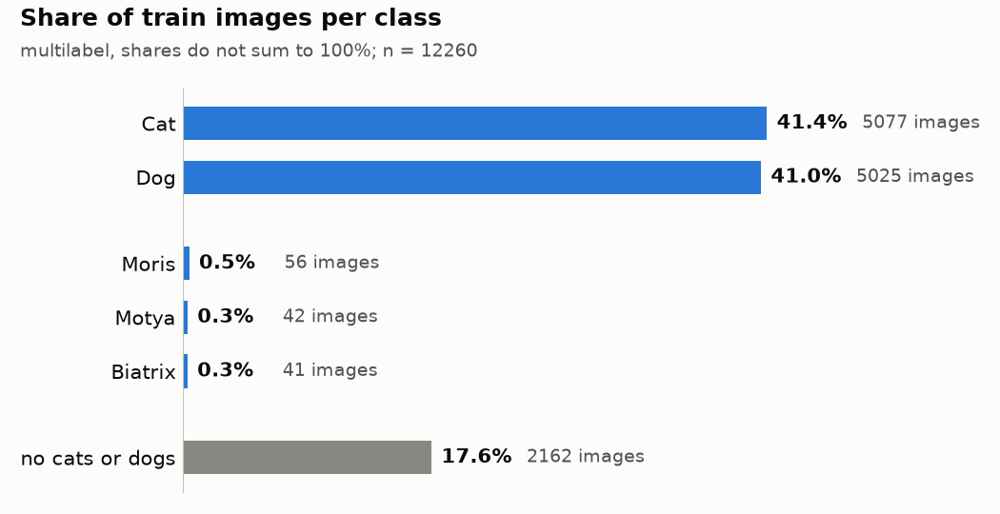
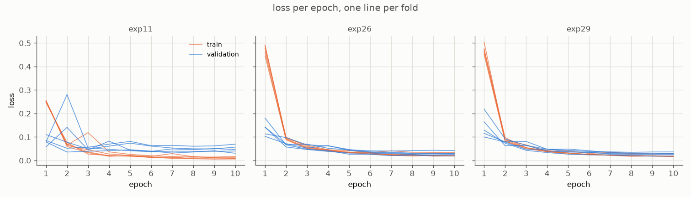
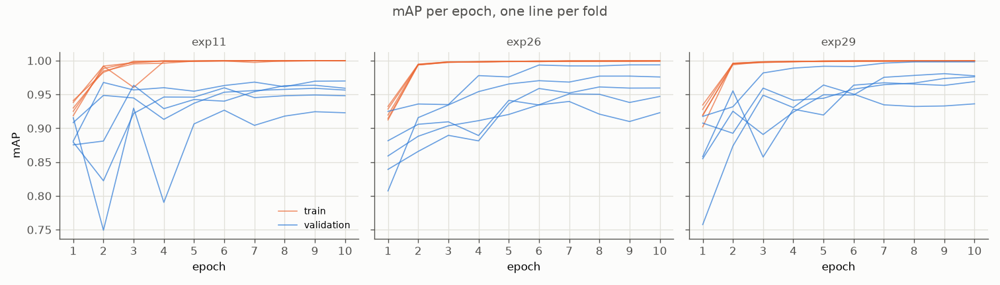

# Report: multilabel classification, 5 classes

## EDA

### Image distribution

12260 train, 18673 test images, all 450 × 375 JPEG RGB.

- Cat 5077, Dog 5025; VIP animals rare: Moris 56, Motya 42, Biatrix 41.
- Every VIP image also has parent label: Moris, Motya with Cat; Biatrix with Dog.
- Only 8 of 32 label combinations occur; Cat + Dog only in 4 images, all with Moris + Biatrix.
- VIP classes are 3 of 5 in Macro F1: 60% of score rests on about 140 images.

### Handling imbalance

- VIP oversampling ×8: each VIP image drawn 8 times per epoch, every draw augmented anew; plain shuffle leaves 3 of 4 batches without Moris (exp04, mAP up).
- Non-VIP downsampling: random 20% of Cat, Dog, none rows per epoch, new draw each epoch; not worse, about 4× fewer steps (exp16).
- Loss weight: BCE `pos_weight` full ratio $(N - n_c)/n_c$, counted over sampled draws, not rows (exp09, mAP up, smoother `val_map`).
- Detail: [docs/oversampling.md](docs/oversampling.md).

### Metrics

- Training loss: `BCEWithLogitsLoss` with `pos_weight`, one sigmoid per class.
- Validation and checkpoint selection: mAP (mean of per-class AP), multilabel stratified 5-fold CV, same folds for every model.
- Target: Macro F1 at per-class thresholds tuned on out-of-fold predictions.
- Diagnostics: precision-recall curves per class, Grad-CAM.

### Why mAP

- Macro F1 not differentiable, cannot be loss; soft F1 rejected: noisy gradient, zero signal in batches without VIP.
- AP has no threshold: measures ranking only. Best F1 lies on PR curve, so larger area means better reachable F1; threshold tuned once, for chosen model.
- Macro F1 mixes ranking with threshold noise: with 8–11 VIP positives per fold, one image moves threshold and score; mAP steadier for comparing checkpoints and runs.

### Why local score can differ from Kaggle

- Different metric: local selection by mAP, Kaggle scores Macro F1 at fixed thresholds.
- Different photos: Kaggle VIP photos come from other scenes; cross-validation only holds out training photos, often near-duplicates of each other.
- Few positives: about 140 VIP images in train; one image moves VIP F1 visibly.
- Thresholds tuned on out-of-fold probs of single fold models; test probs are mean of 5 fold models, smoother, so thresholds and stacking weights transfer imperfectly (exp37–39).

## Tried models

All on exp26 setup (coarse dropout on non-VIP, oversampling ×8, downsampling 0.2, full ratio `pos_weight`), 5 folds, pretrained timm weights.

| model | weights | ImageNet top-1 | Moris AP | Motya AP | Biatrix AP |
|---|---|---|---|---|---|
| ResNet-18 (exp26) | `resnet18.a1_in1k` | 71.5 | 0.924 | 0.861 | 0.989 |
| EfficientNet-B0 (exp32) | `efficientnet_b0.ra_in1k` | 77.7 | 0.939 | 0.895 | 0.959 |
| RegNetY-016 (exp33) | `regnety_016.tv2_in1k` | 80.7 | 0.969 | 0.892 | 0.965 |
| ConvNeXt-Tiny (exp34) | `convnext_tiny.fb_in1k` | 82.1 | 0.956 | 0.925 | 0.973 |

AP on pooled out-of-fold rows of folds 0–4; Cat, Dog AP about 0.998 for all.

- Earlier: AlexNet collapses (exp01); EfficientNet-B0 `tf_` weights unstable on 2 folds (exp10); ResNet-18 kept as base until exp32.
- Newer backbones: Moris, Motya AP up vs ResNet-18, Biatrix down.
- Grad-CAM: area narrows from ResNet-18 (whole-body blob) to ConvNeXt-Tiny (spots on head, paws); EfficientNet-B0 drifts to background most; misses fall on different images per model (exp36).

## Chosen hyperparameters

- Adam, lr 1e-3 to 1e-5 cosine schedule, 10 epochs, batch 64, 224 px.
- Best checkpoint per fold by `val_map`.
- Same for every backbone, not tuned per model.

## Metrics and optimization curves

Submitted ResNet-18 runs (exp11, exp26, exp29), one thin line per fold (exp35):

- Example exp29 fold 0: train mAP near 1 from epoch 2; validation mAP noisy early, validation loss falls overall.
- Large train-validation gap, but validation not getting worse: no classic overfitting seen in checked runs.

## Augmentations

Worked:

- Coarse dropout on non-VIP rows (exp20, exp26): Dog heat onto body, Kaggle up vs exp29.
- Lecture recipe, lighting, color, orientation (exp03): mAP within noise.
- Box-safe crop (exp07): mAP flat.
- Background paste (exp17): mAP within noise.

Did not work:

- Color and degradation recipes (exp05, exp06): Moris, Motya down.
- Grid dropout (exp18): squares look like calico coat, Motya down.
- Face and head erase (exp21, exp24): VIP AP down or no gain.
- Smaller images (exp27), JPEG (exp28): VIP AP down.
- Gray on non-VIP (exp30): extra Moris, Motya false positives.

Pattern: color or texture change hurts VIP identity by coat; non-VIP-only augmentation safe.

## Ensembling

- Plain mean of probs, 4 models (exp38): wide F1 plateaus, VIP thresholds fall from near 1 to middle; each model confidently wrong on different negatives, mean pulls them down.
- Logistic regression stacking on logits, `C = 0.1` (exp39): flatter F1 curves locally, peak not higher; `C = 0.1` halves fold spread of weights vs `C = 1`.
- Stacking without ConvNeXt-Tiny, weights normalized per class (exp40): locally almost same as with it.
- Ensemble submissions: plateau-middle thresholds (F1 within 0.05 of max); single-model submissions: best-F1 thresholds.

| submission | CV Macro F1 (cross-fold thresholds) | Kaggle public |
|---|---|---|
| ResNet-18, 5 folds (exp11) | 0.894 | 0.827 |
| ResNet-18 + coarse dropout (exp26) | 0.885 | — |
| ResNet-18 downsampling (exp29) | — | — |
| Mean, 4 models (exp38) | 0.959 | 0.92773 |
| Stacking `C = 0.1`, 4 models (exp39) | — | 0.90639 |
| Stacking `C = 0.1`, 3 models normalized (exp40) | — | 0.89919 |
| Mean, 3 models without ResNet-18 | — | 0.92287 |

CV for exp11, exp26 at best-F1 thresholds, exp38 at plateau thresholds; empty cells not computed or not submitted yet.

Mean ensembling beat logistic regression stacking on Kaggle public.

## Conclusions
