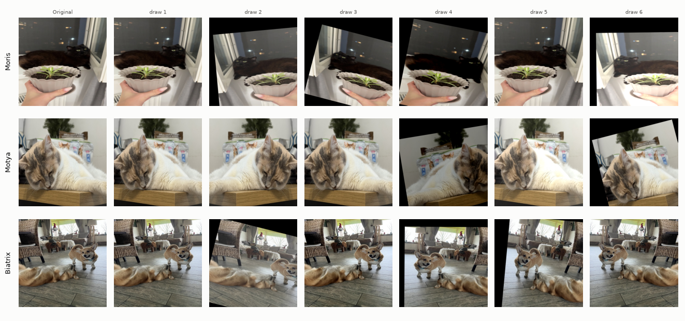
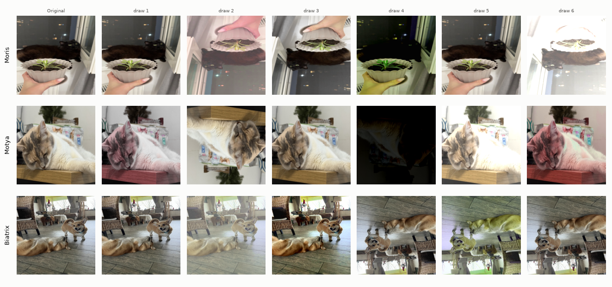
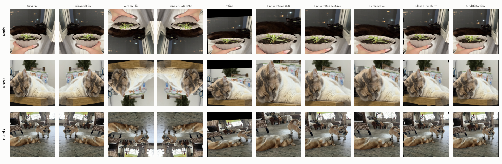
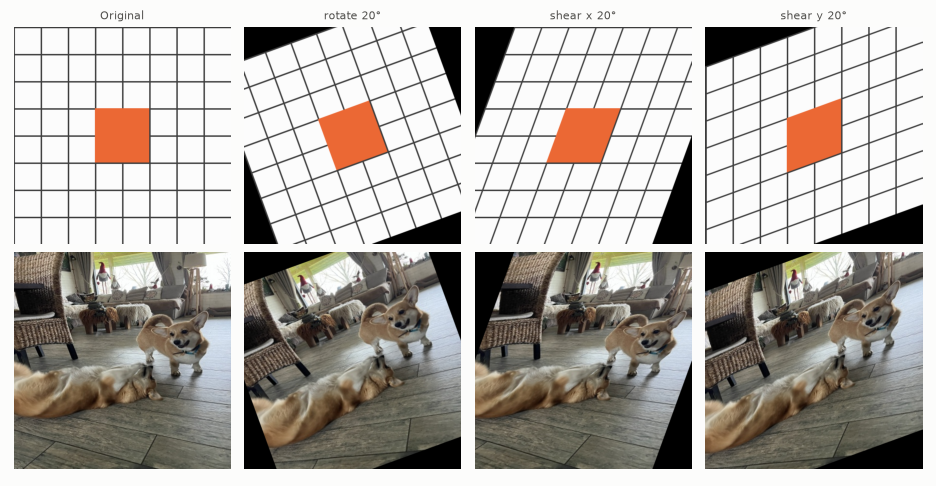
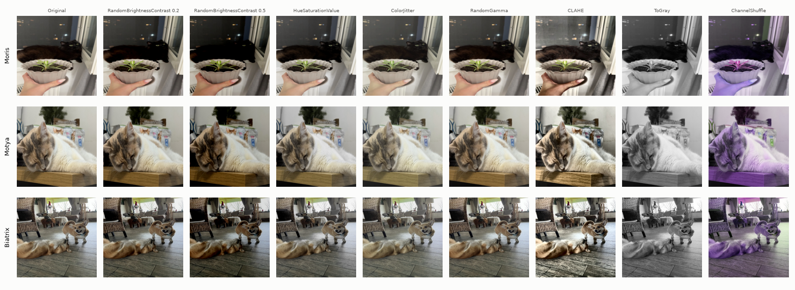
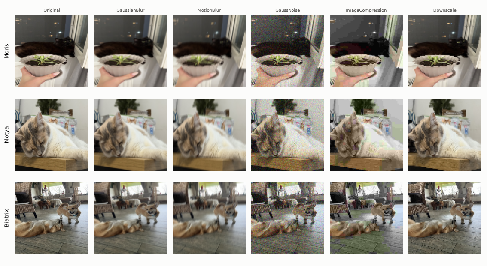
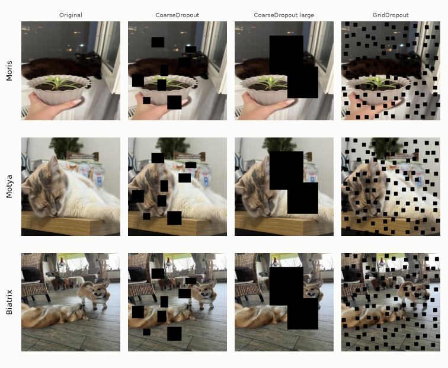
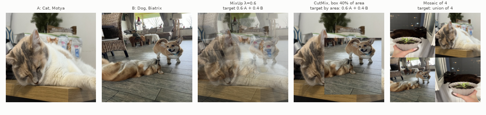
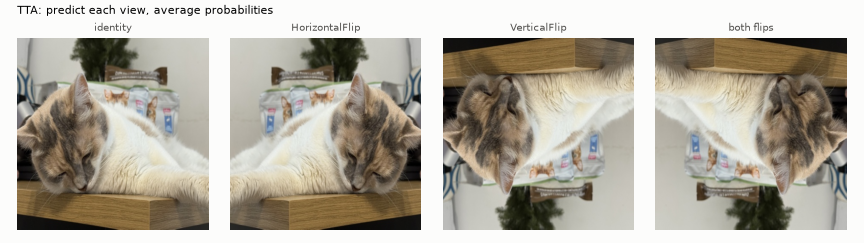

# Image Augmentations

Recipe design sources:

- Albumentations, [Choosing Augmentations for Model Generalization](https://albumentations.ai/docs/3-basic-usage/choosing-augmentations/). Step-by-step recipe design: realistic variation first, then strength, then check per-class effect. Primary ref of v3 (exp06).
- Shorten, Khoshgoftaar (2019), [A Survey on Image Data Augmentation for Deep Learning](https://doi.org/10.1186/s40537-019-0197-0), Journal of Big Data. Map of all families: geometric, color, erasing, mixing, learned policies, TTA.
- Müller, Hutter (2021), [TrivialAugment](https://arxiv.org/abs/2103.10158), ICCV. One random op, random strength per image beats tuned policies; baseline for picking op pool and strength.

Related: `docs/oversampling.md` (VIP sampling), `docs/gradcam_augmentations.md` (pseudo-boxes, Grad-CAM-guided, whole-animal).

Multilabel twist: augmentation valid only if every present class stays visible. Crop cutting Biatrix out leaves `Biatrix = 1` on image without Biatrix: label noise.

Identity twist: `Cat`, `Dog` species; `Moris`, `Motya`, `Biatrix` individuals, told apart by coat. Moris black long-haired cat, Motya calico, Biatrix ginger-white corgi. Hue shift can turn one VIP into another.

Figures: one training image per VIP class, 448 px, each augmentation at p = 1, fixed seed. Albumentations 2.0.8.

## In this project

`Config.augment` picks key of `core.data.TRAIN_TFMS`. Applied on the fly in `MultilabelImageDataset.__getitem__`. Validation, test: `val_tfms`, resize plus normalize.

Default `train_tfms` (`augment = "default"`): `Resize`, `HorizontalFlip(p=0.5)`, `RandomBrightnessContrast(p=0.5)` (limits 0.2), `Affine(translate_percent=0.1, scale=(0.8, 1.2), rotate=(-15, 15), p=0.5)`.

Lecture `lecture_tfms` (`augment = "lecture"`, exp03): `Resize`, `HorizontalFlip(p=0.5)`, `VerticalFlip(p=0.5)`, `RandomBrightnessContrast(0.5, 0.5, p=0.5)`, `HueSaturationValue(20, 30, 20, p=0.5)`. Strong color: Motya pink or almost black, Biatrix yellow-green; half upside down.

## Geometric

Albumentations [Affine API](https://albumentations.ai/docs/api-reference/albumentations/augmentations/geometric/transforms/#Affine).

`HorizontalFlip`: safest, mirrored cat same cat.

`VerticalFlip`, `RandomRotate90`: phone photos upright, mostly unrealistic views.

Orientations of square image (8, dihedral group D4), share per transform, 40000 draws:

| transform | 0° | 0° mirror (h-flip) | 180° | 180° mirror (v-flip) | 90° | 90° mirror | 270° | 270° mirror |
|---|---|---|---|---|---|---|---|---|
| `SquareSymmetry(p=1)` | 1/8 | 1/8 | 1/8 | 1/8 | 1/8 | 1/8 | 1/8 | 1/8 |
| `HorizontalFlip(p=0.5)` + `VerticalFlip(p=0.5)` | 1/4 | 1/4 | 1/4 | 1/4 | 0 | 0 | 0 | 0 |
| `RandomRotate90(p=0.5)` | 5/8 | 0 | 1/8 | 0 | 1/8 | 0 | 1/8 | 0 |
| `HorizontalFlip` + `VerticalFlip` + `RandomRotate90`, all `p=0.5` | 3/16 | 3/16 | 3/16 | 3/16 | 1/16 | 1/16 | 1/16 | 1/16 |

- `SquareSymmetry` (`D4`): needs square image, so after `Resize`.
- `RandomRotate90`: no mirror, does not replace `HorizontalFlip`. `HorizontalFlip(p=0.5)` + `RandomRotate90(p=1)` = `SquareSymmetry(p=1)`.

`Affine` pitfalls (2.0.8):

- `translate_percent=0.1`: fixed shift right and down, not range. Default recipe has it. Range: `(-0.15, 0.15)`.
- `keep_ratio=False` (default): x, y scale independent, animal stretches.
- `border_mode` default `BORDER_CONSTANT`, `fill=0`: black corners only on augmented images. `cv2.BORDER_REFLECT_101` looks like scene.

Shear slants (corgi leans), rotation rigid.

`RandomCrop`: lecture demo keeps 45% of area, VIP easily cut out.

`RandomResizedCrop`: torchvision default `scale=(0.08, 1.0)`; here `scale=(0.5, 1.0)` or higher.

`BBoxSafeRandomCrop(erosion_rate=0.0)` ([API](https://albumentations.ai/docs/api-reference/albumentations/augmentations/crops/transforms/#BBoxSafeRandomCrop)): crop keeps union of all boxes, edges uniform between union and image edge. Multi-hot label stays true.

- Far-apart objects: union nearly whole image, crop does little.
- Size, aspect vary: `Resize` after.
- `erosion_rate` > 0: union shrunk, edge objects cut; single box ignores it; no boxes, random crop. Label must then follow surviving boxes (`BboxParams(min_visibility=...)`).
- Needs boxes. Manual boxes banned (`docs/rules.md`); v3 uses Grad-CAM pseudo-boxes (`docs/gradcam_augmentations.md`).

`Perspective`: projective warp, frame filled. In v2 draft, removed.

`ElasticTransform`, `GridDistortion`: handwriting origin, little use for pets. Elastic in lecture demo.

## Color and intensity

- Zini et al. (2023), [Planckian Jitter](https://arxiv.org/abs/2202.07993), ICLR. Color jitter destroys color features; color-temperature shift keeps them. Cited exp06, exp07.
- Albumentations [transform reference](https://albumentations.ai/docs/reference/supported-targets-by-transform/): `RandomGamma`, `CLAHE`, `RGBShift`, `PlanckianJitter`.

- `RandomBrightnessContrast`: 0.2 mild; 0.5 blacks out dark scenes, Moris vanishes.
- `HueSaturationValue`: hue 20 changes coat, VIP identity risk.
- `ColorJitter`: `hue` ≤ 0.05.
- `RandomGamma`: $\gamma < 1$ opens Moris black fur, $\gamma > 1$ crushes it.
- `CLAHE`: texture in dark areas. Lecture demo.
- `ToGray`, `ChannelShuffle`: remove coat cue.
- `RGBShift` slight: phone white balance, relative coat colors kept. `PlanckianJitter`: physical alternative. v2 (exp05).

Experiments: color on VIP images hurt Moris, Motya (exp05, exp07).

## Noise, blur, quality

Phone-photo defects: `MotionBlur` (moving pet), `GaussNoise` (low light), `ImageCompression` (forwarded photos), `Downscale` (far animal), `GaussianBlur`.

`ImageCompression(quality_range=(40, 95))` (v3): JPEG round trip in memory; low quality loses fine texture (fur, whiskers, eyes) first.

`OneOf([...], p)`: applies exactly one child with probability `p`. Real photo has one dominant defect; no stacking, one knob. `p=0.4` with four children: 40% degraded, 10% each.

Experiments: degradation hurt VIP (exp07); JPEG quality 10 hurt VIP, maps unchanged (exp28).

## Occlusion

`CoarseDropout`: `fill=0` invisible on black Moris; `fill="random_uniform"` visible on any coat. Large holes can cover animal, label wrong. Lecture torchvision: `RandomErasing(p=0.5, scale=(0.02, 0.33), ratio=(0.3, 3.3))` after `Normalize`.

`GridDropout` colored: holes look like calico, Motya hurt (exp18).

Experiments: colored `CoarseDropout` on non-VIP rows only safe, Kaggle up (exp20, exp26).

## Mixing two or more images

MixUp, CutMix, Mosaic: batch-level, not in Albumentations pipeline. Multilabel:

- MixUp: soft target with BCE, or union $\max(y_i, y_j)$.
- CutMix: patch may cover VIP, area-weighted label wrong.
- Mosaic: union of labels, all true.
- `timm.data.Mixup` builds one-hot from class index; multi-hot needs own batch function.

## Test-time augmentation (TTA)

Lecture: `ttach`, `tta.ClassificationTTAWrapper(model, tta.aliases.flip_transform())`. Installed.

- Average sigmoid per class, no argmax.
- Thresholds tuned on TTA predictions of validation folds.
- Vertical flip at test only if trained with it.

## Automatic policies

AutoAugment, RandAugment (timm `rand-m9-mstd0.5`), TrivialAugment (torchvision `TrivialAugmentWide`, header). All include color ops (`Solarize`, `Posterize`, `Color`, `Equalize`): identity risk.

## Libraries

[Albumentations](https://albumentations.ai), used here. Others: torchvision.transforms `v2`, Kornia (GPU), `ttach`, timm `create_transform`, `Mixup`.

Course: `docs/course/Module_2/Lecture_2/Advanced_CNNs.ipynb`, section Augmentations.
