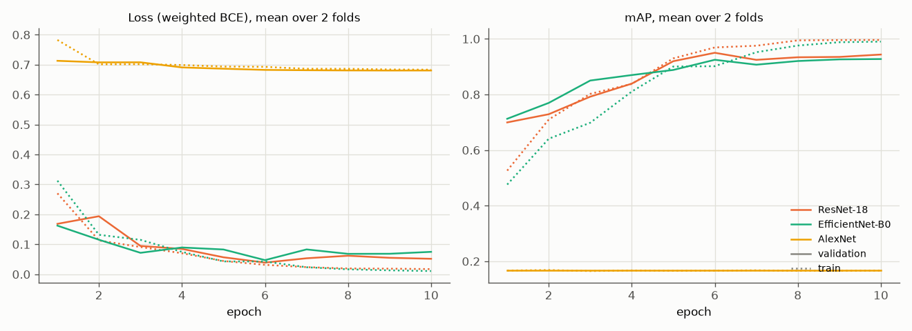
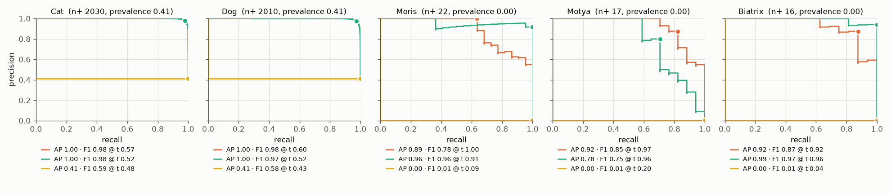

# Experiment 01: Lecture models

## Request

using current configuration create experiment in baseline; experiment should compare how the same models as in lecture 2 module 2, but with adjusted loss and metric, perform on current dataset. report training plot (if available), precision recall curves (models on 1 figure compared together, for each class separate figure), table with cAP comparison

## Question

How do ImageNet-pretrained ResNet-18, EfficientNet-B0, AlexNet differ?

## Plan

1. Plot `train_loss`, `val_loss`, `val_map` per epoch, mean over folds, one line per model.
2. Plot PR curve per class on pooled folds, all models on one figure.
3. Tabulate per-class AP and mAP per model.
4. Tabulate mAP per fold and gap to leader, flag models below leader on both folds.

## Setup

- **Notebook:** [exp01_lecture_models.ipynb](../../notebooks/experiments/exp01_lecture_models.ipynb)
- **Tracking:** `cnn-model-lecture-models`
- **What changes:** model
  - ResNet-18 `resnet18.a1_in1k`
  - EfficientNet-B0 `tf_efficientnet_b0.in1k`
  - AlexNet `AlexNet_Weights.IMAGENET1K_V1`, torchvision
- **What stays fixed:** lecture recipe
  - Adam, cosine lr 1e-3 to 1e-5
  - 10 epochs, batch 64, 224 px
  - mean = std = 0.5
- **Metric:** Fast validation, per-class AP and mAP

## Fixes

redesign experiment 1 so it uses only models pretrained on ImageNet

fuck, cut to 10 and change notebook

redesign exp01 to use Fast validation mode, in notebook I want to run each model training in separate cell

I just do not want to show AlexNet on plot and do not rerun it again

change exp01 so it does not contain Convnext, but contains alex net

## Results

| model | Cat | Dog | Moris | Motya | Biatrix | mAP | mAP fold 0 | mAP fold 1 | macro F1 |
|---|---|---|---|---|---|---|---|---|---|
| ResNet-18 | 0.999 | 0.997 | 0.893 | 0.922 | 0.941 | 0.951 | 0.951 | 0.951 | 0.892 |
| EfficientNet-B0 | 0.998 | 0.997 | 0.942 | 0.807 | 0.993 | 0.948 | 0.942 | 0.954 | 0.926 |
| AlexNet | 0.414 | 0.410 | 0.004 | 0.003 | 0.003 | 0.167 | 0.167 | 0.167 | 0.238 |

Macro F1 at best per-class threshold picked on same rows, optimistic. Only AlexNet below leader on both folds.

## AI Summary

ResNet-18 and EfficientNet-B0 tie, each leads on one fold. AlexNet collapsed to constant output. Differences only in rare classes: EfficientNet-B0 better on Moris, ResNet-18 better on Motya.

## Conclusion

Drop AlexNet. ConvNext was tried in previous iteration, but training was too long. Therefore, for further work I will consider only EfficientNet and ResNet.

During training both models were slightly overfitting. ResNet better predicted Motya, while Efficient Net predicted Moris.

Based on this data, both models tie, while efficient net is assumed to be more capable. Therefore, I choose ResNet for further tuning, beause it trains faster.