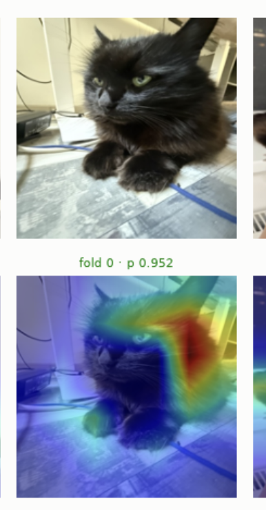
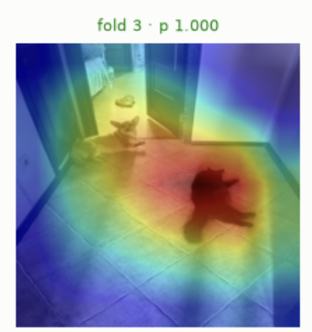
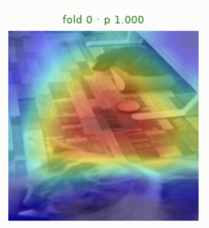
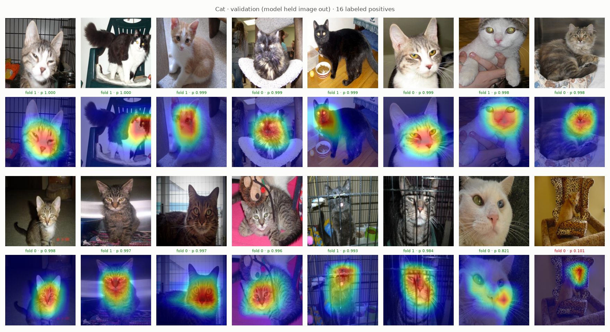
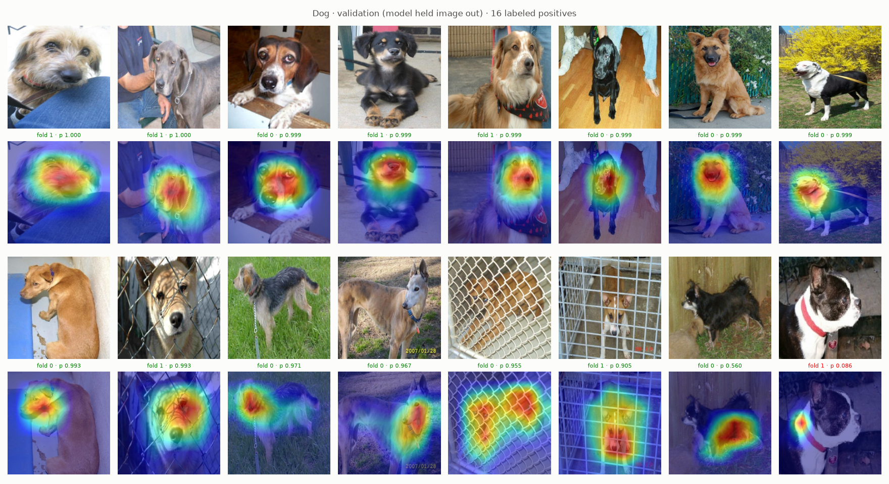

# Grad-CAM augmentations

Grad-CAM map of own model picks where to crop, erase or paste. Caveat: `layer4` map 7 × 7, upsampled, so boundary blobs coarse.

Sources:

- Selvaraju et al. (2017), [Grad-CAM](https://arxiv.org/abs/1610.02391), ICCV: section 3 method, localization section for box from thresholded map. Tool behind `core.gradcam`, `core.boxes`.
- Hu et al. (2019), [WS-DAN](https://arxiv.org/abs/1901.09891): own attention maps drive attention cropping and dropping, fine-grained. Basis of exp14.
- CMO (background paste, exp17): `docs/oversampling.md`.

## Pseudo-boxes

`core/boxes.py`, `python -m core.boxes`, result `data/processed/boxes.csv`.

1. Model: exp04 ResNet-18; image in validation fold 0 or 1 boxed by fold model that never trained on it, others by fold 0 model.
2. Input: `Validation`, 224 × 224.
3. Classes: every present label; unlabeled image: top logit.
4. Grad-CAM at `layer4` (`core.gradcam.GradCam`).
5. Box: bounding rectangle of pixels ≥ 0.5 of max, coordinates in [0, 1].
6. All-zero map: no box (671 images), crop keeps whole image.

Box marks part model looked at (often head), not whole animal. Grad-CAM paper uses 0.15, larger boxes.

`BBoxSafeRandomCrop` with boxes (v3) vs `RandomResizedCrop(scale=(0.6, 1.0))`: stronger zoom without label noise, less background, more position variety.

Limits:

- Guarantees hot spot only, not whole animal.
- Box from model with background shortcuts: may protect background.
- x, y edges independent: aspect up to ~1.7, `Resize` stretches.
- 671 images without box never cropped.

Box variants: `RandomSizedBBoxSafeCrop` (crop plus resize), `AtLeastOneBBoxRandomCrop`, `RandomCropNearBBox`. Setup: Albumentations [Bounding Box Augmentation](https://albumentations.ai/docs/3-basic-usage/bounding-boxes-augmentations/) (`BboxParams`, `label_fields`, `min_visibility`).

## VIP cases

Case 1: Moris correct, heat on wall beside head. Contour or background, not coat.

Case 2: small black cat on floor, heat on cat, dog cold. Box covers whole cat: dropping would erase it, skip such images.

Case 3: heat on rug, cats cold. Right answer, wrong reason; CV hides it (same room in train and validation). Crop protects rug; dropping, background swap fit.

## VIP ideas

1. Attention dropping (WS-DAN): erase hot spot, label kept, model finds second cue. Risk case 2. exp14: boxes cover whole animal.
2. Attention cropping (WS-DAN): crop to box plus margin, resize, label kept; finer detail. Fails where map off target (cases 1, 3). Multilabel: crop may cut other present animal.
3. Background swap (CMO): paste VIP onto other images. exp17: within noise.
4. Contour cue: `RandomBrightnessContrast`, `RandomGamma` on whole image; hue fixed.

None raises training accuracy (already p 1.000); aim is reason, so check Grad-CAM shift plus VIP AP. Folds not grouped by room (`docs/validation.md`): CV may miss gain.

## Whole-animal features for Cat and Dog

exp19: heat on face, body cold. Misses when face hidden, turned or small (kitten on leopard chair, Boston terrier side view, washed-out white cat). Grad-CAM peaks on most discriminative part by construction; face-erase exam (exp22) is direct test.

Instruments, simplest first: hide what model uses most, keep label.

1. Colored `CoarseDropout`, non-VIP rows only (exp20). VIP coat never masked. Shortcut risk: holes mean not VIP. Kaggle up (exp26).
2. Grid hiding with mean fill, Cat, Dog only (colored grid hurt Motya, exp18).
3. CutMix: VIP under patch lost.
4. Face erase by Grad-CAM hot core (exp21, exp24 head). Dogs learned body, VIP hurt.
5. DropBlock in feature map: `timm.create_model("resnet18.a1_in1k", pretrained=True, drop_block_rate=0.1)`, no label risk.
6. Crops missing face: `RandomResizedCrop(scale=(0.3, 1.0))`; may miss animal.

Not available: mask-based losses (need masks), Stylized ImageNet (external data).
