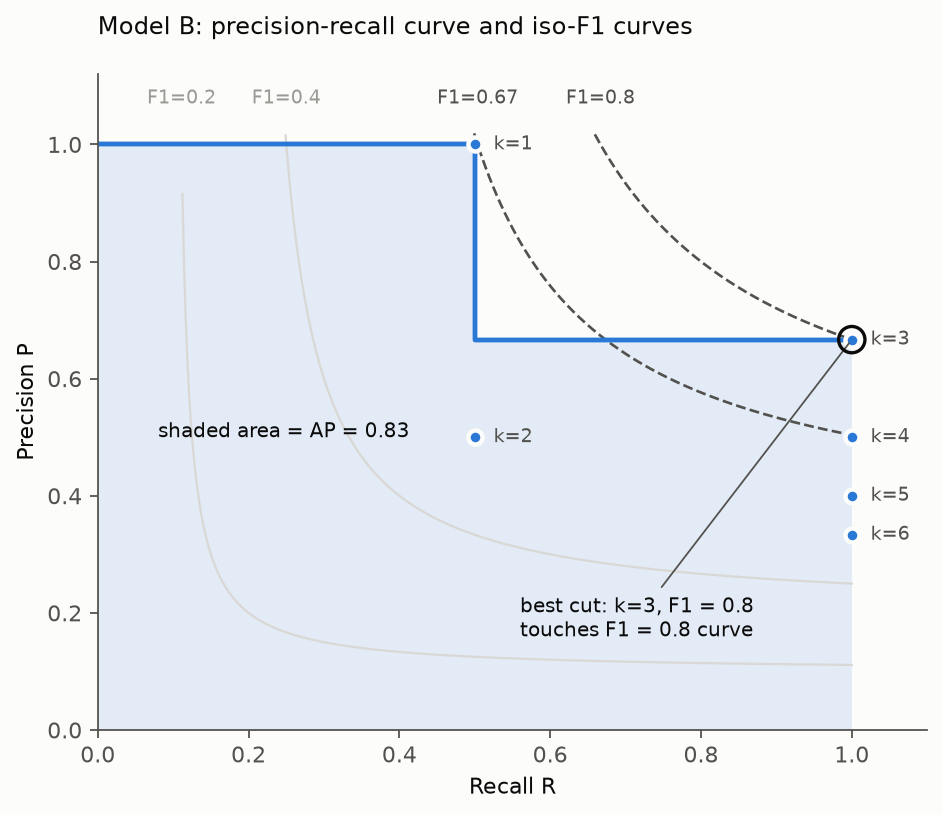

# Multilabel Classification: Loss and Metrics

Notation: $C$ classes, $N$ images; $y_{ic} \in \{0, 1\}$ true label, $z_{ic}$ logit, $p_{ic} = \sigma(z_{ic})$ predicted probability, $\hat y_{ic} = \mathbb{1}[p_{ic} > t_c]$ predicted label at threshold $t_c$; $TP_c, FP_c, FN_c$ counted over images for class $c$. Here $C = 5$: (`Cat`, `Dog`, `Moris`, `Motya`, `Biatrix`), one sigmoid per class.

Three roles, never mixed. Loss: what gradient descent minimizes. Selection metric: compares checkpoints and runs. Target metric: final score, after thresholding.

Read for whole doc:

- Zhang, Zhou (2014), [A Review on Multi-Label Learning Algorithms](https://doi.org/10.1109/TKDE.2013.39), IEEE TKDE. Section 2: multilabel setting, binary relevance, example-based and label-based metrics (micro, macro, subset accuracy).
- Sokolova, Lapalme (2009), [A Systematic Analysis of Performance Measures for Classification Tasks](https://doi.org/10.1016/j.ipm.2009.03.002), Information Processing & Management. Precision, recall, F, micro vs macro.

## Binary cross entropy (loss)

$$\mathcal{L} = -\frac{1}{NC}\sum_{i,c}\big[y_{ic}\log p_{ic} + (1-y_{ic})\log(1-p_{ic})\big]$$

Read:

- Goodfellow, Bengio, Courville, [Deep Learning](https://www.deeplearningbook.org/contents/mlp.html), 6.2.2.2 "Sigmoid Units for Bernoulli Output Distributions". Why sigmoid plus log-likelihood, why logits for numerical stability.
- PyTorch, [`BCEWithLogitsLoss`](https://pytorch.org/docs/stable/generated/torch.nn.BCEWithLogitsLoss.html). `pos_weight` per class.

$$\mathcal{L}_{pw} = -\frac{1}{NC}\sum_{i,c}\big[w_c\,y_{ic}\log p_{ic} + (1-y_{ic})\log(1-p_{ic})\big], \qquad w_c = \frac{N - n_c}{n_c}$$

### Choosing `pos_weight`

Read:

- Elkan (2001), [The Foundations of Cost-Sensitive Learning](https://mlanthology.org/ijcai/2001/elkan2001ijcai-foundations/), IJCAI. Weighting positives by $w$ multiplies predicted odds by $w$; ranking unchanged, optimal threshold moves.
- Cui et al. (2019), [Class-Balanced Loss Based on Effective Number of Samples](https://arxiv.org/abs/1901.05555), CVPR. Full inverse-frequency weight overshoots on rare classes; smoothed weight works better.
- Mahajan et al. (2018), [Exploring the Limits of Weakly Supervised Pretraining](https://arxiv.org/abs/1805.00932). Square-root resampling of long-tailed labels: precedent for $\sqrt{w_c}$ damping.

Train, $N = 12260$:

| Class | $n_c$ | $w_c = (N - n_c)/n_c$ | $\sqrt{w_c}$ |
|---|---|---|---|
| Cat | 5077 | 1.41 | 1.2 |
| Dog | 5025 | 1.44 | 1.2 |
| Moris | 56 | 218 | 14.8 |
| Motya | 42 | 291 | 17.1 |
| Biatrix | 41 | 298 | 17.3 |

Batch 64 = 320 loss terms. One Moris term at full $w_c = 218$: $218 / (218 + 319) = 41\%$ of batch loss, whole shared backbone steps toward one photo; unstable training, memorization, false positives. At $\sqrt{w_c} = 14.8$: 4.4%.

Share of class weight carried by positives, $w_c n_c / (w_c n_c + N - n_c)$:

| Class | $w_c = 1$ | $\sqrt{w_c}$ | full $w_c$ |
|---|---|---|---|
| Moris | 0.5% | 6.3% | 50% |
| Motya | 0.3% | 5.5% | 50% |
| Biatrix | 0.3% | 5.5% | 50% |

Real limit is 41–56 photos, not weight; more variety (oversampling with augmentation, `docs/oversampling.md`) adds information, weight does not.

How to pick:

1. Start with $w_c = 1$ (plain BCE), tuned $t_c$: baseline.
2. Try damped weight, $\sqrt{w_c}$ (about 15–17 for VIP, 1.2 for Cat and Dog), or clip at 10–50.
3. Treat $w_c$ as hyperparameter: pick by validation mAP, then check Macro F1 at tuned $t_c$. Full $w_c$ only if it wins.

PyTorch: `nn.BCEWithLogitsLoss(pos_weight=torch.tensor([w_cat, w_dog, w_moris, w_motya, w_biatrix]))`, one value per class, in label order.

$$\mathcal{L}_{focal} = -\frac{1}{NC}\sum_{i,c}\big[y_{ic}(1-p_{ic})^{\gamma}\log p_{ic} + (1-y_{ic})\,p_{ic}^{\gamma}\log(1-p_{ic})\big]$$

Read:

- Lin et al. (2017), [Focal Loss for Dense Object Detection](https://arxiv.org/abs/1708.02002), section 3. $\gamma \approx 2$ down-weights easy examples.
- Ridnik et al. (2021), [Asymmetric Loss For Multi-Label Classification](https://arxiv.org/abs/2009.14119). Focal loss split by positives and negatives, for multilabel imbalance.

### Plain BCE on this dataset

BCE of constant predictor $q_c = n_c / N$ equals entropy $H(q_c)$: all removable loss for class $c$.

| Class | $n_c$ | $q_c$ | $H(q_c)$, nats |
|---|---|---|---|
| Cat | 5077 | 0.414 | 0.678 |
| Dog | 5025 | 0.410 | 0.677 |
| Moris | 56 | 0.0046 | 0.029 |
| Motya | 42 | 0.0034 | 0.023 |
| Biatrix | 41 | 0.0033 | 0.022 |

Model perfect on Cat and Dog, constant on VIP: 95% of removable loss gone, Macro F1 $\le 0.4$. Last 5% of loss carries 60% of target. Fixes: `pos_weight`, oversampling, focal loss, soft macro F1.

## Soft macro F1 (loss)

$$\text{soft } F1_c = \frac{2\sum_i p_{ic}y_{ic}}{\sum_i p_{ic} + \sum_i y_{ic} + \epsilon}, \qquad \mathcal{L}_{softF1} = 1 - \frac{1}{C}\sum_c \text{soft } F1_c, \qquad \mathcal{L} = \mathcal{L}_{BCE} + \lambda\,\mathcal{L}_{softF1}$$

Read:

- Bénédict, Koops, Odijk, de Rijke (2022), [sigmoidF1: A Smooth F1 Score Surrogate Loss for Multilabel Classification](https://arxiv.org/abs/2108.10566), TMLR. Sections 5.3, 6: setup (fixed thresholds), results.
- Eban et al. (2017), [Scalable Learning of Non-Decomposable Objectives](https://arxiv.org/abs/1608.04802), AISTATS. Surrogates for F-measure and precision at recall.

### Evidence: soft F1 vs BCE

Read:

- Koyejo, Natarajan, Ravikumar, Dhillon (2014), [Consistent Binary Classification with Generalized Performance Metrics](https://papers.neurips.cc/paper_files/paper/2014/hash/98053046e0dce5c7d946c67b96a85e18-Abstract.html), NeurIPS. F1-optimal classifier = calibrated probability cut at tuned threshold; BCE plus tuned $t_c$ consistent.
- Bénédict et al. (2022), above. Compared at fixed threshold, no per-class tuning; BCE always in top 2.

Risk here: soft F1 per batch needs VIP positives in batch. Chance of batch with zero positives, random sampling:

| Batch size | Moris | Motya | Biatrix |
|---|---|---|---|
| 32 | 0.86 | 0.90 | 0.90 |
| 64 | 0.75 | 0.80 | 0.81 |
| 128 | 0.56 | 0.64 | 0.65 |
| 256 | 0.31 | 0.42 | 0.42 |

Test on own data: BCE vs BCE + $\lambda$ soft F1, per-class $t_c$ tuned for both; compare mAP, then Macro F1 at tuned $t_c$.

## Macro F1

$$F1_c = \frac{2\,TP_c}{2\,TP_c + FP_c + FN_c}, \qquad \text{Macro F1} = \frac{1}{C} \sum_{c} F1_c$$

Read: Opitz, Burst (2019), [Macro F1 and Macro F1](https://arxiv.org/abs/1911.03347). Two definitions in use (mean of $F1_c$ vs F1 of mean P and R); this one is mean of $F1_c$, as `sklearn.metrics.f1_score(average="macro")`. Empty class: set `zero_division`.

## Per-class precision and recall

$$P_c = \frac{TP_c}{TP_c + FP_c}, \qquad R_c = \frac{TP_c}{TP_c + FN_c}$$

Read: Manning, Raghavan, Schütze, *Introduction to Information Retrieval*, [8.3 Evaluation of unranked retrieval sets](https://nlp.stanford.edu/IR-book/html/htmledition/evaluation-of-unranked-retrieval-sets-1.html).

## Average precision per class and mean (mAP)

$$AP_c = \sum_{k} (R_c^{(k)} - R_c^{(k-1)})\,P_c^{(k)} = \frac{1}{n_c} \sum_{k:\ \text{rank } k \text{ positive}} P_c^{(k)}, \qquad \text{mAP} = \frac{1}{C} \sum_{c} AP_c$$

Read:

- Manning, Raghavan, Schütze, [8.4 Evaluation of ranked retrieval results](https://nlp.stanford.edu/IR-book/html/htmledition/evaluation-of-ranked-retrieval-results-1.html). Precision-recall curve, average precision as mean precision at positives.
- Everingham et al. (2010), [The PASCAL Visual Object Classes (VOC) Challenge](https://doi.org/10.1007/s11263-009-0275-4), IJCV. AP as classification metric, interpolated vs non-interpolated.
- scikit-learn, [`average_precision_score`](https://scikit-learn.org/stable/modules/generated/sklearn.metrics.average_precision_score.html). Non-interpolated; tied scores form one threshold.

### Training mAP vs validation mAP

Same formula, different images. `val_map`: mAP on held-out fold, computed after epoch with fixed weights. `train_map`: mAP on training images, collected during epoch. `core/model.py`: every `training_step` feeds batch probs $\sigma(z_{ic})$ into `MultilabelAveragePrecision(average="macro")`, `on_train_epoch_end` computes over all batches, then resets.

Not trained on. Gradient comes from weighted BCE only; mAP not differentiable (depends on sort order), never optimized. Checkpoint chosen by `val_map`, not `train_map`. So `train_map` is diagnostic only: says how well model ranks images it learns from, on same scale as `val_map`.

Purpose: read pair, not one curve. Both low, both flat: underfit (capacity, LR, too few epochs). `train_map` rising, `val_map` flat or falling: overfit, model memorizes training images; gap `train_map - val_map` = generalization gap. Both rising: keep training. Loss alone cannot show this on mAP scale: weighted BCE also moves with calibration and `pos_weight`, so train and val loss not comparable to selection metric.

Not clean estimate, biased both ways. Optimistic: model trained on these images. Pessimistic: probs come from train mode (augmentation, dropout, BatchNorm batch statistics) and from weights that change during epoch, early batches scored by worse model. Early epochs pessimistic side wins: `train_map` can sit below `val_map`, gap negative, no meaning. Trust trend and gap growth over epochs, not single value.

### F1 on precision-recall curve

Read:

- Flach, Kull (2015), [Precision-Recall-Gain Curves: PR Analysis Done Right](https://papers.nips.cc/paper/2015/file/33e8075e9970de0cfea955afd4644bb2-Paper.pdf), NeurIPS. Iso-F1 curves in PR space; AP (arithmetic mean of precision) vs F1 (harmonic mean) can pick different models.
- Lipton et al. (2014), below. Best F1 point on curve.

Dots: all 6 cuts $k$ of Model B (next section). Blue step: curve AP integrates. Shaded area: $AP = 0.83$. Dashed: iso-F1 curves through $k = 1$ (0.67) and $k = 3$ (0.8). Best cut $k = 3$ touches highest one. AP chooses model, iso-F1 geometry chooses $t_c$.

## Ranking vs threshold: why Macro F1 mixes them, mAP does not

mAP judges ranking only. Macro F1 judges ranking plus cut $t_c$.

### Example

One class, 6 images, 2 positives (P), 4 negatives (N):

| Image | P | P | N | N | N | N |
|---|---|---|---|---|---|---|
| Model A | 0.9 | 0.8 | 0.6 | 0.55 | 0.2 | 0.1 |
| Model B | 0.9 | 0.3 | 0.4 | 0.2 | 0.1 | 0.05 |

| | F1 at $t = 0.5$ | Best F1 (its $t$) | AP |
|---|---|---|---|
| Model A | 0.67 | 1.0 ($t = 0.7$) | 1.0 |
| Model B | 0.67 | 0.8 ($t = 0.25$) | 0.83 |

AP separates A and B; F1 at 0.5 does not.

### Why AP ignores scale

AP depends on order only; monotone rescaling (temperature, calibration) leaves it unchanged, moves F1 at fixed $t_c$. Read: Guo et al. (2017), [On Calibration of Modern Neural Networks](https://arxiv.org/abs/1706.04599).

### Why tune thresholds

Read:

- Lipton, Elkan, Narayanaswamy (2014), [Thresholding Classifiers to Maximize F1 Score](https://arxiv.org/abs/1402.1892). F1-optimal threshold = half of best achievable F1 for calibrated probabilities, so rarely 0.5; macro F1 in multilabel case.
- scikit-learn, [3.3 Tuning the decision threshold for class prediction](https://scikit-learn.org/stable/modules/classification_threshold.html).

Here, per class:

1. Plain BCE learns prevalence: Moris $q_c = 0.0046$. Real Moris image may get $p = 0.2$, above every negative: good ranking, but never predicted at $t = 0.5$, $F1_c = 0$, 20% of Macro F1 lost.
2. `pos_weight` inflates odds by $w_c$, best cut moves up. Damped $w_c$ differs by class: Cat 1.30, Moris 56.72.
3. Scale differs per class, so $t_c$ per class, not one $t$.

Cost: tuning is selection, overfits few positives (`docs/validation.md`, "Threshold tuning is selection").

### Use

1. Compare models and checkpoints by mAP.
2. Tune $t_c$ per class on validation for chosen model.
3. Report Macro F1 at tuned $t_c$.

## ROC-AUC per class and macro

$$TPR_c = \frac{TP_c}{TP_c + FN_c}, \qquad FPR_c = \frac{FP_c}{FP_c + TN_c}, \qquad AUC_c = P(p_{ic} > p_{jc} \mid y_{ic} = 1,\, y_{jc} = 0)$$

Read: Fawcett (2006), [An Introduction to ROC Analysis](https://doi.org/10.1016/j.patrec.2005.10.010), Pattern Recognition Letters. ROC space, AUC as ranking probability, class-ratio invariance.

### ROC vs precision-recall curve

Read:

- Davis, Goadrich, [The Relationship Between Precision-Recall and ROC Curves](https://dl.acm.org/doi/10.1145/1143844.1143874), ICML (2006). Dominance in ROC space equals dominance in PR space.
- Saito, Rehmsmeier, [The Precision-Recall Plot Is More Informative than the ROC Plot When Evaluating Binary Classifiers on Imbalanced Datasets](https://journals.plos.org/plosone/article?id=10.1371/journal.pone.0118432), PLOS ONE (2015). Random baselines: ROC AUC 0.5, AP $\approx n_c / N$.

Here: VIP prevalence 0.3–0.5%, so AUC looks high while precision low. AP primary, AUC secondary check of ranking.

## Micro F1

$$\text{Micro F1} = \frac{2 \sum_c TP_c}{2 \sum_c TP_c + \sum_c FP_c + \sum_c FN_c}$$

Read: Sokolova, Lapalme (2009), above. Here dominated by Cat and Dog; gap to Macro F1 shows how much VIP classes lag.

## Exact match (subset accuracy)

$$\text{EM} = \frac{1}{N} \sum_{i} \mathbb{1}[\hat y_{i\cdot} = y_{i\cdot}]$$

Read: Zhang, Zhou (2014), above. Here catches impossible label vectors, e.g. VIP without `Cat` or `Dog`.
