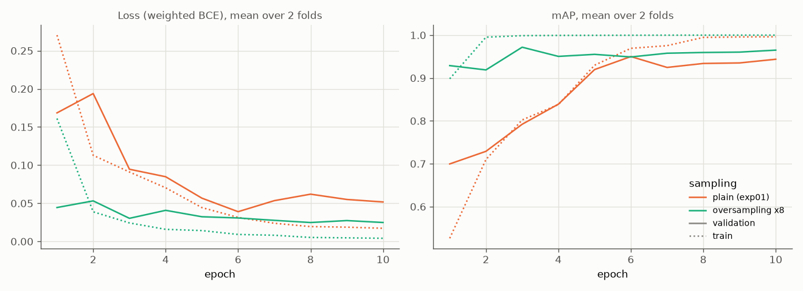
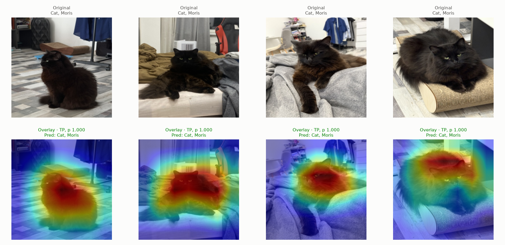
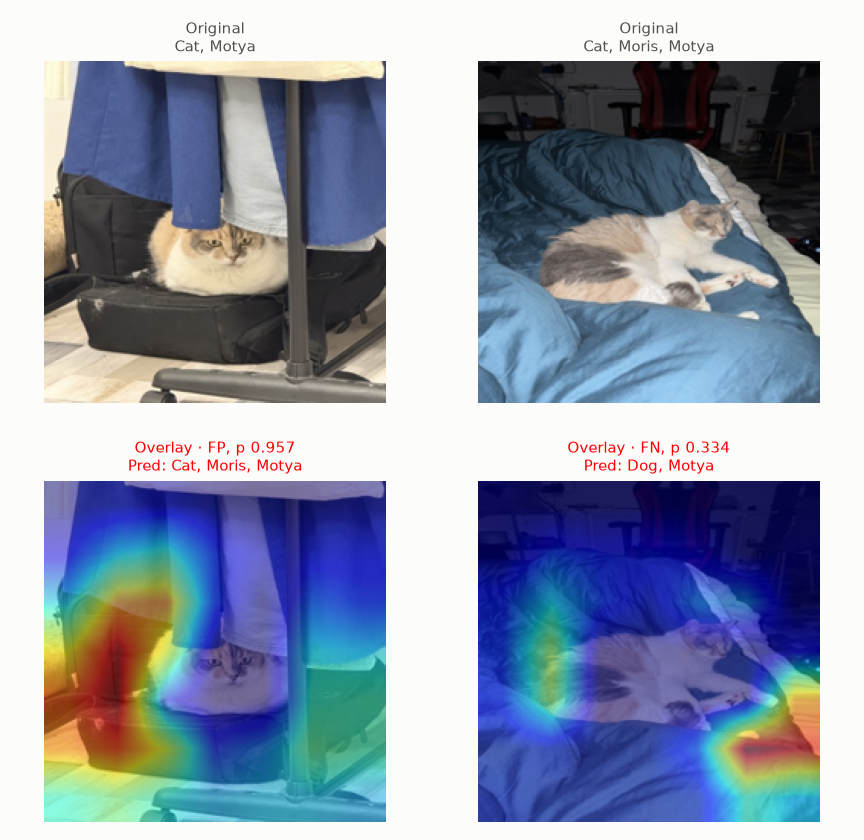
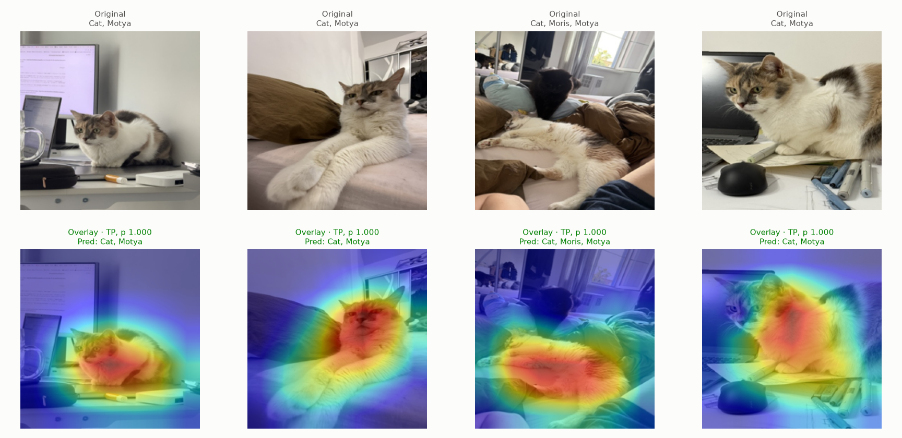
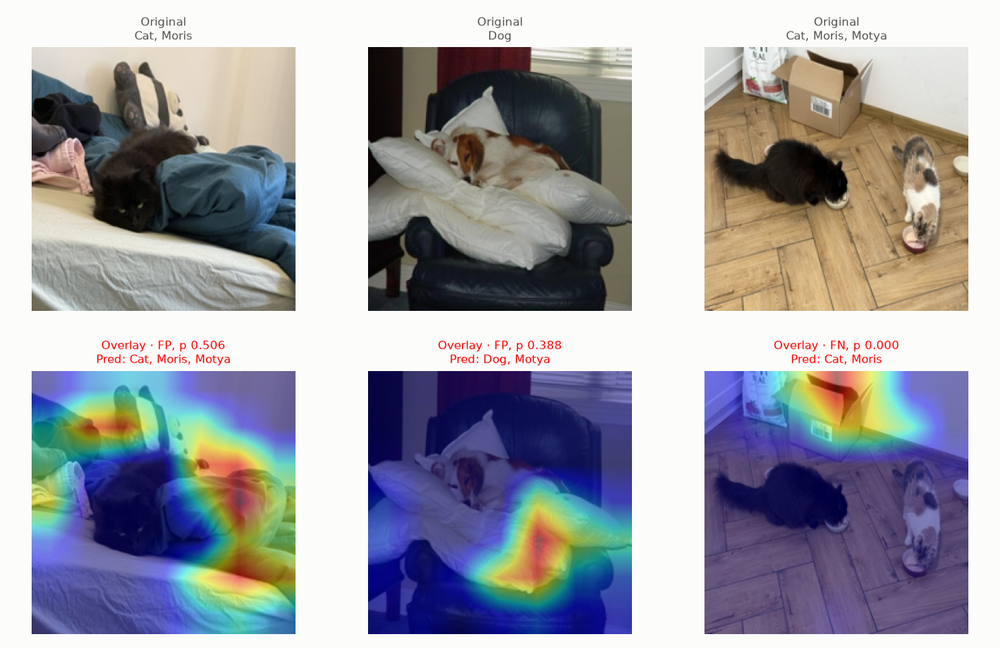
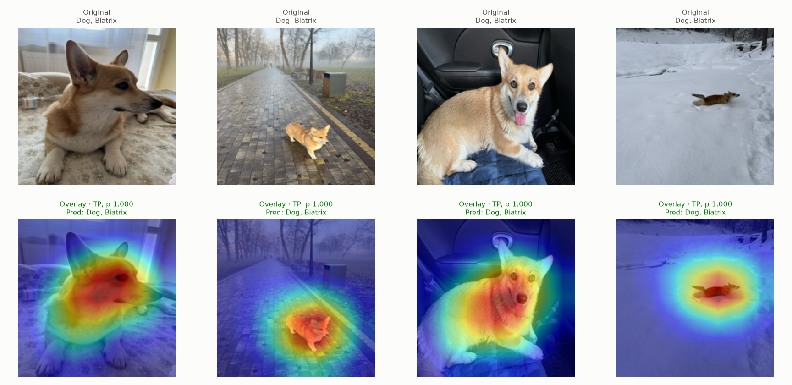
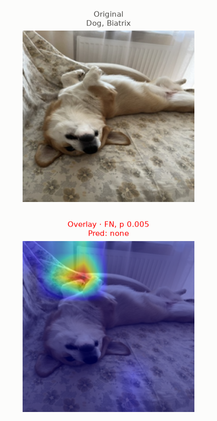

# Experiment 04: Oversampling VIP animals

## Request

move exp04 to exp10, create exp04 oversampling vip animals, describe your idea from augmentations.md

## Question

Does VIP oversampling beat plain shuffling (exp01) for ResNet-18?

## Plan

1. Plot `train_loss`, `val_loss`, `val_map` per epoch, mean over folds, next to exp01 ResNet-18.
2. Tabulate per-class AP and mAP for exp01 and oversampling, plus per-fold difference, flag same sign on both folds.
3. Plot Grad-CAM per VIP class, one correct and one incorrect figure.

## Setup

- **Notebook:** [exp04_oversampling_vip.ipynb](../../../notebooks/experiments/exp04_oversampling_vip.ipynb)
- **Tracking:** `cnn-model-oversampling-vip`
- **What changes:** VIP oversampling
  - VIP rows drawn 8 times per epoch, `oversample = 8`
  - VIP `pos_weight` divided by 8
- **What stays fixed:** exp01 ResNet-18, exp01 results reused
- **Metric:** Fast validation, per-class AP and mAP

## Fixes

## Results

| sampling | Cat | Dog | Moris | Motya | Biatrix | mAP |
|---|---|---|---|---|---|---|
| plain (exp01) | 0.999 | 0.997 | 0.893 | 0.922 | 0.941 | 0.951 |
| oversampling ×8 | 0.999 | 0.997 | 0.977 | 0.938 | 0.948 | 0.972 |

| metric | diff fold 0 | diff fold 1 | same sign on both folds |
|---|---|---|---|
| Cat | -0.000 | -0.000 | yes |
| Dog | -0.001 | -0.000 | yes |
| Moris | +0.138 | +0.029 | yes |
| Motya | -0.053 | +0.085 | no |
| Biatrix | +0.048 | -0.035 | no |
| mAP | +0.026 | +0.016 | yes |

Second table: oversampling minus plain, per fold.

Each class at best-F1 threshold. Incorrect figures short: few errors left.

## AI Summary

Yes: mAP up on both folds, driven by Moris. Motya and Biatrix flip sign between folds, Cat and Dog flat. Train mAP near perfect by epoch two, validation peaks at epoch three then flat: VIP images memorized early. Grad-CAM errors with heat off animal (bedding, box, wall).

## Conclusion

Oversampling helps, but stronger augmentation should be used. Slightly overfits. Keep as new standard.
