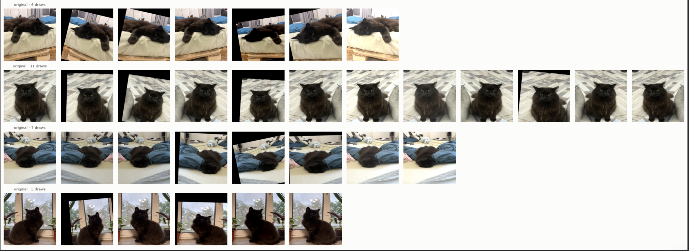

# Oversampling VIP classes

exp04: VIP image drawn 8 times per epoch, VIP `pos_weight` divided by 8. Same total push, many small differently augmented steps instead of few big ones.

## Problem

$N = 12260$ images; Moris 56, Motya 42, Biatrix 41. Plain shuffle: 3 of 4 batches without Moris. `pos_weight` ~57–72 lets one VIP photo dominate batch gradient, shared backbone jumps toward it: noisy training, memorization (`docs/metrics.md`, "Choosing `pos_weight`").

## Oversampling = weighting

Drawing image $k$ times = loss times $k$ in expectation. Effective VIP weight $k \cdot w$.

- Oversampling ×8 with unchanged `pos_weight` = 8× stronger push. `core.cv` (`fit_fold`) computes `pos_weight` from rows, not draws, so division by `oversample` explicit.
- $k \cdot w$ fixed: only delivery differs.

| | Moris | Motya | Biatrix |
|---|---|---|---|
| `pos_weight`, exp01 | 56.7 | 70.4 | 71.7 |
| `pos_weight`, exp04 (÷ 8) | 7.1 | 8.8 | 9.0 |
| batches without this class, exp01 | 75% | 80% | 81% |
| batches without this class, exp04 | 11% | 19% | 20% |

## Not copies

Sampler picks index; `__getitem__` augments every draw, so repeats add views.

- Offline augment then copy: identical copies, memorization.
- Stronger augmentation on VIP only: shortcut "distorted means VIP". Same recipe for all.

## Draws per epoch with downsampling (exp16 on)

Fold 0 training part, 9808 images. VIP image 8 draws, other image p 0.2 (new 20% each epoch).

| Class | Images in training part | Draws per epoch | From VIP images |
|---|---|---|---|
| Cat | 4062 | 1366 | 568 |
| Dog | 4020 | 1061 | 264 |
| Moris | 45 | 360 | 360 |
| Motya | 33 | 264 | 264 |
| Biatrix | 33 | 264 | 264 |
| no animal | 1729 | 346 | 0 |
| all | 9808 | 2749 | 808 |

Non-VIP-only augmentation (exp20, exp21) reaches 58% of Cat draws, 75% of Dog draws; rest VIP photos with face visible. Likely why exp21 moved Dog attention, not Cat.

## Oversampled Moris draws

Draw count 5–11 (`WeightedRandomSampler` with replacement). `Affine` p 0.5: half of draws near original. Same bed, wall, pose every draw: background taught as strongly as cat. Closer to 4 distinct views than 8.

Fixes: crop (`BBoxSafeRandomCrop`, v3), background swap (CMO, exp17), ×4 instead of ×8.

## Why ×8

Heuristic. ×1 = exp01; full balance ~×90, too many repeats. $k = \sqrt{w} \approx 8$ splits weight evenly between sampler and loss; epoch ~8% longer. Next points: ×4, ×16.

Multilabel side effect: VIP image also oversamples its Cat or Dog label, harmless at >5000 positives. Moris + Biatrix image weight 8, not 64.

## Sources

- Park et al. (2022), [Context-rich Minority Oversampling (CMO)](https://arxiv.org/abs/2112.00412), CVPR, section 3: paste rare-class objects onto frequent-class images. Basis of exp17.
- PyTorch [`WeightedRandomSampler`](https://pytorch.org/docs/stable/data.html#torch.utils.data.WeightedRandomSampler): `replacement=True`, `num_samples` sets epoch length.
