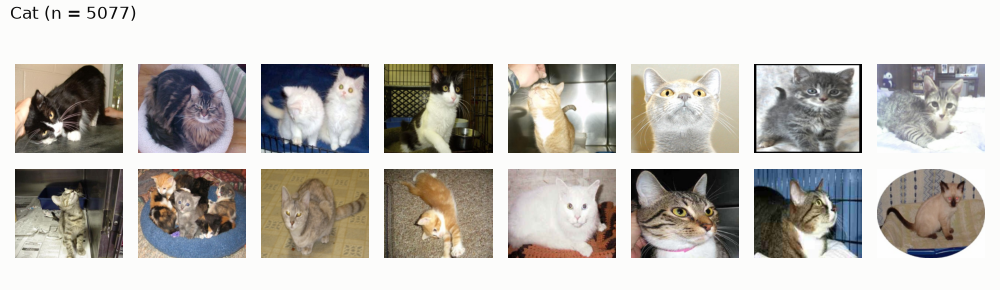
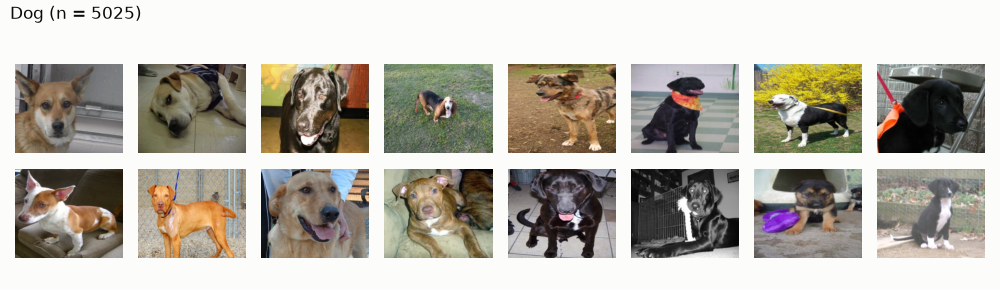
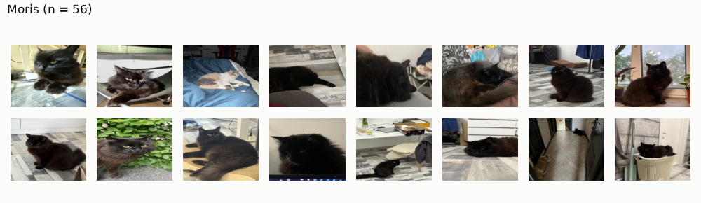
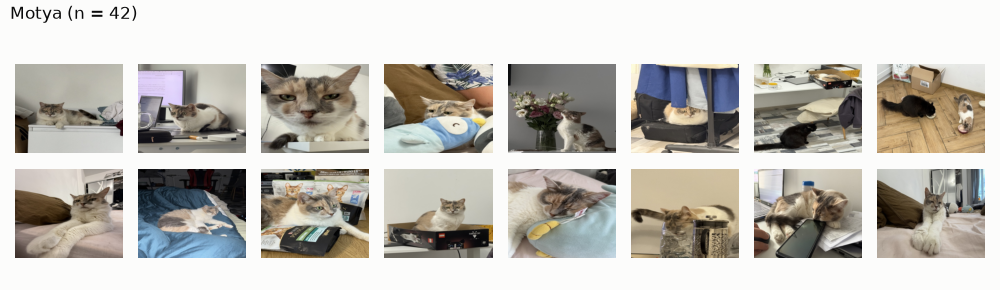
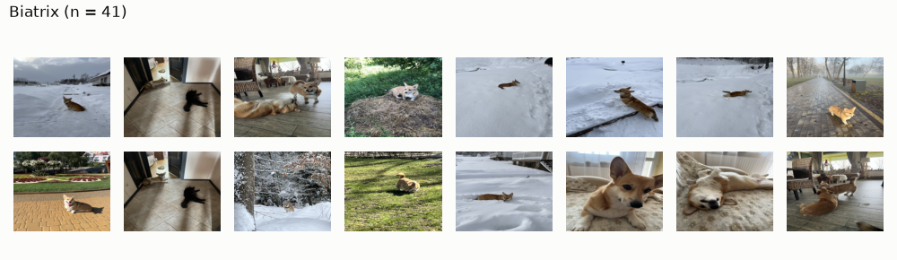
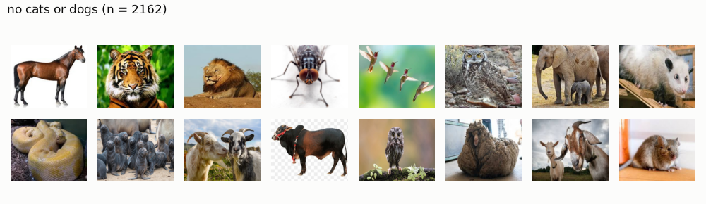
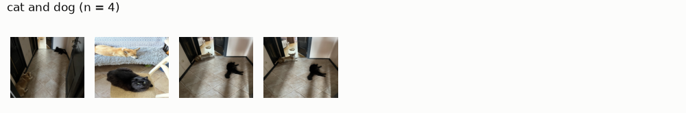

# EDA Report

## Data

Source: [exp01 first overview](experiments/exp01_first_overview.md). Contact sheets: [Appendix](#appendix-contact-sheets).

All 12260 train and 18673 test images: 450 x 375, JPEG, RGB. One fixed size, aspect 1.2, not square.

Only 8 of 32 label combinations occur. Every VIP image also has parent label: Moris and Motya with Cat, Biatrix with Dog. Cat + Dog appears only in 4 images, all Cat + Dog + Moris + Biatrix. Moris + Motya together: 10 images.

Conclusions:

- Very few images for VIP animals.
- Only case with more than 1 animal (cat and dog) on picture: Moris and Biatrix together.
- Classifying only VIP animals and then extrapolating parent labels: bad idea.
- Biatrix often shot from distance, so zooming needed; keep non-zoomed version too. Open question: zoom for images with both Moris and Biatrix.
- Rescaling is needed.

## Metrics

See [docs/metrics.md](../../docs/metrics.md).

What we will work with

- Loss: BCE with pos_weight
- Selection metric: mAP
- Target metric: F1 macro
- Additionally: F1 per class for diagnostics.

Target metric is F1 macro, which means VIP animals, despite small count, drive 60% of it (3 of 5 classes).
As selection metric we will use mAP, because AP does not depend on threshold (connection to F1 can be showed geometrically via isocurves). Also, diagnotic will include Precision Recall curves themselves. Sometimes, for each class spearately as well.

We can not choose F1 macro or mAP as loss, because they are not differentiable.

For loss function I choose BCE as standard choice, but with correction on pos_weight for classes. The problem is that if we take standard w_c = (N - n_c) / n_c, then VIP animals will get too high weights, while being underrepresented in training batches (1 image of Moris, 63 other for example). Therefore, it should be dumped (by w'_c = w_c ^ (3/4)). But, after data augmentation the distribution of images will change, so dumping will need to be adjusted as well. Also note that class imbalance affects batch sizes.

Note that for loss also soft F1 macro was considered as it differentiable surogate to F1 macro, but there is no evidence that it optimizes F1 better then BCE. Moreover, it is numerically unstable and the gradient is noisy.

## Configuration (AI written)

Reasoning behind [docs/configuration.md](../../docs/configuration.md).

### Metric

Three roles, never mixed.

Target metric: Macro F1. Competition score, mean of per-class F1 over 5 classes. VIP classes (Moris, Motya, Biatrix) are 3 of 5, so drive 60% of score despite 41 to 56 train images each.

Selection metric: mAP, mean over classes of average precision. Compares models, checkpoints, runs. No threshold, so measures ranking only; best F1 lies on PR curve, so larger area means better reachable F1. Diagnostics: PR curves, per class too.

Thresholds: per class $t_c$, tuned on validation for chosen model only, then Macro F1 reported at tuned $t_c$. Never 0.5 by default.

### Loss

BCE with damped `pos_weight`: `nn.BCEWithLogitsLoss(pos_weight=w)`, one sigmoid per class.

$$w_c = \left(\frac{N - n_c}{n_c}\right)^{3/4}$$

Full weight $(N - n_c)/n_c$ too large for VIP classes, which appear about once per batch; exponent $3/4$ damps it. Train, $N = 12260$:

| Class | $n_c$ | full $w_c$ | damped $w_c$ |
|---|---|---|---|
| Cat | 5077 | 1.41 | 1.30 |
| Dog | 5025 | 1.44 | 1.31 |
| Moris | 56 | 217.93 | 56.72 |
| Motya | 42 | 290.90 | 70.44 |
| Biatrix | 41 | 298.02 | 71.73 |

Recompute $w_c$ once augmentation or oversampling changes class distribution in batches.

Rejected: soft macro F1. Differentiable surrogate of target, but no evidence it beats BCE with tuned $t_c$; noisy gradient, zero signal in batches without VIP positives.

### Validation

Scheme: multilabel stratified 5-fold CV. Theory: `docs/validation.md`.

Why CV, not holdout: VIP classes have 41 to 56 train images, about 8 to 11 per validation fold. One holdout split leaves score of these classes, i.e. 60% of Macro F1, on few images; CV uses every positive once for validation.

Why 5 folds: convention ($k = 5$ or $10$), not tested against other $k$. $k = 4$ also defensible. Trade-off per fold, $k = 5$ vs $k = 4$: train share 80% vs 75%; VIP positives in validation about 8 to 11 vs 10 to 14, so per-fold AP less noisy at $k = 4$; compute 5 vs 4 trainings per model, $k = 4$ 20% cheaper; spread estimated from 5 vs 4 fold scores. Total positives validated identical, every image once. Changing $k$ reshuffles all folds (`N_FOLDS` in `core/config.py`), so scores across experiments with different $k$ not comparable.

Why multilabel stratification: every fold keeps share of each class, rare VIP classes included. Stratifying on one class leaves others split at random.

Fold aggregation: mean of per-fold mAP, not mAP of pooled OOF predictions. Pooling mixes scores of 5 different models, whose probability scales differ, so pooled ranking depends on scale; per-fold AP does not.

## My Notes

What about ROC AUC?

Is it useless for this project.

"ROC-AUC divides false positives by all those negatives, so even many false positives barely change it. "

Also, F1 is harmonic mean between precision and recall, so it is much natural to use mAP for this.

The question left: how exactly to tune BCE?

## Appendix: contact sheets

Random samples from exp01, image count in title.

