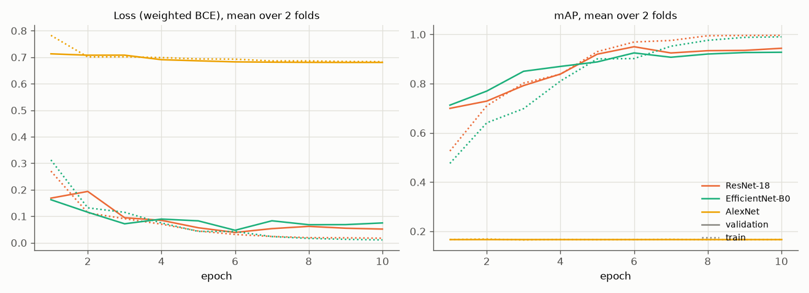
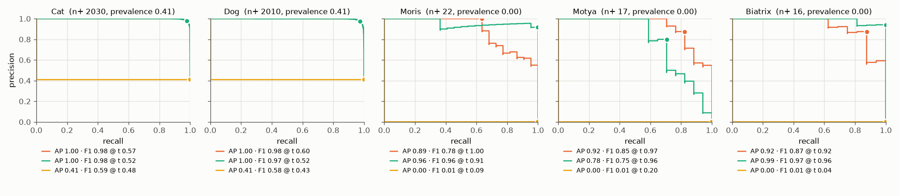

# Experiment 01: Lecture models

## Request

using current configuration create experiment in baseline; experiment should compare how the same models as in lecture 2 module 2, but with adjusted loss and metric, perform on current dataset. report training plot (if available), precision recall curves (models on 1 figure compared together, for each class separate figure), table with cAP comparison

## Question

Which of 3 ImageNet-pretrained lecture 2 models (ResNet-18, EfficientNet-B0, AlexNet) gives highest mean per-fold mAP in Fast validation mode (folds 0 and 1 of 5-fold split), and how does per-class AP differ between them?

## Plan

1. Train each model on folds 0 and 1 with weighted BCE, one notebook cell per model, log `train_loss`, `val_loss`, `val_map` per epoch, plot mean over 2 folds per epoch, one line per model.
2. Plot precision-recall curve of each class on pooled probabilities of folds 0 and 1, all 3 models on one figure, one figure per class.
3. Tabulate AP of each class plus mAP per model, mean over folds 0 and 1.
4. Tabulate mAP per fold and difference to leader per fold, flag models below leader on both folds.

All plots follow `dataviz` skill.

## Setup

- **Notebook:** [exp01_lecture_models.ipynb](../notebooks/experiments/exp01_lecture_models.ipynb), configs `configs/exp01_lecture_models/`, training `core.cv`
- **Tracking:** `cnn-model-lecture-models` (one run per model and fold with `best_ap_<class>` metrics, run `summary` with param `val_mode` = `fast`)
- **What changes:** model, all ImageNet-1k pretrained (`docs/rules.md`): timm `resnet18.a1_in1k`, `tf_efficientnet_b0.in1k`, torchvision AlexNet `AlexNet_Weights.IMAGENET1K_V1` (no timm version, config field `torchvision_model`); scratch models dropped; ConvNeXt-Tiny (`convnext_tiny.fb_in1k`) dropped: too long to train; earlier AlexNet run collapsed at lr 1e-3, `val_map` 0.167 (constant output) all 10 epochs on both folds, MLflow runs `655e7053`, `f179a3d7`
- **What stays fixed:** lecture recipe: Adam, cosine lr 1e-3 to 1e-5, 10 epochs, batch 64, 224 px, `core.data.train_tfms`, mean = std = 0.5; config from `docs/configuration.md`: `BCEWithLogitsLoss` with `pos_weight` $w_c = ((N - n_c)/n_c)^{3/4}$ computed on train part of fold, best checkpoint by `val_map` (added to `core.model`, `core.train`), folds from `core.data.read_train`, each fold model trains on other 4 folds (80%), `SEED`
- **Metric:** per-class AP and mAP on validation fold, mean over folds 0 and 1; model below leader on both folds counts as worse; PR curves on pooled folds 0 and 1 only for display

## Fixes

redesign experiment 1 so it uses only models pretrained on ImageNet

fuck, cut to 10 and change notebook

redesign exp01 to use Fast validation mode, in notebook I want to run each model training in separate cell

I just do not want to show AlexNet on plot and do not rerun it again

change exp01 so it does not contain Convnext, but contains alex net

## Results

| model | Cat | Dog | Moris | Motya | Biatrix | mAP | mAP fold 0 | mAP fold 1 | macro F1 |
|---|---|---|---|---|---|---|---|---|---|
| ResNet-18 | 0.999 | 0.997 | 0.893 | 0.922 | 0.941 | 0.951 | 0.951 | 0.951 | 0.892 |
| EfficientNet-B0 | 0.998 | 0.997 | 0.942 | 0.807 | 0.993 | 0.948 | 0.942 | 0.954 | 0.926 |
| AlexNet | 0.414 | 0.410 | 0.004 | 0.003 | 0.003 | 0.167 | 0.167 | 0.167 | 0.238 |

Per-class AP and mAP on validation part of folds 0 and 1, table mean over 2 folds; macro F1 and PR curves on pooled folds 0 and 1, macro F1 at best threshold per class picked on same rows (optimistic). Only AlexNet below leader on both folds.

## AI Summary

ResNet-18 and EfficientNet-B0 tie (mAP 0.951 vs 0.948, each leads on one fold); AlexNet collapsed to constant output (mAP 0.167). Differences only in rare classes: EfficientNet-B0 better on Moris, ResNet-18 better on Motya.

## Conclusion

Drop AlexNet. ConvNext was tried in previous iteration, but training was too long. Therefore, for further work I will consider only EfficientNet and ResNet.

During training both models were slightly overfitting. ResNet better predicted Motya, while Efficient Net predicted Moris.

Based on this data, both models tie, while efficient net is assumed to be more capable. Therefore, I choose ResNet for further tuning, beause it trains faster.