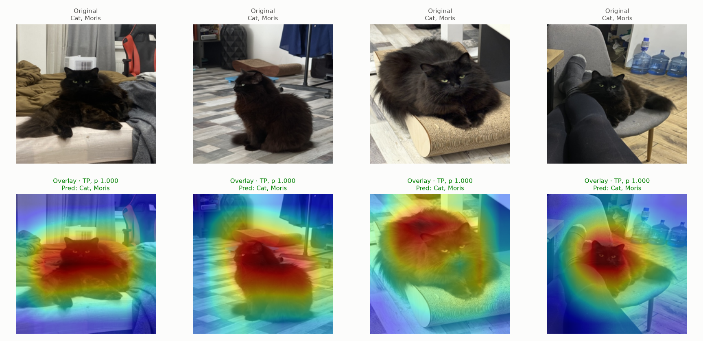
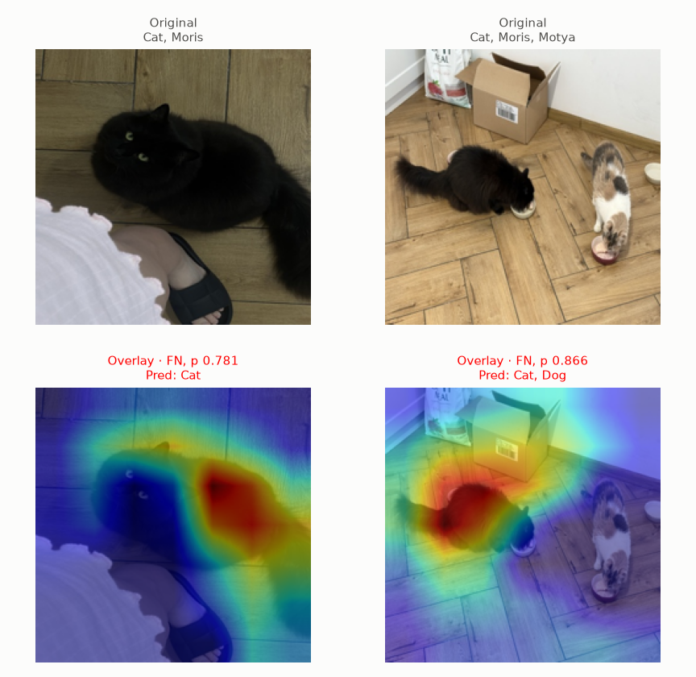
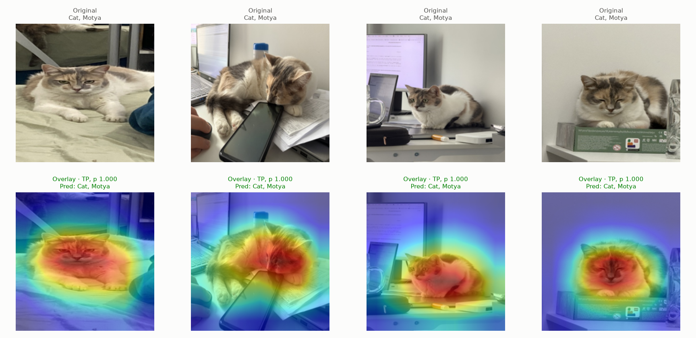
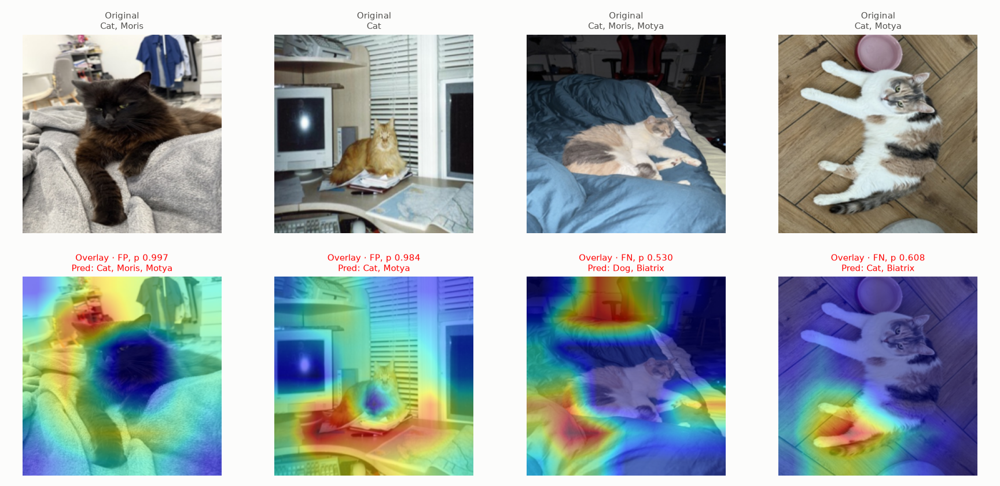
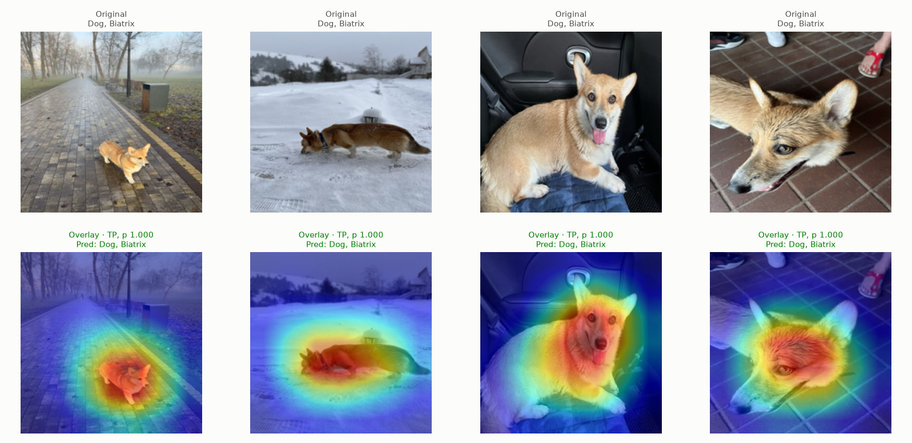
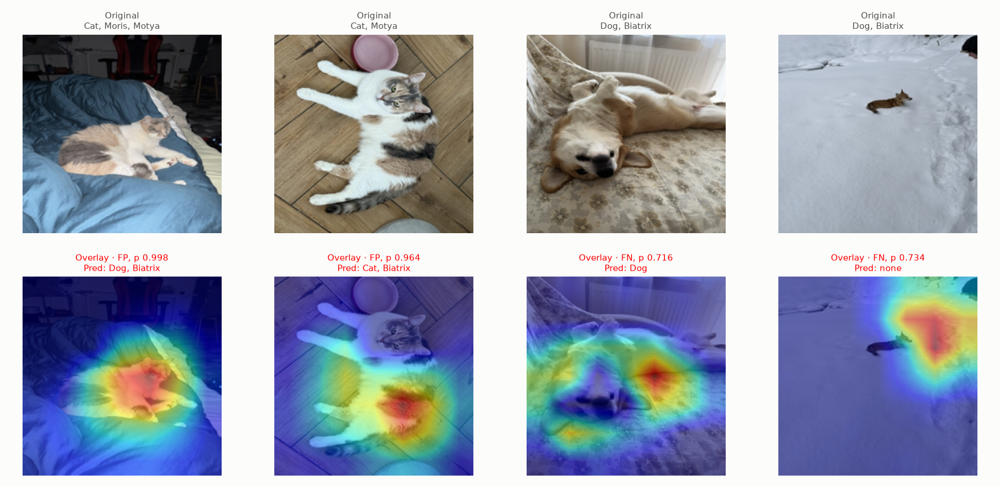

# Experiment 02: Grad-CAM

## Request

create experiment for grad cam visualization, result should contain 6 figures: 3 for correct, 3 for incorrect for each VIP animal; each figure contains original image and gradcam overlap visualization

## Question

For each VIP class (Moris, Motya, Biatrix), does ResNet-18 from exp01 focus on the animal itself in correct predictions, and where does it look in errors?

## Plan

1. Load ResNet-18 fold 0 and fold 1 checkpoints of exp01 and their out-of-fold probabilities, binarize each VIP class at its best-F1 threshold (`core.predict.best_f1`) on pooled folds 0 and 1.
2. Plot one "correct" figure per VIP class: 4 most confident true positives, one column per image, original on top and Grad-CAM overlay for that class logit below, computed by the fold model that held the image out.
3. Plot one "incorrect" figure per VIP class: 2 most confident false positives plus 2 most confident false negatives, same layout; as in Advanced CNN lecture, original titled with true labels, overlay titled with outcome, probability and predicted labels (all classes at their thresholds), green for true positive, red for error.

All plots follow `dataviz` skill.

## Setup

- **Notebook:** [exp02_grad_cam.ipynb](../notebooks/experiments/exp02_grad_cam.ipynb), no training
- **Tracking:** `cnn-model-grad-cam` (one run, 6 figures as artifacts)
- **What changes:** VIP class, prediction outcome (correct or incorrect)
- **What stays fixed:** model ResNet-18 `resnet18.a1_in1k` from `docs/configuration.md`, checkpoints `checkpoints/cnn-model-lecture-models/ResNet-18 fold {0,1}/`, OOF from `data/processed/cv/cnn-model-lecture-models/ResNet-18/`, `core.data.val_tfms` at 224 px; Grad-CAM on last block `layer4` (own implementation via forward/backward hooks in `core.model`, no new dependency), ReLU of gradient-weighted activations, upsampled to 224 px, overlay on resized image with `jet` colormap at alpha 0.5 (as in Advanced CNN lecture)
- **Metric:** none, visual; class threshold from best F1 on pooled folds 0 and 1

## Fixes

1. I want not

   ```text
   orig | gradcam
   ... | ...
   ```

   but

   ```text
   orig | ...
   ----------
   gradcam | ...
   ```

2. use standard  rgb visualization as shown on image (as in Advanced CNN lecture)
3. make red green labels same as in lecture
4. remove title, make space between images bigger so labels did not overlap

## Results













No metric, visual only. Out-of-fold ResNet-18 predictions on pooled folds 0 and 1, best-F1 thresholds Moris 0.997, Motya 0.974, Biatrix 0.922; Moris has no false positive at its threshold, so its "incorrect" figure holds 2 false negatives only.

## AI Summary

In all 12 correct examples heat sits on the animal's body and face. In errors heat mostly leaves the animal: background, blanket, desk or snow next to the dog (Motya false positives, Biatrix false negatives), while Motya and Biatrix confuse each other on the two calico Motya photos, and the two Moris misses do look at Moris but fall short of the 0.997 threshold (p 0.78, 0.87).

## Conclusion

As AI said, for incorrect images ResNet looks at different regions. Therefore, the most natural next step is to try doing augmentations.