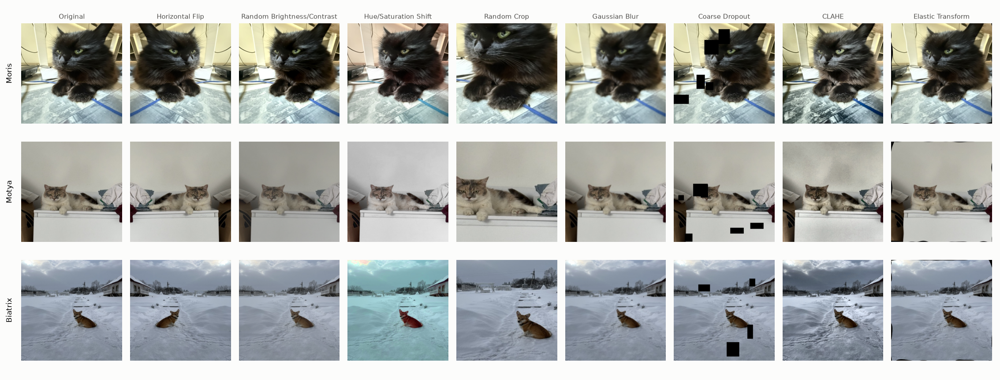
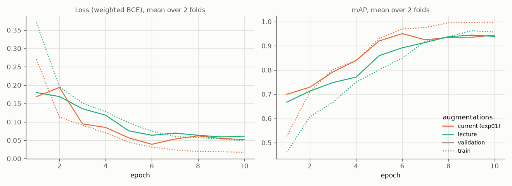
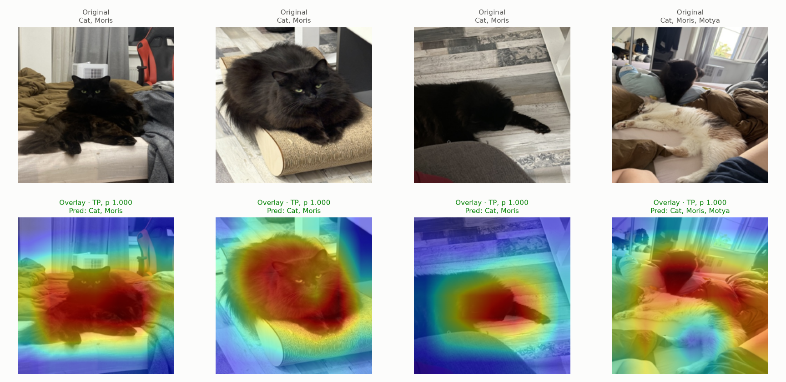
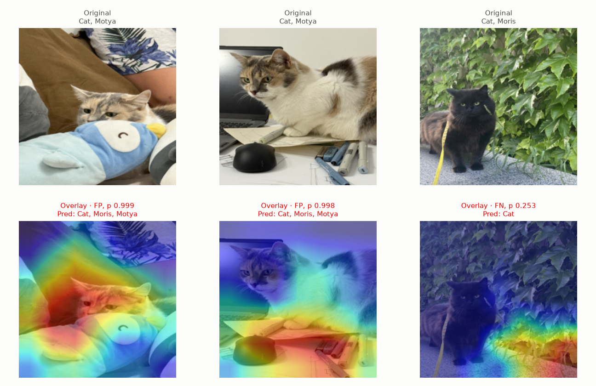
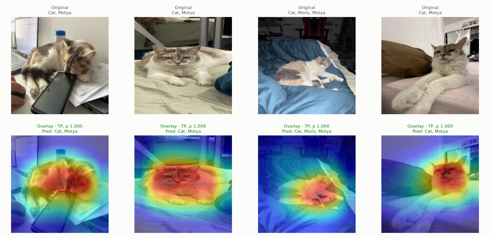
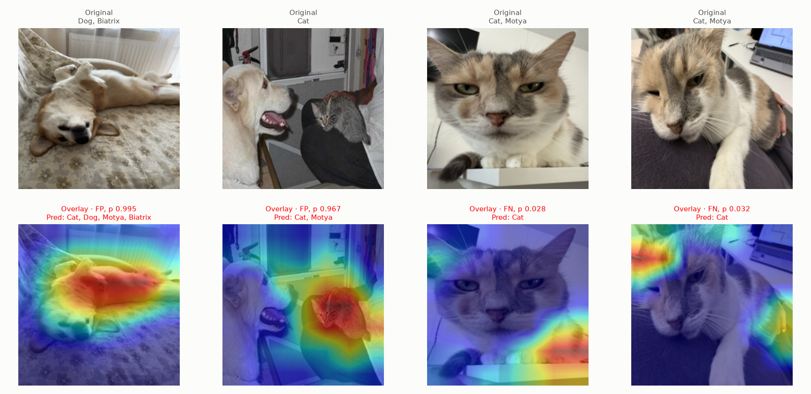
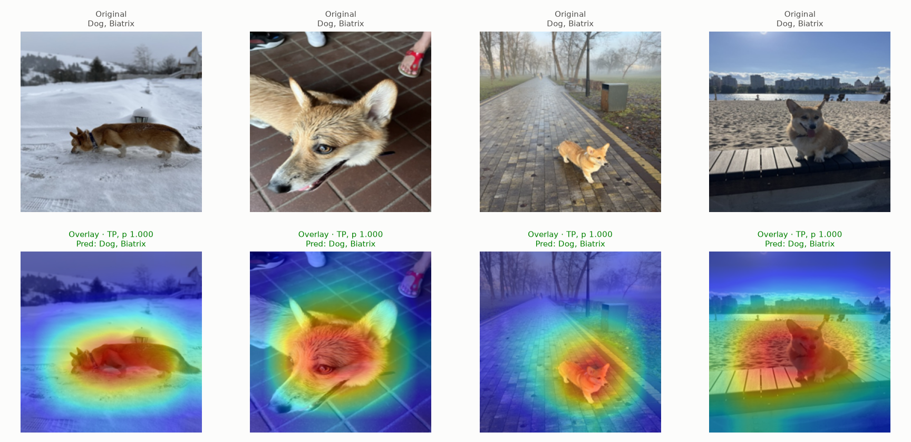
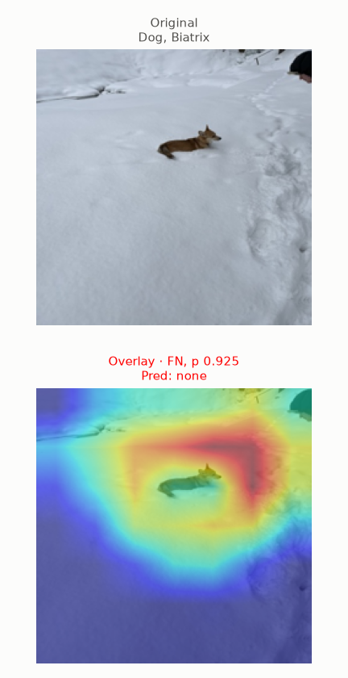

# Experiment 03: Lecture augmentations

## Request

then remove augementation/ section as well, create experiment 3 for augmentations, where perform use same augmentations as in lecture

add to plan same gradcam figures as in exp02

## Question

Does ResNet-18 trained with Advanced CNN lecture augmentations give higher mean per-fold mAP on folds 0 and 1 than same model with current `core.data.train_tfms` (exp01)?

## Plan

1. Plot 9 single augmentations from lecture demo (original, horizontal flip, brightness/contrast, hue/saturation, random crop, Gaussian blur, coarse dropout, CLAHE, elastic), same parameters at p = 1, on one training image per VIP class resized to 448 px (pixel-sized crop and elastic parameters act close to lecture demo image size), one row per class.
2. Train ResNet-18 on folds 0 and 1 with lecture training augmentations, plot `train_loss`, `val_loss`, `val_map` per epoch, mean over 2 folds, next to exp01 ResNet-18.
3. Tabulate AP of each class plus mAP per fold for both augmentation sets, difference to exp01 per fold, flag difference with same sign on both folds.
4. Plot same 6 Grad-CAM figures as exp02 for new model: per VIP class one "correct" (4 most confident true positives) and one "incorrect" (2 most confident false positives plus 2 most confident false negatives), original on top, `jet` overlay below, lecture-style green and red titles.

All plots follow `dataviz` skill.

## Setup

- **Notebook:** [exp03_lecture_augmentations.ipynb](../notebooks/experiments/exp03_lecture_augmentations.ipynb), config `configs/exp03_lecture_augmentations/resnet18.toml`, training `core.cv`
- **Tracking:** `cnn-model-lecture-augmentations` (one run per fold with `best_ap_<class>` metrics, run `summary`)
- **What changes:** training augmentations. Lecture recipe (ResNet-18 transfer learning cell): `Resize(224)`, `HorizontalFlip(p=0.5)`, `VerticalFlip(p=0.5)`, `RandomBrightnessContrast(0.5, 0.5, p=0.5)`, `HueSaturationValue(20, 30, 20, p=0.5)`. Current (exp01): `Resize(224)`, `HorizontalFlip(p=0.5)`, `RandomBrightnessContrast(p=0.5)` (limits 0.2), `Affine(translate 0.1, scale 0.8–1.2, rotate ±15°, p=0.5)`. Lecture recipe added as `core.data.lecture_tfms`, chosen by new `Config` field `augment` (`"default"` or `"lecture"`); exp01 results unchanged, `train_tfms` remains the default.
- **What stays fixed:** everything else from exp01 ResNet-18: `resnet18.a1_in1k` pretrained, Adam, cosine lr 1e-3 to 1e-5, 10 epochs, batch 64, 224 px, `val_tfms`, mean = std = 0.5, weighted BCE from `docs/configuration.md`, best checkpoint by `val_map`, folds 0 and 1, `SEED`; exp01 ResNet-18 results reused from `data/processed/cv/cnn-model-lecture-models/ResNet-18/`, not retrained. Grad-CAM code of exp02 notebook moved to `core.gradcam` (`grad_cam`, `GradCamFigures`), exp02 notebook uses it, its figures unchanged; figures `exp03_lecture_augmentations_grad_cam_<class>_<correct|incorrect>.png`. Test-time augmentation from lecture not part of this experiment.
- **Metric:** per-class AP and mAP on validation fold, mean over folds 0 and 1; difference counts only when same sign on both folds

## Fixes

## Results

| augmentations | Cat | Dog | Moris | Motya | Biatrix | mAP |
|---|---|---|---|---|---|---|
| current (exp01) | 0.999 | 0.997 | 0.893 | 0.922 | 0.941 | 0.951 |
| lecture | 0.998 | 0.996 | 0.871 | 0.871 | 0.983 | 0.944 |

| metric | diff fold 0 | diff fold 1 | same sign on both folds |
|---|---|---|---|
| Cat | -0.001 | -0.001 | yes |
| Dog | -0.001 | -0.002 | yes |
| Moris | -0.097 | +0.053 | no |
| Motya | -0.133 | +0.030 | no |
| Biatrix | +0.014 | +0.069 | yes |
| mAP | -0.044 | +0.030 | no |

AP per class and mAP on validation part of folds 0 and 1, first table mean over 2 folds, second lecture minus current per fold.

Grad-CAM on out-of-fold rows of folds 0 and 1, each class binarized at its best-F1 threshold of lecture model (Moris 0.810, Motya 0.928, Biatrix 0.987). Incorrect figures shorter where errors run out: Moris 2 false positives plus 1 false negative, Biatrix 1 false negative only.

## AI Summary

No: lecture augmentations give mAP 0.944 vs 0.951, and mAP difference flips sign between folds (-0.044, +0.030), so no real change; only Biatrix improves on both folds (+0.014, +0.069), Cat and Dog lose 0.001–0.002, Moris and Motya lose up to 0.13 on fold 0 and gain up to 0.05 on fold 1.

Lecture vs current recipe: lecture adds `VerticalFlip`, stronger `RandomBrightnessContrast` (0.5 vs 0.2) and `HueSaturationValue`, drops `Affine` (shift, scale, rotate). Stronger, mostly photometric augmentation makes training harder: train mAP stays below current all 10 epochs and ends near validation (gap about 0.02 vs 0.05 for current), so less overfitting, but validation mAP reaches same level by epoch 8, not higher. Grad-CAM of correct predictions still centered on animal, as in exp02; errors again partly calico confusion (2 Motya photos predicted Moris, Biatrix lying on back predicted Motya) and misses with heat off animal (Motya close-ups p 0.03, Moris on ivy, Biatrix far away in snow).

## Conclusion

- Looks like augmentaions are not aggressive enough, also it makes sense to combine them
- Is it possible that augmentations on cats break prediction area on Moris?