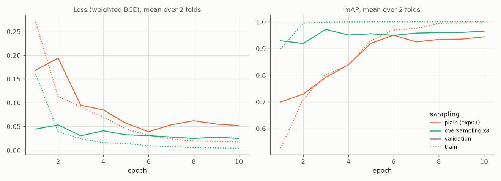
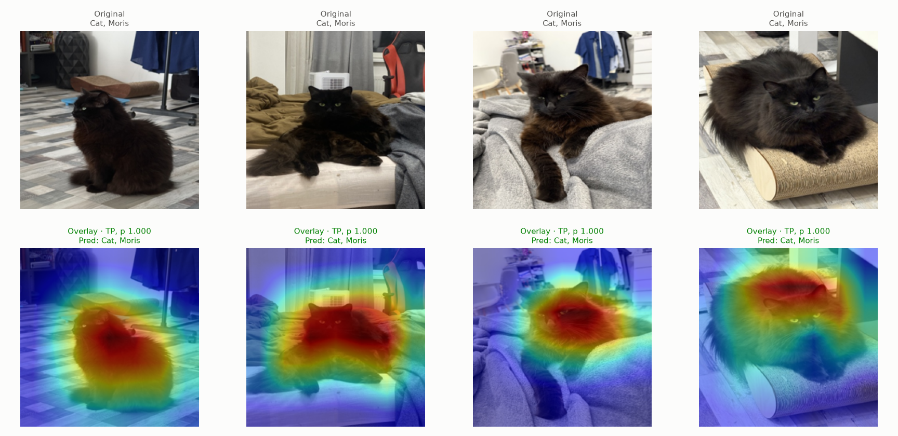
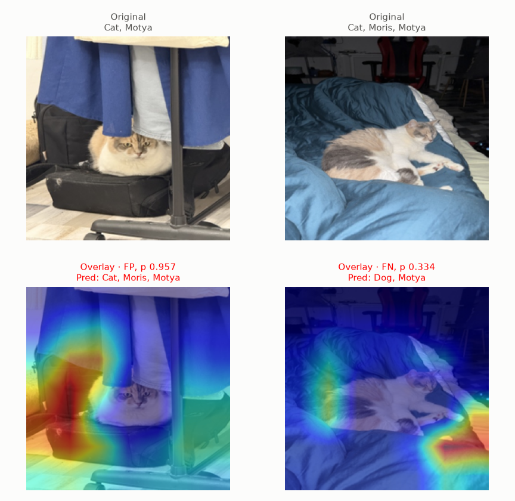
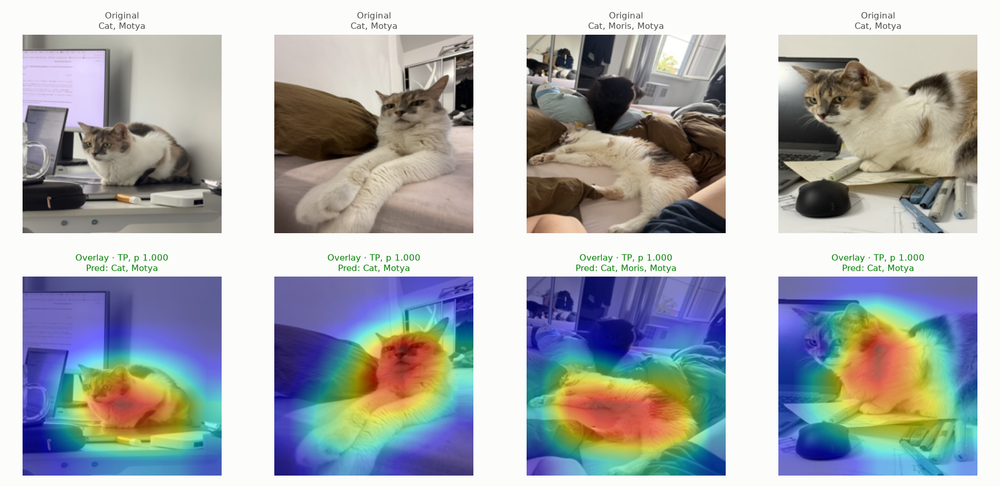
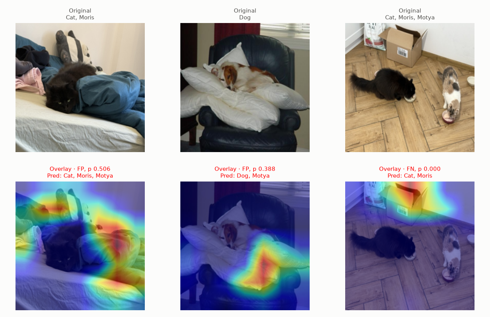
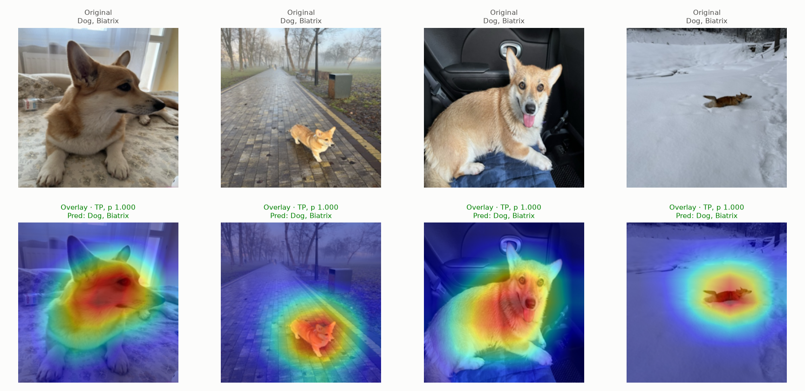
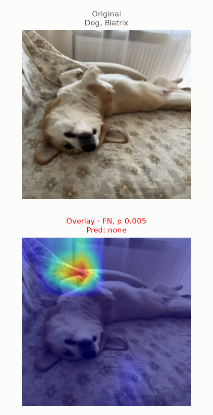

# Experiment 04: Oversampling VIP animals

## Request

move exp04 to exp10, create exp04 oversampling vip animals, describe your idea from augmentations.md

## Question

Does ResNet-18 trained with VIP images drawn 8 times per epoch (`pos_weight` divided by 8) give higher mean per-fold mAP on folds 0 and 1 than same model with plain shuffling (exp01)?

## Plan

1. Train ResNet-18 on folds 0 and 1 with VIP oversampling ×8, plot `train_loss`, `val_loss`, `val_map` per epoch, mean over 2 folds, next to exp01 ResNet-18.
2. Tabulate AP of each class plus mAP, mean over folds 0 and 1, for exp01 and oversampling, plus per-fold difference to exp01, flag difference with same sign on both folds.
3. Plot exp02 Grad-CAM figures (`core.gradcam.GradCamFigures`) for oversampling model: per VIP class one "correct" and one "incorrect" figure, 6 figures.

All plots follow `dataviz` skill.

## Setup

- **Notebook:** [exp04_oversampling_vip.ipynb](../notebooks/experiments/exp04_oversampling_vip.ipynb), config `configs/exp04_oversampling_vip/resnet18.toml`, training `core.cv`
- **Tracking:** `cnn-model-oversampling-vip` (one run per fold with `best_ap_<class>` metrics, run `summary`)
- **What changes:** sampling of training rows and `pos_weight`, new `Config` field `oversample = 8` (default 1 = plain shuffling, exp01 unchanged).
  - Order: oversample, then augment (`docs/oversampling.md`). `WeightedRandomSampler` with replacement replaces `shuffle=True`: weight 8 for training row with any VIP label, 1 otherwise. Row with Moris + Biatrix weighted 8 once, not 64.
  - Epoch length $n_{train} + 7 \cdot n_{VIP}$: non-VIP rows drawn about once per epoch as before, VIP rows about 8 times; about 8% of draws VIP, about 5 per batch of 64 (now about 0.7). Epoch about 8% longer.
  - Augmentation runs in `MultilabelImageDataset.__getitem__` after sampler choice, so each VIP copy gets new random draw of same recipe. No extra or stronger augmentation for copies: label-tied augmentation is shortcut.
  - `pos_weight` of VIP classes from train part of fold divided by `oversample`, so effective VIP weight (sampling × `pos_weight`) stays as in exp01: Moris about 7.1, Motya 8.8, Biatrix 9.0 instead of 56.7, 70.4, 71.7. Cat and Dog weight unchanged (about 1.3): every VIP image also carries Cat or Dog, but 800 extra draws barely move 5000+ positives.
- **What stays fixed:** everything else from exp01 ResNet-18: `resnet18.a1_in1k` pretrained, Adam, cosine lr 1e-3 to 1e-5, 10 epochs, batch 64, 224 px, `augment = "default"` (`core.data.train_tfms`, including its fixed 10% shift right and down), `val_tfms`, mean = std = 0.5, best checkpoint by `val_map`, folds 0 and 1, `SEED`; validation rows never oversampled, never augmented; exp01 ResNet-18 results reused, not retrained. Deferred oversampling (only last epochs) and Grad-CAM-guided augmentations from `docs/augmentations.md` not part of this experiment.
- **Metric:** per-class AP and mAP on validation fold, mean over folds 0 and 1; difference counts only when same sign on both folds

## Fixes

## Results

| sampling | Cat | Dog | Moris | Motya | Biatrix | mAP |
|---|---|---|---|---|---|---|
| plain (exp01) | 0.999 | 0.997 | 0.893 | 0.922 | 0.941 | 0.951 |
| oversampling ×8 | 0.999 | 0.997 | 0.977 | 0.938 | 0.948 | 0.972 |

| metric | diff fold 0 | diff fold 1 | same sign on both folds |
|---|---|---|---|
| Cat | -0.000 | -0.000 | yes |
| Dog | -0.001 | -0.000 | yes |
| Moris | +0.138 | +0.029 | yes |
| Motya | -0.053 | +0.085 | no |
| Biatrix | +0.048 | -0.035 | no |
| mAP | +0.026 | +0.016 | yes |

AP per class and mAP on validation part of folds 0 and 1, first table mean over 2 folds, second oversampling minus plain per fold.

Grad-CAM on out-of-fold rows of folds 0 and 1, each class binarized at its best-F1 threshold of oversampling model (Moris 0.903, Motya 0.346, Biatrix 0.932). Incorrect figures shorter where errors run out: Moris 1 false positive plus 1 false negative, Motya 2 false positives plus 1 false negative, Biatrix 1 false negative only.

## AI Summary

Yes: oversampling ×8 raises mAP 0.951 to 0.972, higher on both folds (+0.026, +0.016), driven by Moris (+0.138, +0.029); Motya and Biatrix flip sign between folds, Cat and Dog unchanged. Train mAP reaches 0.995 by epoch 2 and 1.000 from epoch 5 while validation mAP peaks at 0.972 in epoch 3 and stays near 0.96: VIP images, seen 8 times per epoch, memorized early; Grad-CAM errors again with heat off animal (bedding, box, wall above Biatrix lying on back).

## Conclusion

Oversampling helps, but stronger augmentation should be used. Slightly overfits. Keep as new standard.
