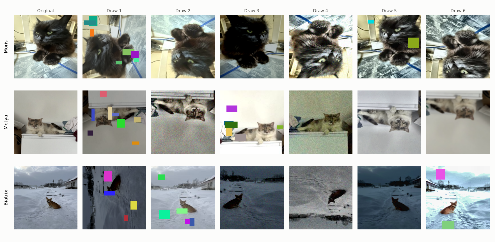
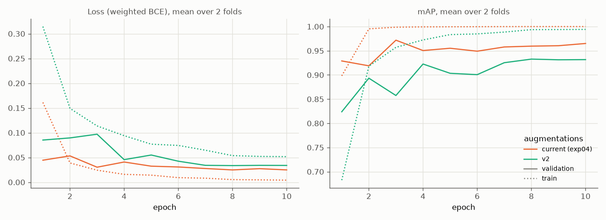
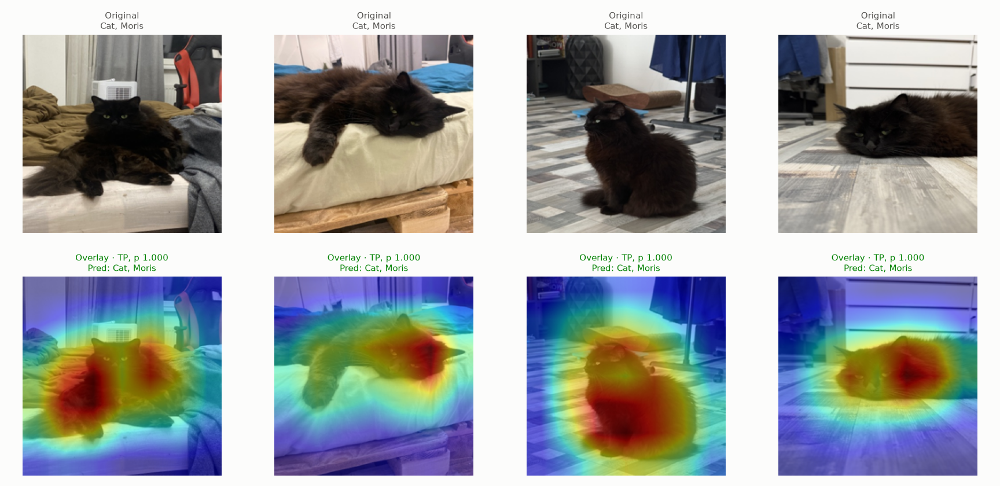
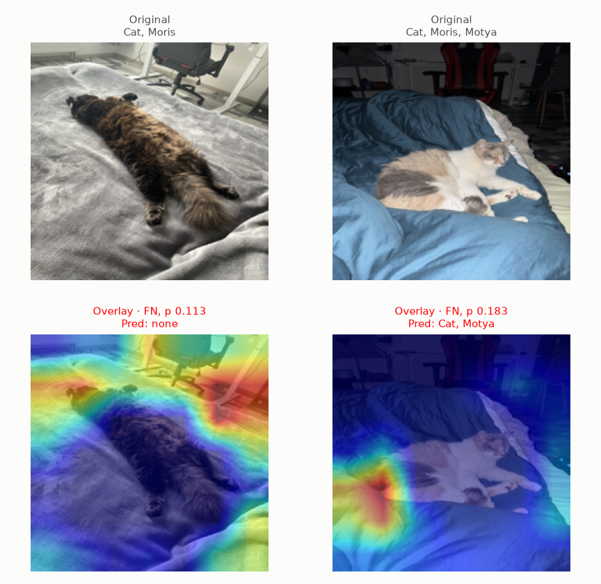
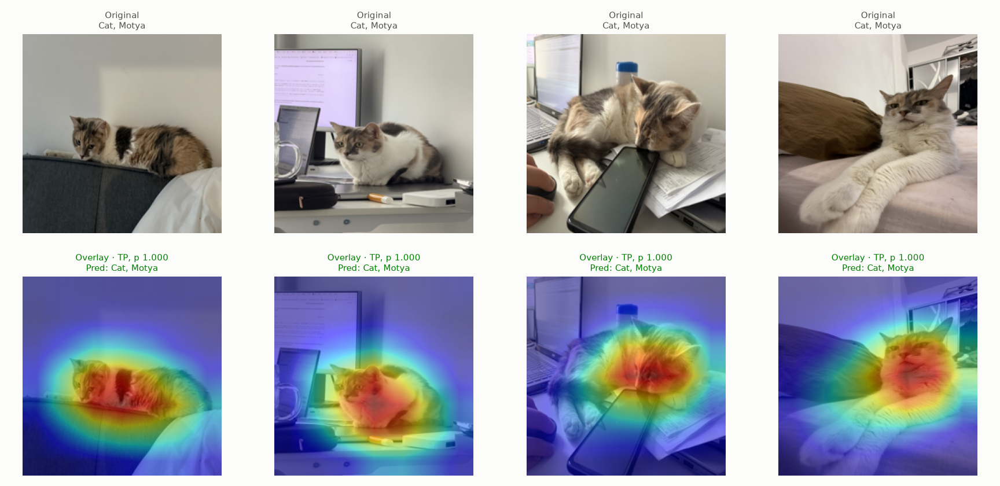
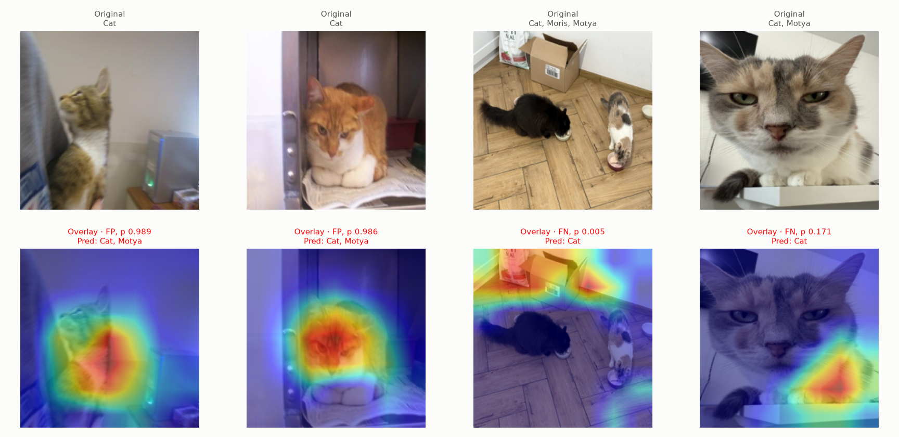
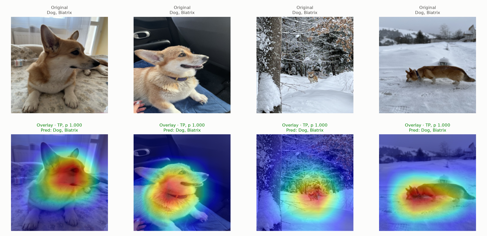
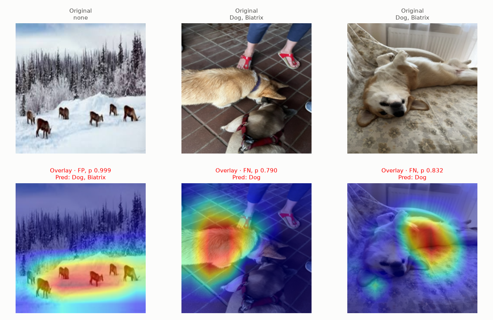

# Experiment 05: Augmentations v2

## Request

create experiment with both geometric and photometric augmentations, make them stronger; split on 2: apply on all animals, apply only on VIP animals

train figures should include all 4 augmentation types, but gradcam for new 2 only

chnage my mind: vertical flip does not represent real situation, but prevents model from learning shit like in the case of beatrix on the snow, or ivy near moris

remove (-30, 30) rotations, but add 90 rotations

remove it at all

agree with random resized crop

remove it. reanalyze v2

okay, return all 3 instead of square symmetry

move exp10 to exp5; to v2 add augmentations from color and intensity, noise, blur, quality, occlusion; do not build without my command;

## Question

Does ResNet-18 with VIP oversampling ×8 and v2 augmentations (geometric, color, noise and blur, occlusion) give higher mean per-fold mAP on folds 0 and 1 than same oversampling with current augmentations (exp04)?

## Plan

1. Plot 6 random draws of v2 recipe on one training image per VIP class, one row per class, original first.
2. Train ResNet-18 on folds 0 and 1 with v2 recipe, plot `train_loss`, `val_loss`, `val_map` per epoch, mean over 2 folds, one line per augmentation type: current (exp04), v2.
3. Tabulate AP of each class plus mAP, mean over folds 0 and 1, for both augmentation types, plus per-fold difference of v2 to current (exp04), flag difference with same sign on both folds.
4. Plot exp02 Grad-CAM figures (`core.gradcam.GradCamFigures`) for v2 only: per VIP class one "correct" and one "incorrect" figure, 6 figures.

All plots follow `dataviz` skill.

## Setup

- **Notebook:** [exp05_augmentations_v2.ipynb](../notebooks/experiments/exp05_augmentations_v2.ipynb), config `configs/exp05_augmentations_v2/resnet18.toml`, training `core.cv`
- **Tracking:** `cnn-model-augmentations-v2` (one run per fold with `best_ap_<class>` metrics, run `summary`)
- **What changes:** training augmentations, `augment = "v2"`, applied to every training image.
  - v2 recipe, new `core.data.v2_tfms`:
    - `Resize(224)`
    - `HorizontalFlip(p=0.5)`
    - `VerticalFlip(p=0.5)`
    - `RandomRotate90(p=0.5)`
    - `RandomResizedCrop(size=(224, 224), scale=(0.5, 1.0), ratio=(1, 1), p=1)`
    - `RandomBrightnessContrast(0.3, 0.3, p=0.8)`
    - `HueSaturationValue(10, 40, 20, p=0.6)`
    - `RGBShift(r_shift_limit=15, g_shift_limit=15, b_shift_limit=15, p=0.3)`
    - `RandomGamma(gamma_limit=(80, 120), p=0.3)`
    - `CLAHE(p=0.2)`
    - `OneOf([MotionBlur(blur_limit=(3, 7)), GaussianBlur(blur_limit=(3, 5)), GaussNoise(std_range=(0.02, 0.06)), Downscale(scale_range=(0.5, 0.9))], p=0.4)`
    - `ImageCompression(quality_range=(50, 95), p=0.3)`
    - `CoarseDropout(num_holes_range=(2, 8), hole_height_range=(0.05, 0.2), hole_width_range=(0.05, 0.2), fill="random_uniform", p=0.5)`
  - Current recipe (exp01, exp04), for comparison:
    - `Resize(224)`
    - `HorizontalFlip(p=0.5)`
    - `RandomBrightnessContrast(0.2, 0.2, p=0.5)`
    - `Affine(translate_percent=0.1, scale=(0.8, 1.2), rotate=(-15, 15), p=0.5)`, black corners; single-number `translate_percent` is fixed shift, so image always moves 10% right and 10% down when applied
  - Lecture recipe (exp03, `core.data.lecture_tfms`), reference only, not compared (trained without oversampling):
    - `Resize(224)`
    - `HorizontalFlip(p=0.5)`
    - `VerticalFlip(p=0.5)`
    - `RandomBrightnessContrast(0.5, 0.5, p=0.5)`
    - `HueSaturationValue(20, 30, 20, p=0.5)`
  - All 8 orientations reachable although upside-down and sideways views unrealistic, not uniform: upright or upside down 3/4, sideways 1/4 (`docs/augmentations.md`); small-angle rotation dropped. Reason: breaks shortcuts tied to fixed position of background, like snow below Biatrix or ivy around Moris, where exp02 and exp03 Grad-CAM put heat on background in misses.
  - Limits: hue shift 10 of 180 (about 20°), still below lecture 20; coat color identifies VIP animals (`docs/augmentations.md`). Brightness limit 0.3, below lecture 0.5 that blacked out Moris and Motya. `ToGray`, `ChannelShuffle` left out: remove or scramble coat color. Blur, noise, downscale in one `OneOf`, so at most one degradation per image; dropout holes at most 20% of side, 7% of image hidden on average, 18% at most; small far animal (Biatrix in snow) can be covered. Each hole filled with one random color, not black.
- **What stays fixed:** everything else from exp04 ResNet-18: `resnet18.a1_in1k` pretrained, `oversample = 8` (VIP `pos_weight` divided by 8), Adam, cosine lr 1e-3 to 1e-5, 10 epochs, batch 64, 224 px, `val_tfms`, mean = std = 0.5, weighted BCE from `docs/configuration.md`, best checkpoint by `val_map`, folds 0 and 1, `SEED`; exp04 ResNet-18 results reused, not retrained. Validation images never augmented.
- **Metric:** per-class AP and mAP on validation fold, mean over folds 0 and 1; difference counts only when same sign on both folds

## Fixes

1. I want more aggressive coarse dropout and changing of colour. maybe it even makes sense to make slight changing of channels

## Results

| augmentations | Cat | Dog | Moris | Motya | Biatrix | mAP |
|---|---|---|---|---|---|---|
| current (exp04) | 0.999 | 0.997 | 0.977 | 0.938 | 0.948 | 0.972 |
| v2 | 0.998 | 0.997 | 0.881 | 0.849 | 0.967 | 0.938 |

| metric | diff fold 0 | diff fold 1 | same sign on both folds |
|---|---|---|---|
| Cat | +0.000 | -0.000 | no |
| Dog | +0.001 | -0.001 | no |
| Moris | -0.078 | -0.114 | yes |
| Motya | -0.167 | -0.011 | yes |
| Biatrix | -0.014 | +0.051 | no |
| mAP | -0.052 | -0.015 | yes |

AP per class and mAP on validation part of folds 0 and 1, first table mean over 2 folds, second v2 minus current (exp04) per fold.

Grad-CAM on out-of-fold rows of folds 0 and 1, each class binarized at its best-F1 threshold of v2 model (Moris 0.996, Motya 0.821, Biatrix 0.974). Incorrect figures: Moris 2 false negatives, Motya 2 false positives plus 2 false negatives, Biatrix 1 false positive plus 2 false negatives.

## AI Summary

No: v2 lowers mAP 0.972 to 0.938, lower on both folds (-0.052, -0.015), driven by Moris (-0.078, -0.114) and Motya (-0.167, -0.011); Biatrix flips sign between folds, Cat and Dog unchanged. Overfitting gap shrinks (train mAP 0.995 at epoch 10 instead of 1.000 from epoch 5) but validation mAP stays about 0.03 below exp04 every epoch from epoch 4; Grad-CAM misses: Motya false positives on calico and ginger-white cats, heat on background (chair, box, bedding) in VIP false negatives, Biatrix false positive on deer in snow.

## Conclusion

Some augmentation techniques, like noise (I guess), rather hurt performance then improve it.