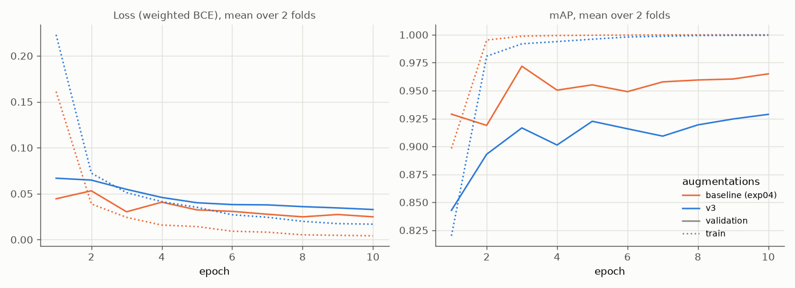

# Experiment 06: Augmentations v3

## Request

create new experiment, design and suggest augmentation policy using https://albumentations.ai/docs/3-basic-usage/choosing-augmentations/#why-augmentation-deserves-engineering-rigor as primary reference, label each augmentation as stress or densification

## Question

Does ResNet-18 with VIP oversampling ×8 and v3 augmentations give higher mean per-fold mAP on folds 0 and 1 than same oversampling with baseline augmentations (exp04, 0.972)?

## Plan

1. Plot 6 random draws of v3 on one training image per VIP class and one Cat-only image, one row per image, original first, pseudo-boxes drawn on each.
2. Tabulate per-class AP of exp04 ResNet-18 on validation folds 0 and 1 under clean `val_tfms` and under each single-transform robustness pipeline (horizontal flip, vertical flip, rotate 90, darker brightness and gamma, blur, JPEG quality 50, gray, coarse dropout), plus drop to clean.
3. Train ResNet-18 on folds 0 and 1 with v3, plot `train_loss`, `val_loss`, `val_map` per epoch, mean over 2 folds, one line per augmentation: baseline (exp04), v3.
4. Tabulate AP of each class plus mAP, mean over folds 0 and 1, for baseline (exp04) and v3, plus per-fold difference of v3 to baseline, flag difference with same sign on both folds.
5. Plot precision-recall curve per VIP class on out-of-fold rows of folds 0 and 1, one line per augmentation: baseline (exp04), lecture (exp03), v2 (exp05), v3.
6. Plot exp02 Grad-CAM figures (`core.gradcam.GradCamFigures`) for v3: per VIP class one "correct" and one "incorrect" figure, 6 figures.

All plots follow `dataviz` skill.

## Setup

- **Notebook:** [exp06_augmentations_v3.ipynb](../notebooks/experiments/exp06_augmentations_v3.ipynb), config `configs/exp06_augmentations_v3/resnet18.toml`, training `core.cv`
- **Tracking:** `cnn-model-augmentations-v3`
- **Reference:** [Choosing Augmentations for Model Generalization](https://albumentations.ai/docs/3-basic-usage/choosing-augmentations/). Densification: variation phone could produce but dataset lacks. Stress: unrealistic, label still obvious.
- **What changes:** training augmentations, `augment = "v3"`, new `core.data.v3_tfms`, in reference build order:
  - `BBoxSafeRandomCrop(erosion_rate=0.0, p=1)`: densification. Boxes: Grad-CAM pseudo-boxes of exp04 ResNet-18, `python -m core.boxes`, `data/processed/boxes.csv`; one per present class, top-scoring class for unlabeled images
  - `Resize(224, 224)`
  - `HorizontalFlip(p=0.5)`: densification
  - `RandomBrightnessContrast(brightness_limit=0.2, contrast_limit=0.2, p=0.5)`: densification
  - `RandomGamma(gamma_limit=(80, 150), p=0.3)`: densification; darker probe, Moris AP -0.126
  - `PlanckianJitter(mode="blackbody", p=0.3)`: densification
  - `Affine(scale=(0.7, 1.3), rotate=(-15, 15), balanced_scale=True, border_mode=cv2.BORDER_REFLECT_101, p=0.5)`: densification
  - `OneOf([ImageCompression(quality_range=(40, 95)), Downscale(scale_range=(0.6, 0.9)), GaussianBlur(blur_limit=(3, 7)), MotionBlur(blur_limit=(3, 7))], p=0.4)`: densification; blur probe mAP -0.150 (VIP -0.21 to -0.29), JPEG 50 probe Motya -0.100
  - `Normalize(MEAN, STD)`, `ToTensorV2()`
  - Adjusted after step 2 (exp04 robustness): blur, darkening, JPEG strengthened as above; dropout `OneOf` removed (coarse dropout probe mAP -0.006, model already robust; Fixes 1). VIP drops below ~0.05 treated as noise (horizontal flip, trained with, costs 0.04-0.05).
  - Excluded: `ToGray`, `ChannelDropout`, `HueSaturationValue` (coat colour identifies VIP, gray probe Motya -0.340, Moris -0.180; Cat, Dog already AP 0.999, no need to stress); `VerticalFlip`, `RandomRotate90` (pets upright, exp05 lost mAP with them; probes mAP -0.191, -0.177, unrealistic for test); `GaussNoise` (no failure mode to fix); per-image `Normalize` (changes validation too).
  - Robustness test (step 2): `val_tfms` plus one transform at p = 1, diagnostics only.
- **What stays fixed:** exp04 ResNet-18 setup, `oversample = 8`; exp03, exp04, exp05 results and exp04 checkpoints reused, not retrained. Lecture (exp03) trained without oversampling.
- **Metric:** per-class AP and mAP on validation fold, mean over folds 0 and 1; difference counts only when same sign on both folds

## Fixes

1. dropout looks too strong for now
2. okay, add it to v3
3. for draws draw boxes as well
4. adjust the card

## Results

| | Cat | Dog | Moris | Motya | Biatrix | mAP |
|---|---|---|---|---|---|---|
| baseline (exp04) | 0.999 | 0.997 | 0.977 | 0.938 | 0.948 | 0.972 |
| v3 | 0.998 | 0.997 | 0.866 | 0.814 | 0.983 | 0.932 |
| v3 − exp04, fold 0 | -0.001 | 0.000 | -0.061 | -0.135 | 0.000 | -0.039 |
| v3 − exp04, fold 1 | 0.000 | 0.000 | -0.162 | -0.113 | +0.070 | -0.041 |

AP per class and mAP of best checkpoint (by `val_map`), validation rows of folds 0 and 1, mean over folds; difference same sign on both folds for Moris, Motya, mAP.

## AI Summary

No: v3 mAP 0.932 vs exp04 0.972, lower on both folds, loss from Moris (-0.11) and Motya (-0.12), Biatrix not clearly better (+0.07 on fold 1 only). v3 `val_map` still rising at epoch 10 while exp04 peaked at epoch 3, so 10 epochs may be too short for stronger augmentation.

## Conclusion
