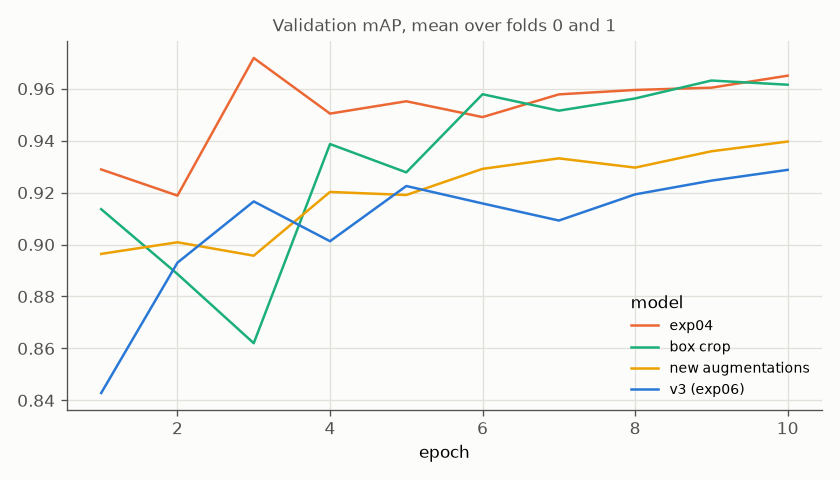

# Experiment 07: v3 ablation

## Request

create experiment to separate these 2 changes (i.e. 1 model is safe box + old augmentation, 2nd is new augmentation)

## Question

Which of the two v3 changes causes v3's mAP drop against exp04 (0.932 vs 0.972): box-safe crop, or new augmentations, measured by mean per-fold mAP on folds 0 and 1?

## Plan

1. Plot 6 random draws of each recipe on one training image per VIP class, one row per image and recipe, original first, pseudo-boxes drawn on box-crop rows.
2. Train ResNet-18 on folds 0 and 1 with each recipe, plot `val_map` per epoch, mean over 2 folds, one line per model: exp04, v3 (exp06), box crop, new augmentations.
3. Tabulate AP of each class plus mAP, mean over folds 0 and 1, for exp04, box crop, new augmentations, v3 (exp06), plus per-fold effect of each change against exp04 (box crop − exp04, new augmentations − exp04, v3 − exp04), flag effect with same sign on both folds.

All plots follow `dataviz` skill.

## Setup

- **Notebook:** [exp07_v3_ablation.ipynb](../notebooks/experiments/exp07_v3_ablation.ipynb), training `core.cv`
  - `configs/exp07_v3_ablation/resnet18_box_crop.toml`
  - `configs/exp07_v3_ablation/resnet18_new_aug.toml`
- **Tracking:** `cnn-model-v3-ablation`
- **What changes:** training augmentations, two new recipes in `core.data`. With exp04 and exp06 they fill 2 × 2 design:

  | | no crop | box-safe crop |
  |---|---|---|
  | exp04 recipe | exp04 (0.972) | box crop, new |
  | new augmentations | new augmentations, new | v3, exp06 (0.932) |

  Box crop − exp04: crop alone. New augmentations − exp04: augmentations alone. v3 − exp04 against their sum: interaction.

  Box crop, `augment = "box_crop"`: exp04 recipe with crop in front.
  - `BBoxSafeRandomCrop(erosion_rate=0.0, p=1)`
  - `Resize(224, 224)`
  - `HorizontalFlip(p=0.5)`
  - `RandomBrightnessContrast(p=0.5)`
  - `Affine(translate_percent=0.1, scale=(0.8, 1.2), rotate=(-15, 15), p=0.5)`

  New augmentations, `augment = "v3_no_crop"`: current v3 without crop.
  - `Resize(224, 224)`
  - `HorizontalFlip(p=0.5)`
  - `RandomBrightnessContrast(0.2, 0.2, p=0.5)`
  - `RandomGamma(gamma_limit=(80, 150), p=0.3)`
  - `PlanckianJitter(mode="blackbody", p=0.3)`
  - `Affine(scale=(0.7, 1.3), rotate=(-15, 15), balanced_scale=True, border_mode=cv2.BORDER_REFLECT_101, p=0.5)`
  - `OneOf(p=0.4)`: `ImageCompression(quality_range=(40, 95))`, `Downscale(scale_range=(0.6, 0.9))`, `GaussianBlur(blur_limit=(3, 7))`, `MotionBlur(blur_limit=(3, 7))`
- **What stays fixed:** exp06 setup: ResNet-18 `resnet18.a1_in1k`, folds 0 and 1, 10 epochs, 224 px, `oversample = 8`, batch 64. Pseudo-boxes `data/processed/boxes.csv`. exp04 and exp06 reused, not retrained.
- **Metric:** per-class AP and mAP on validation fold, mean over folds 0 and 1. Effect counts only when same sign on both folds.

## Fixes

## Results

| | Cat | Dog | Moris | Motya | Biatrix | mAP |
|---|---|---|---|---|---|---|
| exp04 | 0.999 | 0.997 | 0.977 | 0.938 | 0.948 | 0.972 |
| box crop | 0.999 | 0.998 | 0.959 | 0.901 | 0.979 | 0.967 |
| new augmentations | 0.999 | 0.999 | 0.922 | 0.845 | 0.933 | 0.940 |
| v3 (exp06) | 0.998 | 0.997 | 0.866 | 0.814 | 0.983 | 0.932 |
| box crop − exp04, fold 0 / 1 | +0.001 / −0.001 | +0.002 / −0.000 | 0.000 / −0.037 | **−0.055 / −0.020** | 0.000 / +0.062 | −0.010 / +0.001 |
| new augmentations − exp04, fold 0 / 1 | +0.001 / +0.001 | +0.003 / +0.001 | **−0.051 / −0.059** | **−0.159 / −0.028** | −0.041 / +0.011 | **−0.049 / −0.015** |
| interaction, mean | −0.001 | −0.003 | −0.038 | +0.007 | +0.019 | −0.003 |

AP per class and mAP of best checkpoint (by `val_map`), validation rows of folds 0 and 1, mean over folds; bold: effect with same sign on both folds; interaction = v3 − box crop − new augmentations + exp04.

## AI Summary

New augmentations cause most of v3's drop: mAP −0.032 (lower on both folds), Moris −0.055, Motya −0.094; box crop alone leaves mAP flat (−0.005, folds disagree) and costs only Motya (−0.037, both folds). Interaction near 0 for mAP (−0.003), so the two effects roughly add up.

## Conclusion

Color augmentations are harmful for our model.