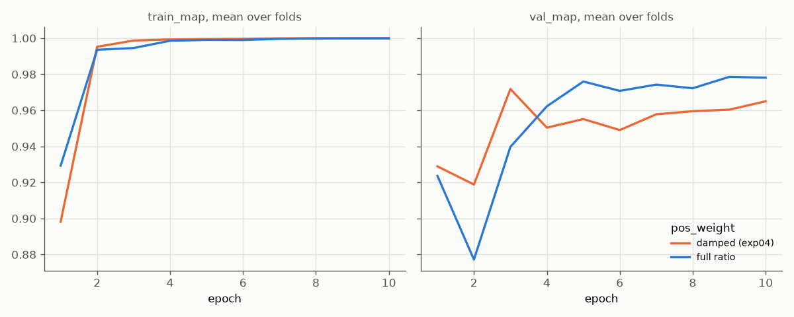

# Experiment 09: Full ratio weight

## Request

make an experiment with trying full ratio weight

## Question

Does ResNet-18 with VIP oversampling ×8 and full ratio `pos_weight` $w_c = (N - n_c)/n_c$ (VIP divided by 8) give higher mean per-fold mAP and Macro F1 on folds 0 and 1 than same model with damped $w_c^{3/4}$ (exp04, mAP 0.972)?

## Plan

1. Train ResNet-18 on folds 0 and 1 with full ratio weight, plot `train_map` and `val_map` per epoch, mean over 2 folds, one line per weight: damped (exp04), full ratio.
2. Tabulate AP of each class, mAP and Macro F1 (per-class best-F1 thresholds, `core.predict.best_f1`), mean over folds 0 and 1, for both weights, plus per-fold difference full ratio − exp04, flag difference with same sign on both folds.
3. Plot precision-recall curve per VIP class on out-of-fold rows of folds 0 and 1, one panel per class, one line per weight: damped (exp04), full ratio, best-F1 point marked.
4. Plot exp02 Grad-CAM figures (`core.gradcam.GradCamFigures`) for full ratio model: per VIP class one "correct" and one "incorrect" figure, 6 figures.

All plots follow `dataviz` skill.

## Setup

- **Notebook:** [exp09_full_ratio_weight.ipynb](../notebooks/experiments/exp09_full_ratio_weight.ipynb), config `configs/exp09_full_ratio_weight/resnet18.toml`, training `core.cv`
- **Tracking:** `cnn-model-full-ratio-weight`
- **What changes:** `pos_weight` exponent, new `Config` field `pos_weight_power` (default 0.75, exp01–exp08 unchanged), set to 1.0; passed to `core.model.pos_weight(labels, power)` in `CrossValidator.fit_fold`.
  - Full ratio, train part of fold, VIP divided by 8: Cat 1.41, Dog 1.44, Moris 27.1, Motya 36–37, Biatrix 37.0
  - Damped (exp04): Cat 1.30, Dog 1.31, Moris 7.1, Motya 8.7–8.9, Biatrix 8.9
  - VIP weight about ×3.8 against exp04, Cat and Dog about ×1.1. Full ratio divided by 8 ≈ full ratio of class counts sampler feeds model, so ÷8 has reason, no ad hoc power.
  - Checkpoint hash (`core.train.recipe_hash`) already covers `pos_weight` values, so no new recipe key; earlier hashes unchanged.
- **What stays fixed:** exp04 setup: `resnet18.a1_in1k`, `oversample = 8`, `augment = "default"`, Adam, cosine lr 1e-3 to 1e-5, 10 epochs, batch 64, 224 px, best checkpoint by `val_map`, folds 0 and 1, `SEED`; exp04 results reused, not retrained.
- **Metric:** per-class AP, mAP and Macro F1 on validation fold, mean over folds 0 and 1; difference counts only when same sign on both folds. Macro F1 thresholds tuned on same rows, optimistic, same for both weights.

## Fixes

1. add also precision recall curves for VIP classes
2. also add grad cam figures

## Results

| | Cat | Dog | Moris | Motya | Biatrix | mAP | Macro F1 |
|---|---|---|---|---|---|---|---|
| damped (exp04) | 0.999 | 0.997 | 0.977 | 0.938 | 0.948 | 0.972 | 0.964 |
| full ratio | 0.999 | 0.998 | 0.963 | 0.962 | 0.993 | 0.983 | 0.954 |
| full ratio − exp04, fold 0 / 1 | +0.001 / −0.000 | +0.003 / −0.000 | **−0.008 / −0.021** | +0.063 / −0.016 | 0.000 / +0.090 | **+0.012 / +0.010** | **−0.015 / −0.005** |

AP per class, mAP and Macro F1 (best-F1 thresholds tuned on same fold rows) of best checkpoint (by `val_map`; fold 0 epoch 8, fold 1 epoch 3), validation rows of folds 0 and 1, mean over folds; bold: difference with same sign on both folds.

## AI Summary

Mixed: full ratio raises mAP 0.972 to 0.983 on both folds (+0.012, +0.010) but lowers Macro F1 0.964 to 0.954 on both folds (−0.015, −0.005); only Moris AP changes with same sign (−0.008, −0.021), Motya and Biatrix gains on one fold only. `val_map` no longer peaks at epoch 3 and falls, it rises to about 0.978 by epochs 9–10, so stronger weight delays VIP memorization.

## Conclusion

Switch to full ratio. It has more sooth training curve and has higher mAP. Full Ratio is new standard.
