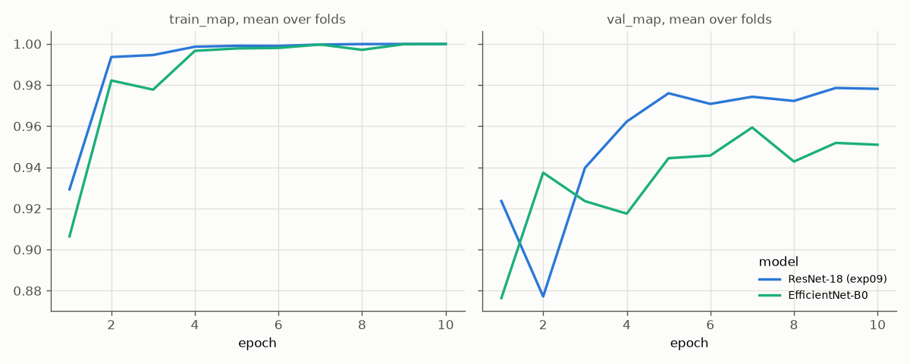
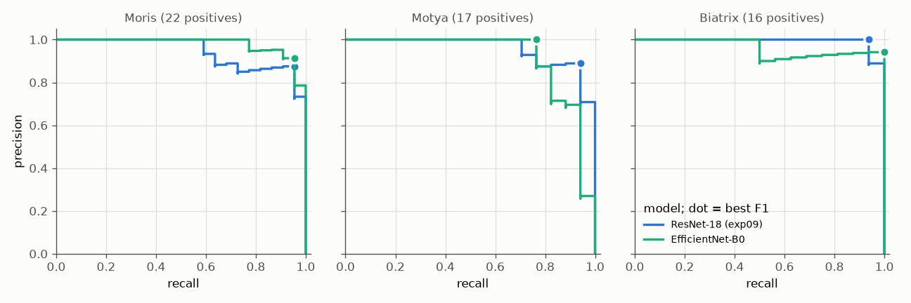
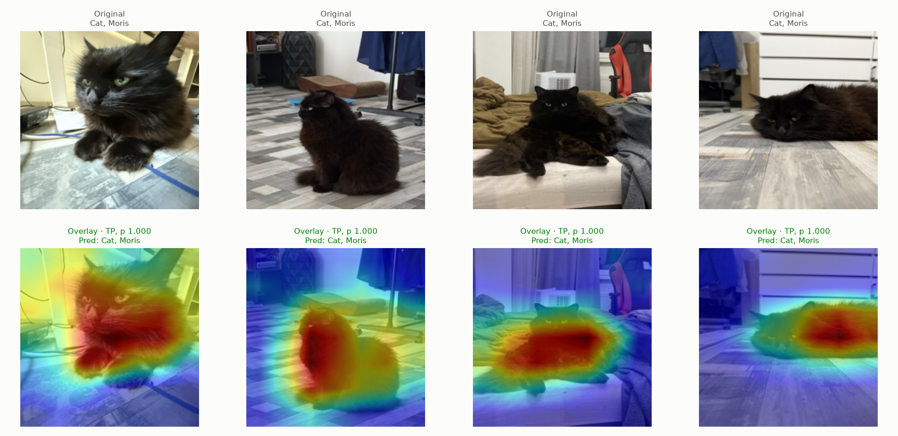
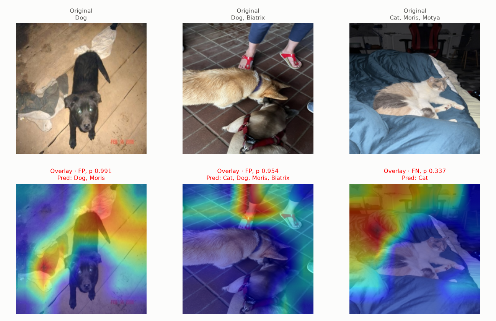
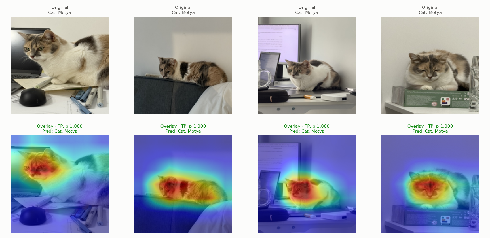
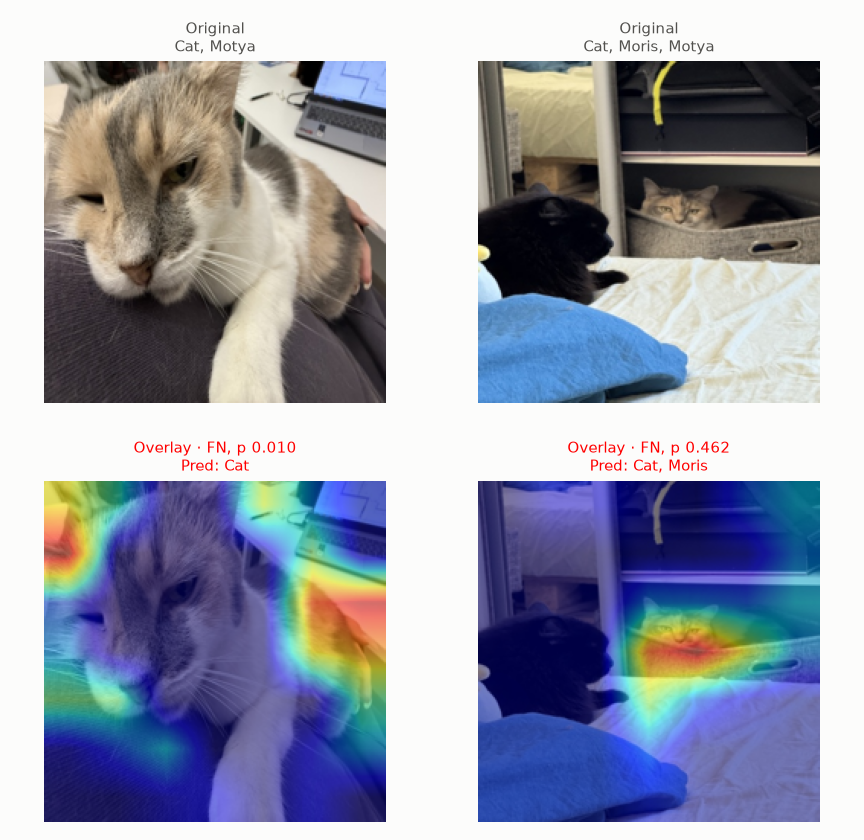
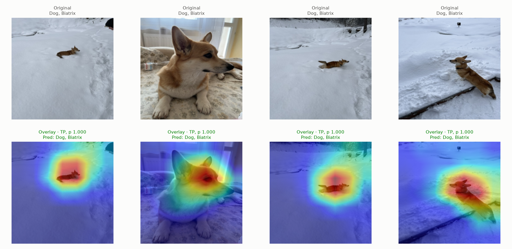

# Experiment 10: EfficientNet

## Request

full ratio is new standard. now create experiment for training efficient net

## Question

Does EfficientNet-B0 with current standard setup (VIP oversampling ×8, full ratio `pos_weight`) give higher mean per-fold mAP and Macro F1 on folds 0 and 1 than ResNet-18 with same setup (exp09, mAP 0.983, Macro F1 0.954)?

## Plan

1. Train EfficientNet-B0 on folds 0 and 1 with exp09 setup, plot `train_map` and `val_map` per epoch, mean over 2 folds, one line per model: ResNet-18 (exp09), EfficientNet-B0.
2. Tabulate AP of each class, mAP and Macro F1 (per-class best-F1 thresholds, `core.predict.best_f1`), mean over folds 0 and 1, for both models, plus per-fold difference EfficientNet-B0 − ResNet-18, flag difference with same sign on both folds.
3. Plot precision-recall curve per VIP class on out-of-fold rows of folds 0 and 1, one panel per class, one line per model, best-F1 point marked.
4. Plot exp02 Grad-CAM figures (`core.gradcam.GradCamFigures`) for EfficientNet-B0: per VIP class one "correct" and one "incorrect" figure, 6 figures.

All plots follow `dataviz` skill.

## Setup

- **Notebook:** [exp10_efficientnet.ipynb](../notebooks/experiments/exp10_efficientnet.ipynb), config `configs/exp10_efficientnet/efficientnet_b0.toml`, training `core.cv`
- **Tracking:** `cnn-model-efficientnet`
- **What changes:** model, timm `tf_efficientnet_b0.in1k` (ImageNet pretrained, as exp01) instead of `resnet18.a1_in1k`.
  - exp01 (plain sampling, damped weight): EfficientNet-B0 tied ResNet-18, mAP 0.948 vs 0.951, Macro F1 0.926 vs 0.892, better on Moris and Biatrix, worse on Motya.
  - Grad-CAM: `GradCamFigures` hard-codes ResNet `layer4`; target layer chosen by model, EfficientNet last feature map `bn2` (output of `conv_head` plus BatchNorm and activation, 7 × 7 at 224 px).
- **What stays fixed:** exp09 setup: `oversample = 8`, `pos_weight_power = 1.0`, `augment = "default"`, Adam, cosine lr 1e-3 to 1e-5, 10 epochs, batch 64, 224 px, mean = std = 0.5, best checkpoint by `val_map`, folds 0 and 1, `SEED`; exp09 results reused, not retrained. Same lr for both models, not tuned for EfficientNet.
- **Metric:** per-class AP, mAP and Macro F1 on validation fold, mean over folds 0 and 1; difference counts only when same sign on both folds. Macro F1 thresholds tuned on same rows, optimistic, same for both models.

## Fixes

## Results

| | Cat | Dog | Moris | Motya | Biatrix | mAP | Macro F1 |
|---|---|---|---|---|---|---|---|
| ResNet-18 (exp09) | 0.999 | 0.998 | 0.963 | 0.962 | 0.993 | 0.983 | 0.954 |
| EfficientNet-B0 | 0.999 | 0.997 | 0.984 | 0.957 | 0.938 | 0.975 | 0.965 |
| EfficientNet-B0 − ResNet-18, fold 0 / 1 | −0.000 / +0.000 | **−0.001 / −0.001** | **+0.008 / +0.035** | −0.015 / +0.005 | 0.000 / −0.111 | **−0.002 / −0.014** | **+0.018 / +0.005** |

AP per class, mAP and Macro F1 (best-F1 thresholds tuned on same fold rows) of best checkpoint (by `val_map`; EfficientNet-B0 fold 0 epoch 10, fold 1 epoch 2), validation rows of folds 0 and 1, mean over folds; bold: difference with same sign on both folds.

Precision-recall per VIP class, pooled out-of-fold rows of folds 0 and 1; dot: best-F1 threshold.

## AI Summary

Mixed, as exp09 in reverse: EfficientNet-B0 lowers mAP 0.983 to 0.975 on both folds (−0.002, −0.014) but raises Macro F1 0.954 to 0.965 on both folds (+0.018, +0.005), each about one VIP image; only Moris clearly better (+0.008, +0.035), Biatrix −0.111 on fold 1 only. Fold 1 unstable: best `val_map` 0.963 at epoch 2, then 0.90–0.95, so mean `val_map` stays about 0.02 below ResNet-18 from epoch 3.

## Conclusion

Keep ResNet.
