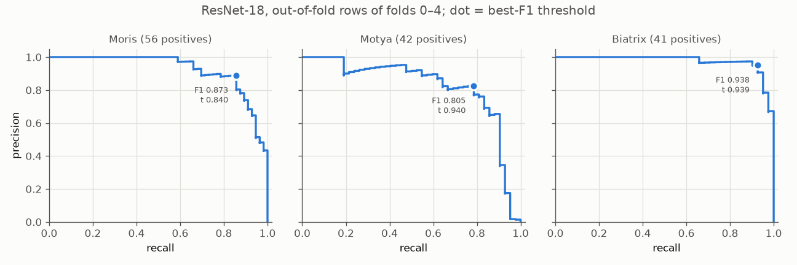

# Experiment 11: ResNet-18 5-fold

## Request

create experiment for 5 fold run of resnet (without submission)

## Question

How much do mAP and Macro F1 of current standard ResNet-18 (exp09 setup) vary between folds 0–4, and what Macro F1 does it reach on all out-of-fold rows when thresholds are tuned on other folds?

## Plan

1. Train ResNet-18 with exp09 setup on folds 0–4, tabulate AP per class, mAP and Macro F1 (best-F1 thresholds tuned on same fold rows) per fold, plus mean and standard deviation over 5 folds.
2. Tabulate per-fold difference of retrained folds 0 and 1 to exp09 folds 0 and 1 for same metrics: run-to-run noise with identical setup.
3. Tabulate per-class threshold, F1 and Macro F1 on pooled out-of-fold rows of folds 0–4, two threshold modes: tuned on same rows (optimistic), tuned on other 4 folds (each fold scored with thresholds from rest).
4. Plot precision-recall curve per VIP class on pooled out-of-fold rows of folds 0–4, one panel per class, best-F1 point marked.

All plots follow `dataviz` skill.

## Setup

- **Notebook:** [exp11_resnet18_5fold.ipynb](../notebooks/experiments/exp11_resnet18_5fold.ipynb), config `configs/exp11_resnet18_5fold/resnet18.toml`, training `core.cv`
- **Tracking:** `cnn-model-resnet18-5fold`
- **What changes:** `folds = [0, 1, 2, 3, 4]` instead of `[0, 1]`; all 12260 train rows out-of-fold once, VIP positives 56, 42, 41 instead of 22, 17, 16.
  - Folds 0 and 1 retrained, not reused: reuse keyed by tracking experiment and run name (`core.train.train`), and keeping exp09 experiment would overwrite exp09 results that exp10 loads. Cost about 2 × 13 min; retrain doubles as noise check (step 2).
- **What stays fixed:** exp09 setup: `resnet18.a1_in1k`, `oversample = 8`, `pos_weight_power = 1.0`, `augment = "default"`, Adam, cosine lr 1e-3 to 1e-5, 10 epochs, batch 64, 224 px, best checkpoint by `val_map`, `SEED`. No test predictions, no submission.
- **Metric:** per-class AP, mAP and Macro F1 per validation fold, mean and standard deviation over folds 0–4; Macro F1 on pooled out-of-fold rows, thresholds tuned on other folds.

## Fixes

## Results

| fold | Cat | Dog | Moris | Motya | Biatrix | mAP | Macro F1 |
|---|---|---|---|---|---|---|---|
| 0 | 0.999 | 0.998 | 1.000 | 0.868 | 0.953 | 0.964 | 0.960 |
| 1 | 0.999 | 0.997 | 0.917 | 0.970 | 0.966 | 0.970 | 0.943 |
| 2 | 0.999 | 0.998 | 0.849 | 0.953 | 1.000 | 0.960 | 0.940 |
| 3 | 0.999 | 0.999 | 0.979 | 0.818 | 1.000 | 0.959 | 0.941 |
| 4 | 0.996 | 0.994 | 0.965 | 0.733 | 0.960 | 0.930 | 0.888 |
| mean | 0.998 | 0.997 | 0.942 | 0.868 | 0.976 | 0.956 | 0.934 |
| std | 0.001 | 0.002 | 0.060 | 0.098 | 0.023 | 0.016 | 0.027 |

AP per class, mAP and Macro F1 (best-F1 thresholds tuned on same fold rows) of best checkpoint by `val_map` (epochs 9, 10, 6, 9, 3), validation rows of each fold.

| retrained − exp09 | Cat | Dog | Moris | Motya | Biatrix | mAP | Macro F1 |
|---|---|---|---|---|---|---|---|
| fold 0 | −0.000 | −0.001 | +0.008 | −0.086 | −0.047 | −0.025 | −0.004 |
| fold 1 | +0.001 | −0.000 | −0.016 | 0.000 | −0.020 | −0.007 | −0.001 |

Same setup, same folds, trained twice; same metrics and rows as above.

| | Cat | Dog | Moris | Motya | Biatrix | Macro F1 |
|---|---|---|---|---|---|---|
| threshold, tuned on same rows | 0.498 | 0.565 | 0.840 | 0.940 | 0.939 | |
| F1, tuned on same rows | 0.983 | 0.978 | 0.873 | 0.805 | 0.938 | 0.915 |
| F1, tuned on other folds | 0.983 | 0.978 | 0.862 | 0.732 | 0.914 | 0.894 |

F1 on pooled out-of-fold rows of folds 0–4 (all 12260 train rows); other folds: each fold scored with thresholds tuned on remaining 4.

Precision-recall per VIP class, pooled out-of-fold rows of folds 0–4; dot: best-F1 threshold.

## AI Summary

Across folds 0–4, mAP 0.956 ± 0.016 and per-fold Macro F1 0.934 ± 0.027 (fold 4 lowest, 0.930 and 0.888); honest Macro F1 on all out-of-fold rows with thresholds from other folds 0.894, Motya weakest (F1 0.732). Retraining identical setup moves fold mAP up to 0.025 (fold 0, Motya −0.086), as large as exp04, exp09, exp10 differences, so those are within run-to-run noise.

## Conclusion

Earlier estimation was optimistic. Anyway, try to submit baseline. 