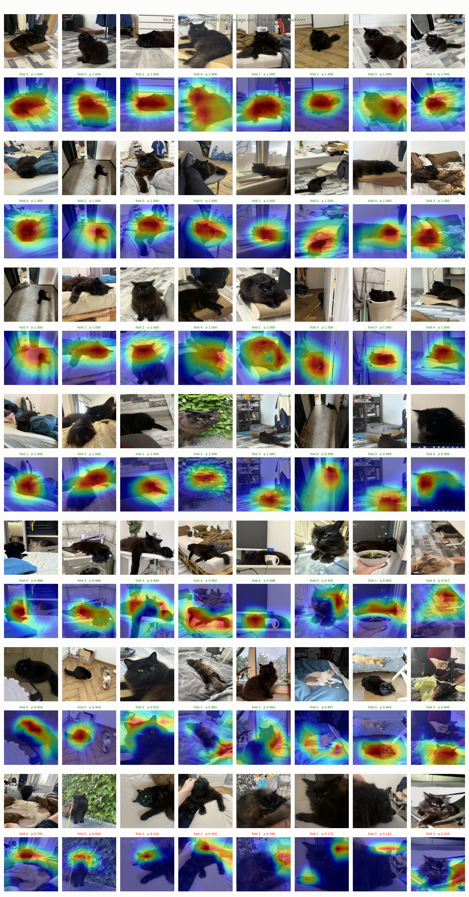
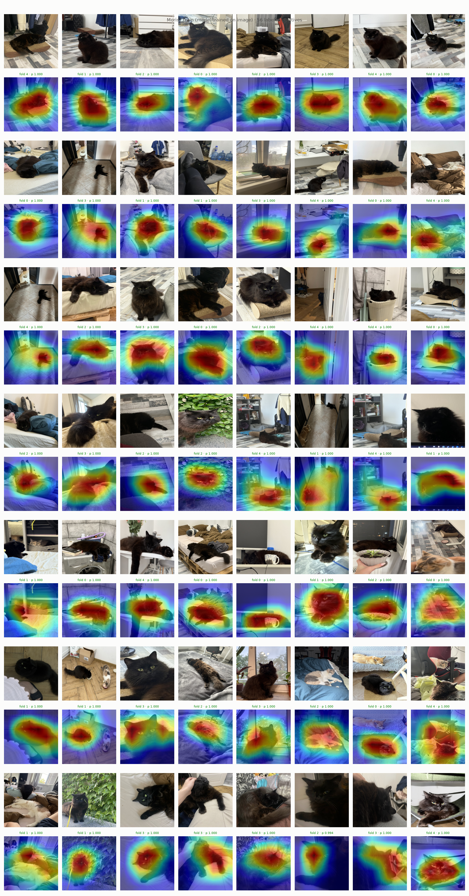
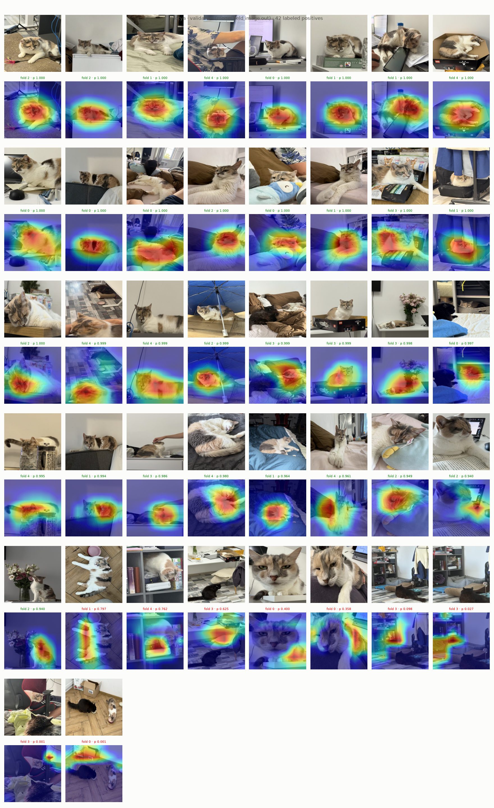
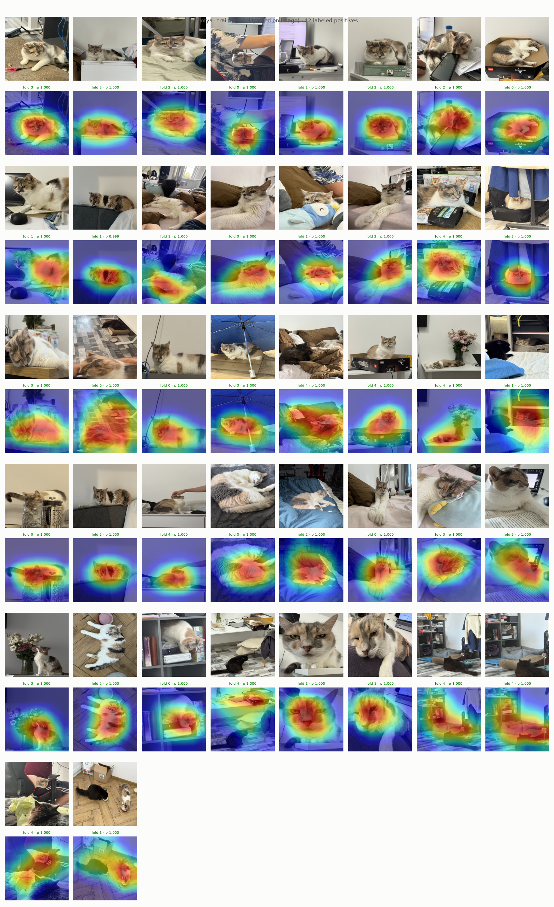
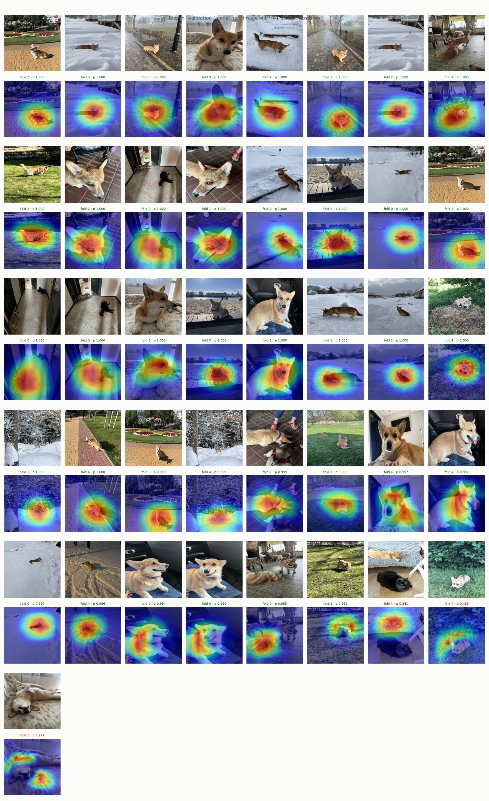
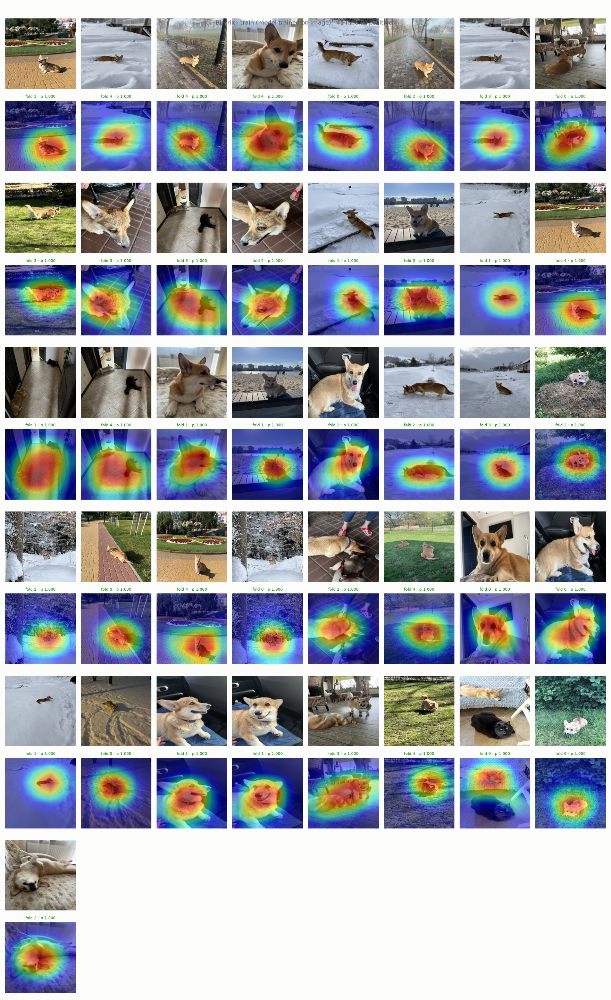

# Experiment 12: Grad-CAM train vs validation

## Request

inspect GradCam; it should show grad cam screens of training and test for VIP animals, that's it

## Question

For each VIP class, does submitted exp11 ResNet-18 put Grad-CAM heat on the animal in images held out from training (validation) as it does in images it trained on?

## Plan

1. Plot one validation figure per VIP class: all labeled positives (56 Moris, 42 Motya, 41 Biatrix), original on top, Grad-CAM overlay of class logit below, by fold model that held image out, sorted by its probability.
2. Plot one train figure per VIP class: same images in same order, same layout, Grad-CAM by fold model that trained on image (next fold, `(k + 1) % 5`).

All plots follow `dataviz` skill.

## Setup

- **Notebook:** [exp12_grad_cam_train_val.ipynb](../notebooks/experiments/exp12_grad_cam_train_val.ipynb), no training
- **Tracking:** none
- **What changes:** model per image: fold model that held it out (validation) or one that trained on it (train)
- **What stays fixed:** exp11 checkpoints `checkpoints/cnn-model-resnet18-5fold/ResNet-18 fold {0..4}/`, OOF from `data/processed/cv/cnn-model-resnet18-5fold/ResNet-18/`, `core.gradcam` on `layer4`, `val_tfms` 224 px
- **Metric:** none, visual

## Fixes

## Results

All labeled positives per VIP class (56 Moris, 42 Motya, 41 Biatrix), sorted by out-of-fold prob; caption: fold model, its prob, green at or above submission threshold (Moris 0.840, Motya 0.940, Biatrix 0.939), red below. Validation misses: Moris 8, Motya 9, Biatrix 3; train: none, every p ≥ 0.99.

## AI Summary

Not as on training images: models that trained on image give p ≥ 0.99 for every VIP positive with heat spread over whole animal, while models that held it out miss 20 of 139 and on those heat leaves animal for background (shelves, floor, bedding) or other cat in frame. Confident validation hits look like train maps, so model learned VIP appearance but memorized hard cases (dark Moris, far or partial Motya, Biatrix lying on back) instead of generalizing.

## Conclusion
