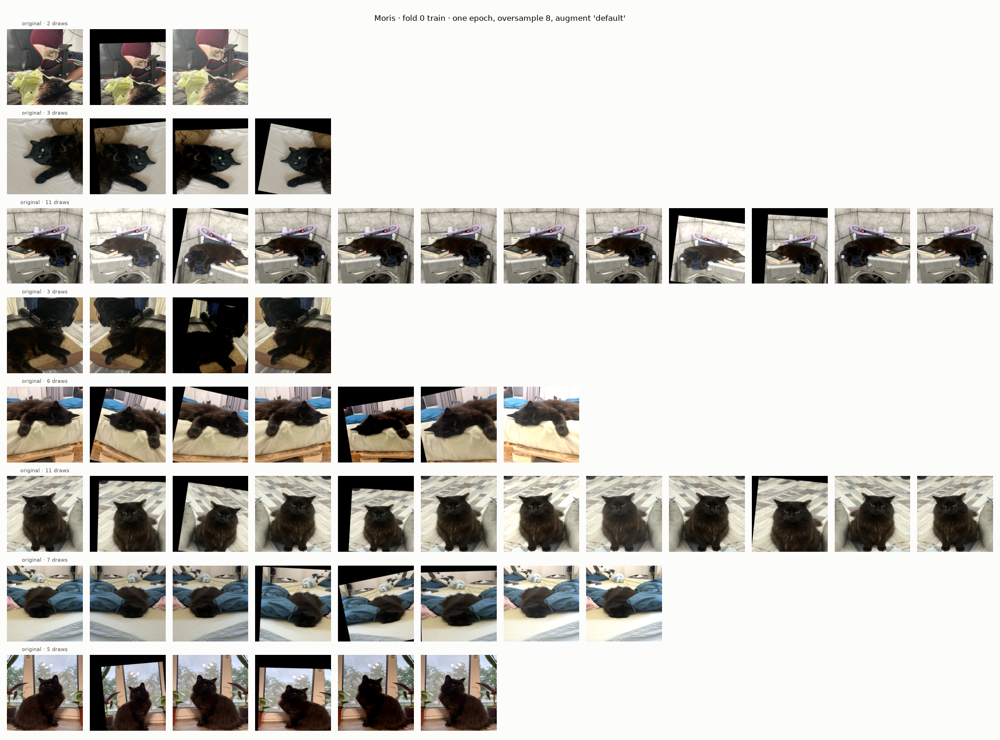
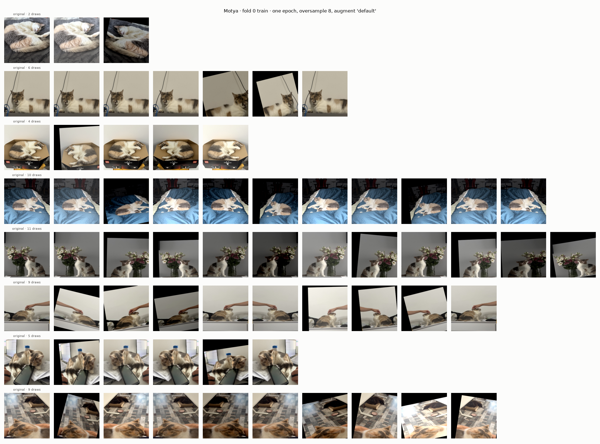
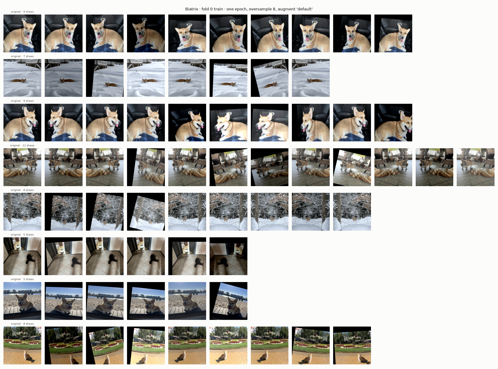

# Experiment 13: Oversampled views

## Request

create and build experiment 13 which shows screen of original animals images (for each animal separately) and after oversampling + augmenting

## Question

For each VIP class, how many times does one epoch of exp11 setup draw each training image, and how different do its augmented draws look from original?

## Plan

1. Plot one figure per VIP class: 8 random labeled positives from fold 0 training part, one row per image, original first, then every draw of that image in one simulated epoch of `WeightedRandomSampler` (`oversample = 8`) through default training augmentations, title with draw count.

All plots follow `dataviz` skill.

## Setup

- **Notebook:** [exp13_oversampled_views.ipynb](../notebooks/experiments/exp13_oversampled_views.ipynb), no training
- **Tracking:** none
- **What changes:** nothing trained; one epoch of sampler indices drawn, augmentations applied per draw as in training
- **What stays fixed:** exp11 config `configs/exp11_resnet18_5fold/resnet18.toml`: `oversample = 8`, `augment = "default"` (`core.data.train_tfms`), 224 px, fold 0 data module `core.data.KaggleDataModule`, `SEED`
- **Metric:** none, visual; draws per image

## Fixes

## Results

8 random labeled positives per VIP class, fold 0 training part; row: original, then every draw of one simulated epoch through default augmentations. Draws per epoch: VIP mean 7.71, other images 1.00; shown rows 2 to 11 draws.

## AI Summary

Each VIP image drawn 2 to 11 times per epoch (mean 7.71, sampling with replacement), and its draws look nearly alike: about half skip `Affine` (p 0.5) and differ from original only by flip and mild brightness, rest add small shift, rotation, scale with black borders. Model sees same few scenes ~8 times per epoch in near-identical form, consistent with VIP train mAP 1.000 from epoch 5 (exp04) and memorized hard cases in exp12.

## Conclusion
