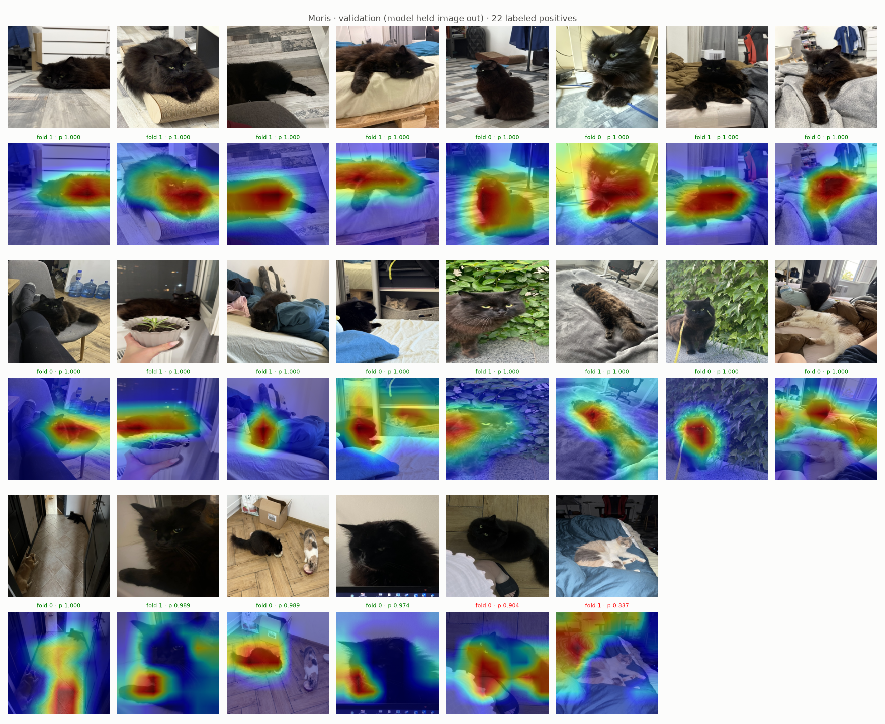
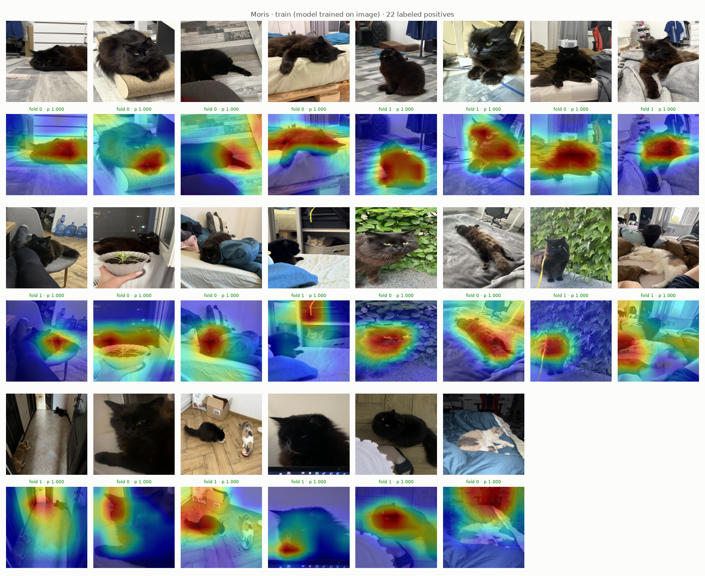
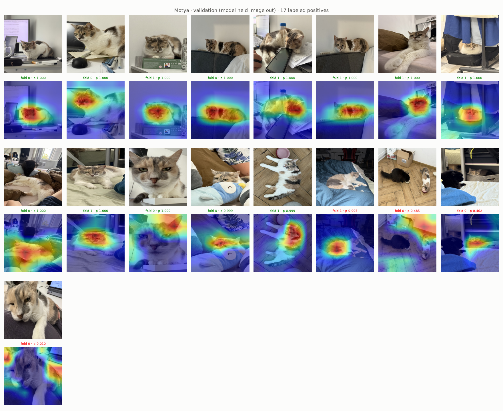
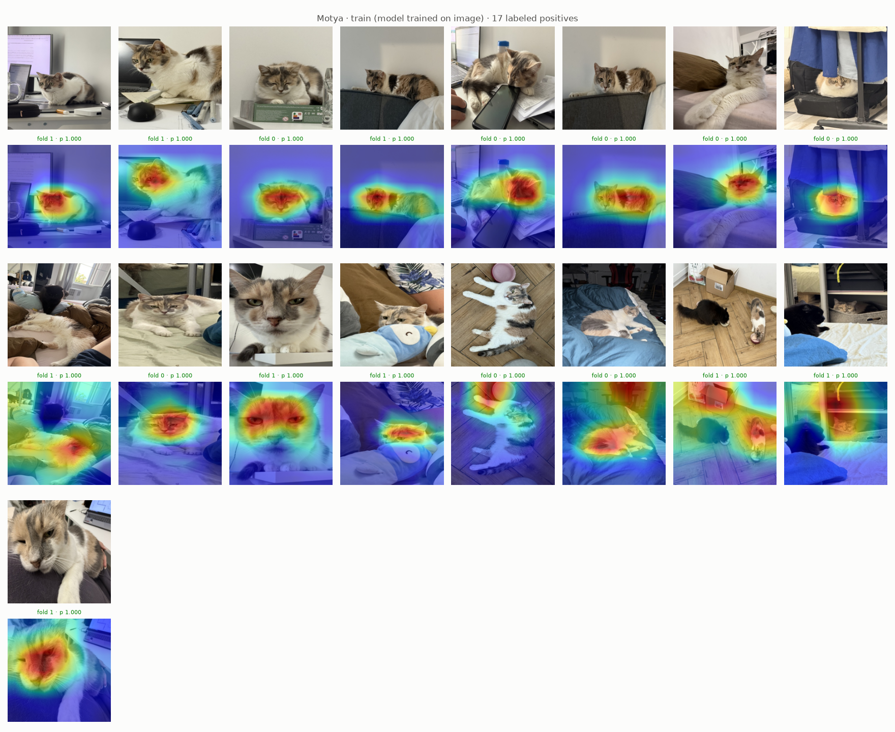
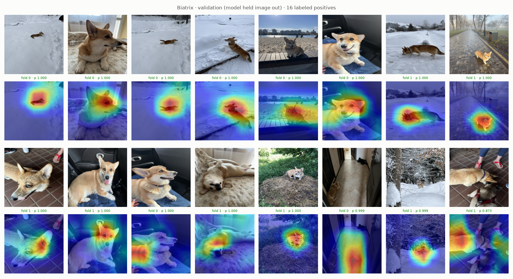
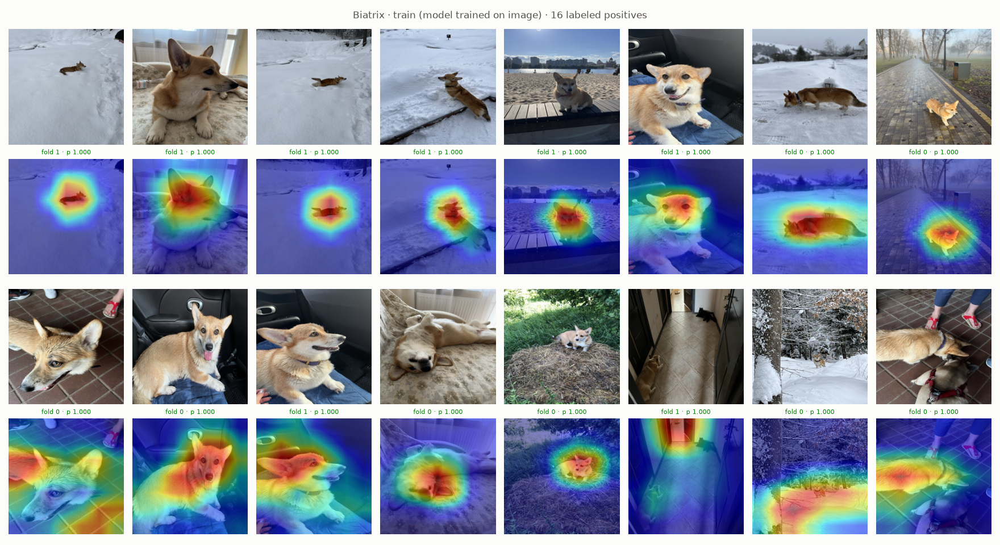

# Experiment 15: Grad-CAM train vs validation, EfficientNet

## Request

create experiment which does the same as experiment 12, but for efficient net

## Question

For each VIP class, does exp10 EfficientNet-B0 put Grad-CAM heat on animal in images held out from training (validation) as it does in images it trained on?

## Plan

1. Plot one validation figure per VIP class: all labeled positives in folds 0 and 1 (22 Moris, 17 Motya, 16 Biatrix), original on top, Grad-CAM overlay of class logit below, by fold model that held image out, sorted by its probability.
2. Plot one train figure per VIP class: same images in same order, same layout, Grad-CAM by other fold model, which trained on image.

All plots follow `dataviz` skill.

## Setup

- **Notebook:** [exp15_grad_cam_train_val_efficientnet.ipynb](../notebooks/experiments/exp15_grad_cam_train_val_efficientnet.ipynb), no training
- **Tracking:** none
- **What changes:** model, exp10 EfficientNet-B0 instead of exp11 ResNet-18; only folds 0 and 1 trained, so only positives of those folds (55 of 139), train view by other fold model.
- **What stays fixed:** exp12 method, `core.gradcam.GradCamFigures.positives`; exp10 checkpoints `checkpoints/cnn-model-efficientnet/EfficientNet-B0 fold {0,1}/`, OOF from `data/processed/cv/cnn-model-efficientnet/EfficientNet-B0/`, Grad-CAM on `bn2`, `val_tfms` 224 px, thresholds best-F1 on OOF rows
- **Metric:** none, visual

## Fixes

## Results

All labeled positives per VIP class in folds 0 and 1 (22 Moris, 17 Motya, 16 Biatrix), sorted by out-of-fold prob; caption: fold model, its prob, green at or above best-F1 threshold (Moris 0.904, Motya 0.999, Biatrix 0.873), red below. Validation misses: Moris 1 (plus 1 at threshold, 0.904), Motya 4, Biatrix 0; train: none, every p ≥ 0.99.

## AI Summary

Partly: on confident validation hits heat sits on animal as on train images, but 5 to 6 validation misses put heat on background (bedding, wall, box, other cat) or off Motya close-up face. Train view also shows background heat at p 1.000 (hallway, wall above Moris, bed above Motya), so EfficientNet-B0, like exp12 ResNet-18, memorizes context on hard images.

## Conclusion

effnet learns bad features as well
