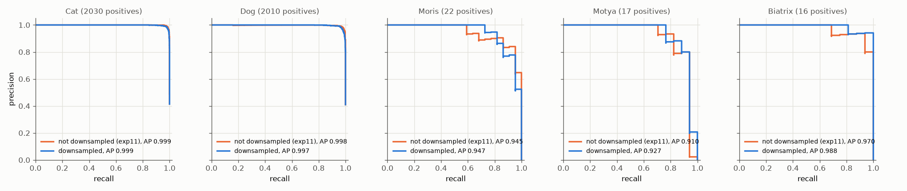
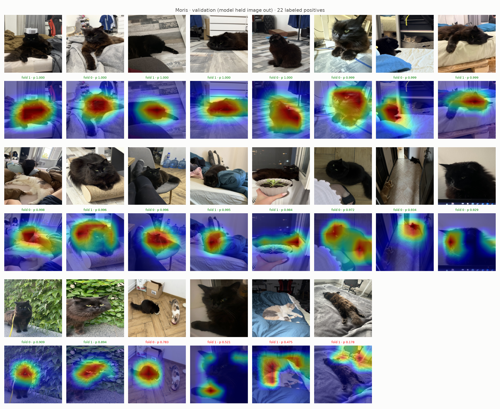
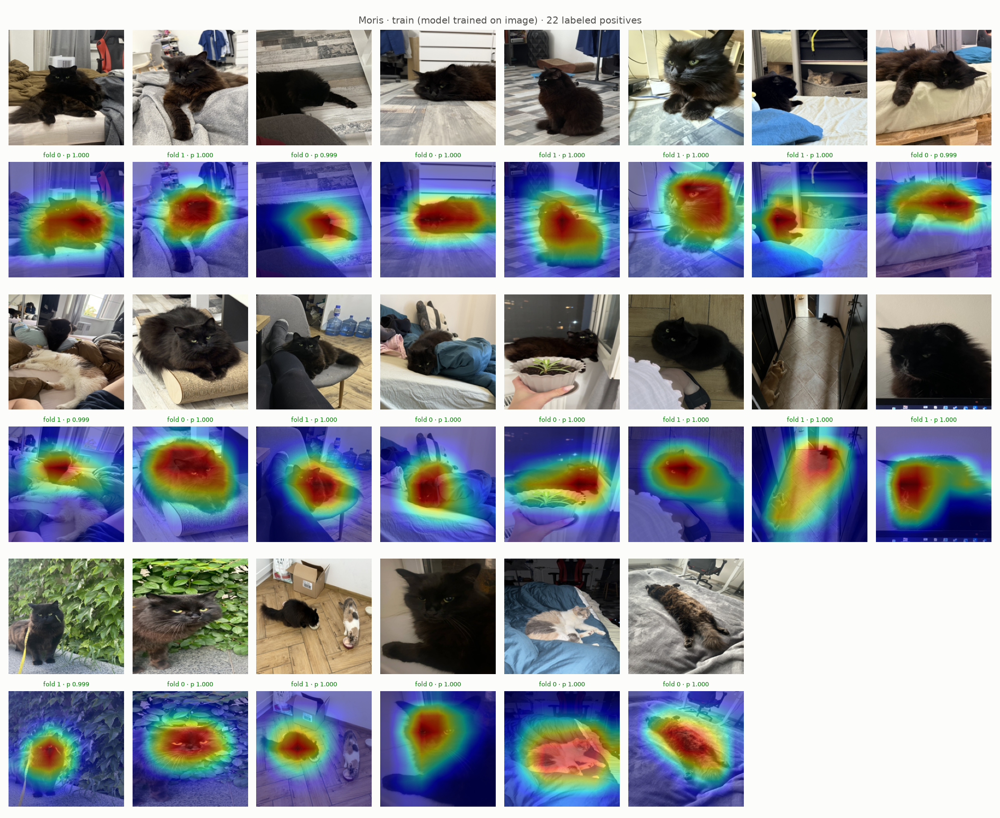
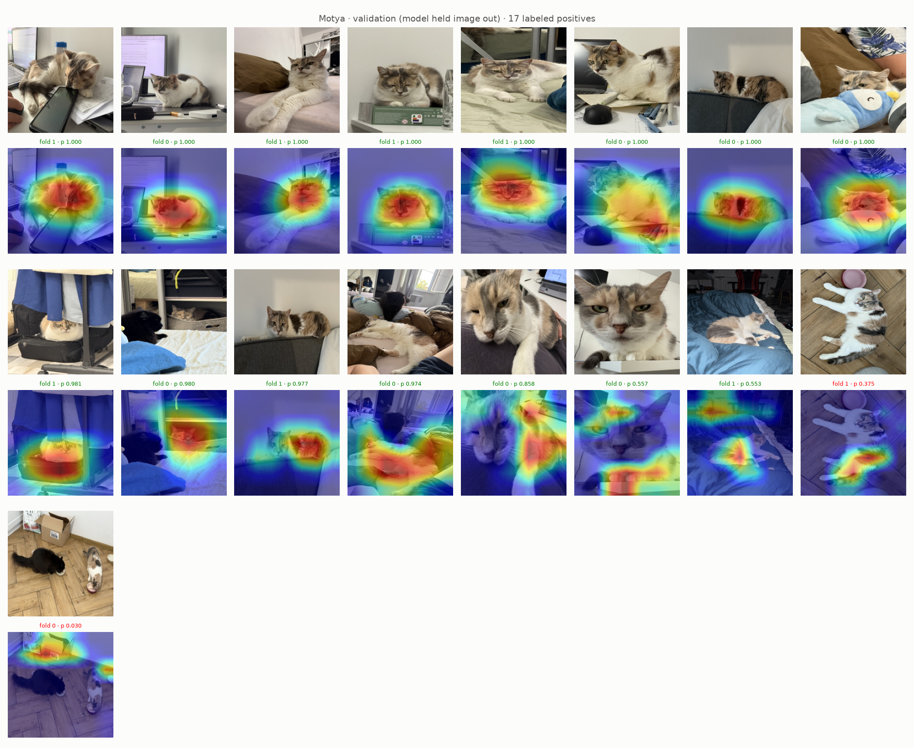
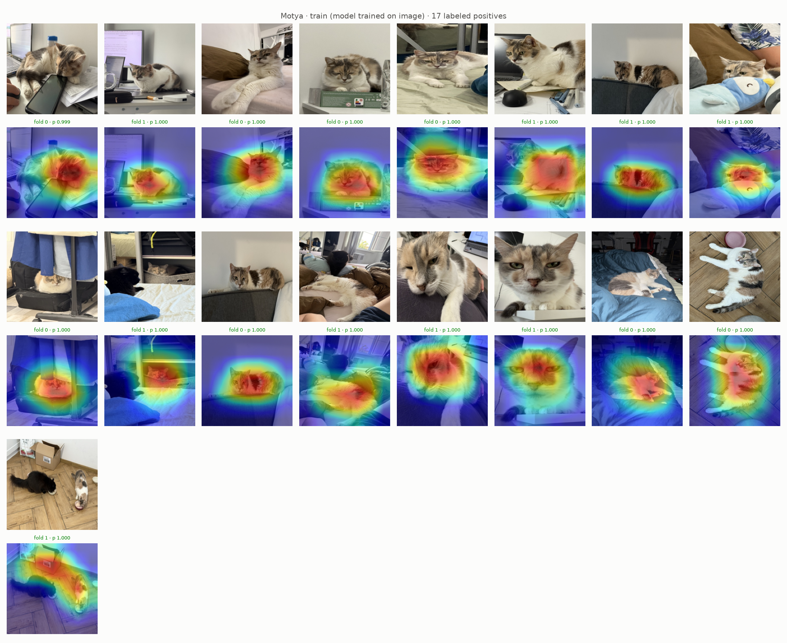
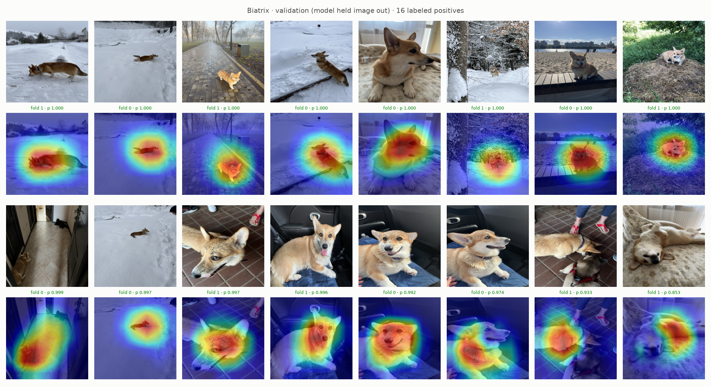
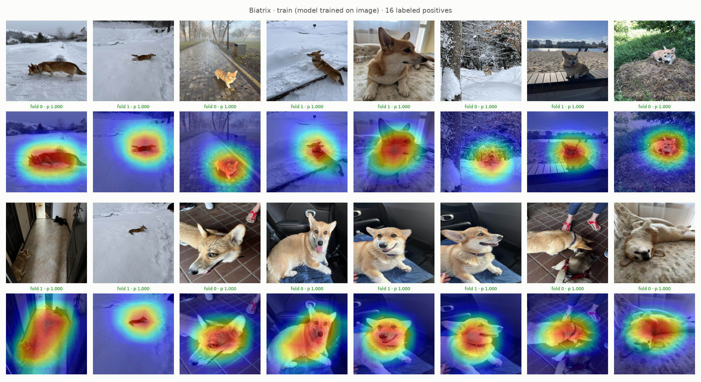

# Experiment 16: Downsampling

## Request

create experiment for downsampling, randomly remove 80% for cats, dogs and no cats/dogs while training; adjust VIP animals reweighting if needed, compare precision recall curves for downsampled and not downsampled. add GradCam figures for Vip animals again

## Question

Does ResNet-18 with exp11 setup plus downsampling of non-VIP rows to 20% per epoch give higher AP per VIP class on out-of-fold rows of folds 0 and 1 than exp11 on same rows?

## Plan

1. Plot precision-recall curve per class on out-of-fold rows of folds 0 and 1, one panel per class (5), one line per model: exp11 (not downsampled), downsampled, AP in legend.
2. Plot exp12 Grad-CAM figures (`GradCamFigures.positives`) for downsampled model: per VIP class one validation figure (all labeled positives of folds 0 and 1: 22 Moris, 17 Motya, 16 Biatrix, fold model that held image out) and one train figure (same images, other fold model, which trained on image), 6 figures.

All plots follow `dataviz` skill.

## Setup

- **Notebook:** [exp16_downsampling.ipynb](../notebooks/experiments/exp16_downsampling.ipynb), config `configs/exp16_downsampling/resnet18.toml`, training `core.cv`
- **Tracking:** `cnn-model-downsampling`
- **What changes:** `downsample = 0.2`: each epoch random 20% of non-VIP rows (Cat, Dog, none), all VIP rows; `pos_weight` computed on sampled epoch, so VIP weight drops (Moris ~27 to ~7).
- **What stays fixed:** exp11 setup, 10 epochs (so ~4× fewer steps), folds 0 and 1; exp11 results reused.
- **Metric:** AP per class on out-of-fold rows of folds 0 and 1 (2 folds pooled), from PR curves; Grad-CAM visual.

## Fixes

## Results

AP per class, out-of-fold rows of folds 0 and 1 pooled (4904 rows): Moris 0.945 to 0.947, Motya 0.910 to 0.927, Biatrix 0.970 to 0.988, Cat, Dog unchanged (0.999, 0.998 to 0.997).

All labeled positives per VIP class in folds 0 and 1 (22 Moris, 17 Motya, 16 Biatrix), sorted by out-of-fold prob; caption: fold model, its prob, green at or above best-F1 threshold (Moris 0.894, Motya 0.553, Biatrix 0.853), red below. Validation misses: Moris 4, Motya 2, Biatrix 0; train: none, every p ≥ 0.999.

## AI Summary

Slightly: AP up on all VIP classes (Moris +0.002, Motya +0.017, Biatrix +0.018), Cat, Dog unchanged, with ~4× fewer steps; 16–22 positives per class, so gain is 1–2 images ranked differently. Grad-CAM same pattern as exp12: hits on animal, misses (dark Moris close-up, Moris on gray bed, Motya far away) heat on background or other cat, train images all p ≥ 0.999.

## Conclusion

I expected that downsampling will make training worse, but it made it even slightly better. Gain is not trustworthy, but I can claim that downsampling is not worse, so we can make further experiments 5x faster.

From Presicion Recall curve, downsampling affected Moris slightly.
