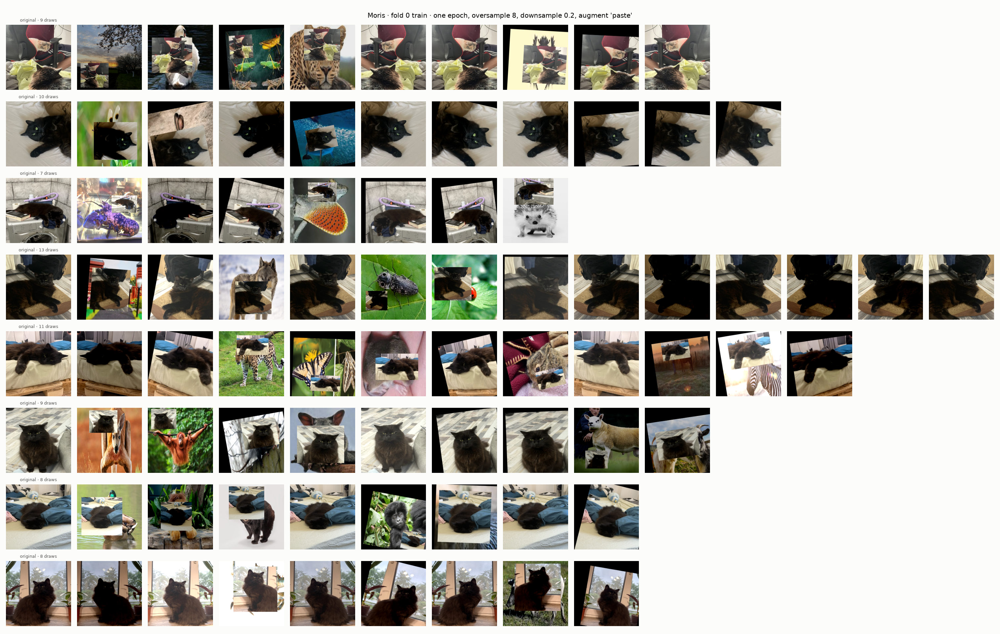
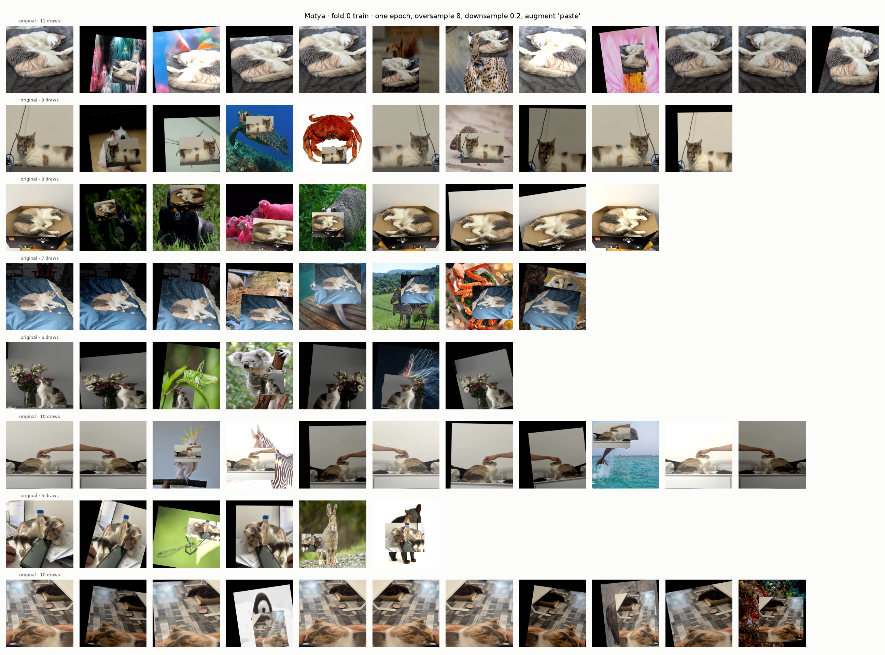
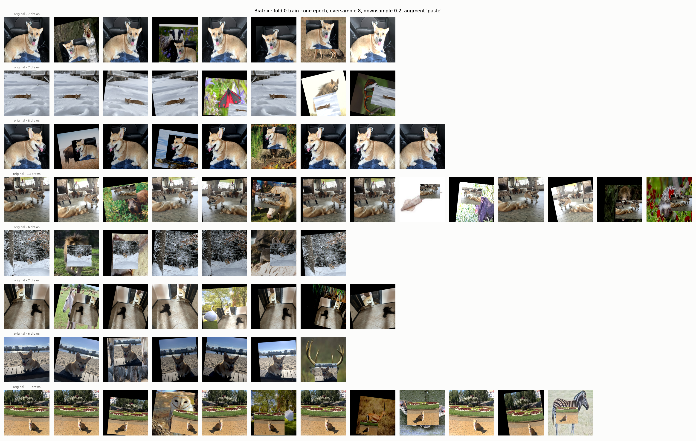
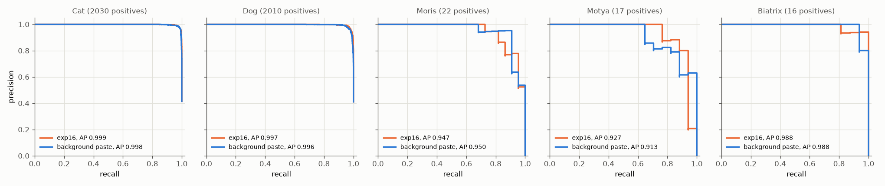
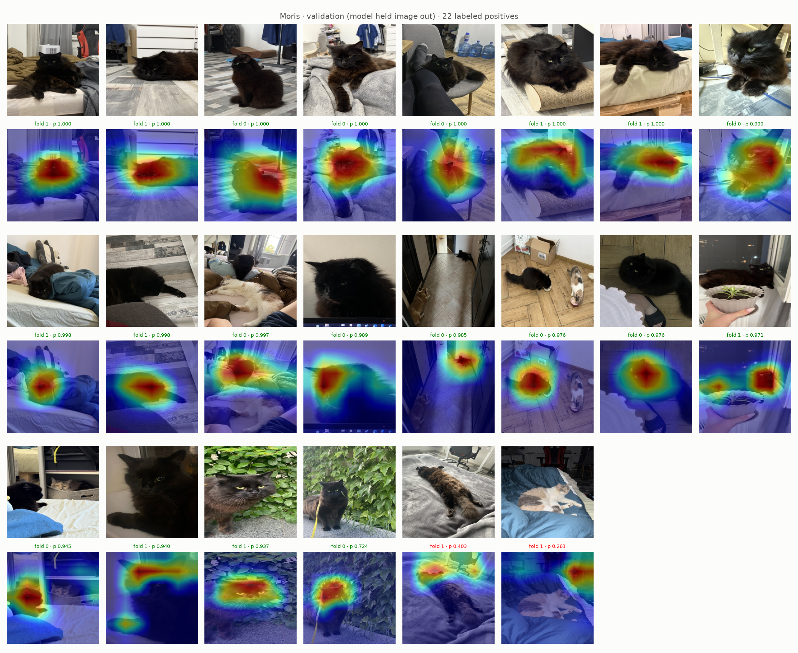
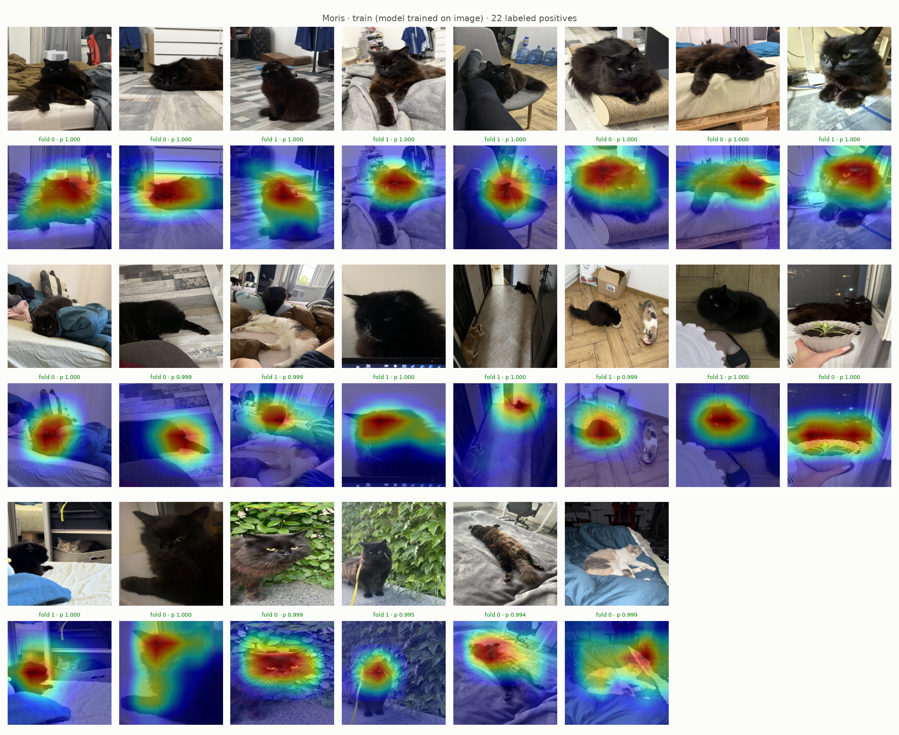
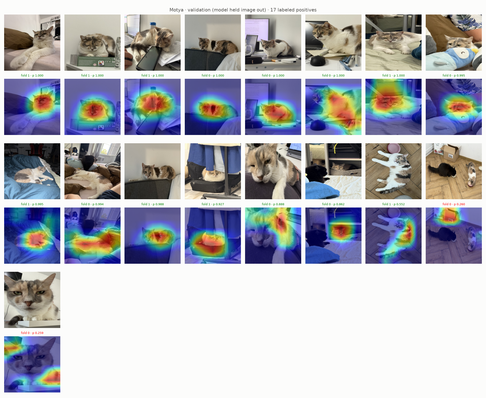
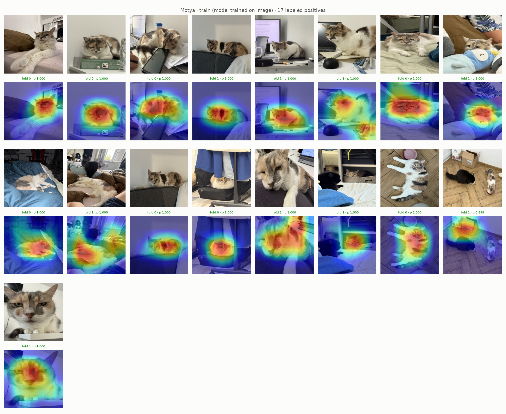
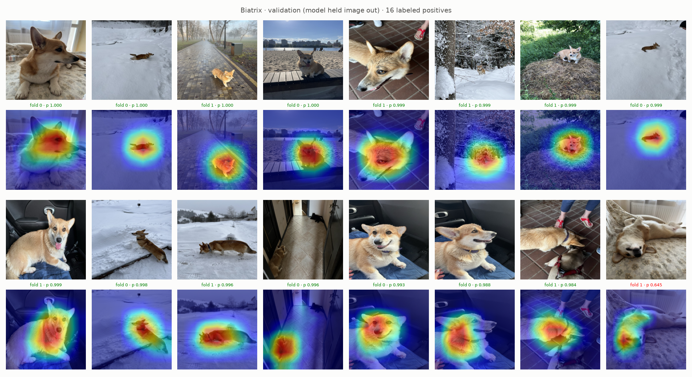
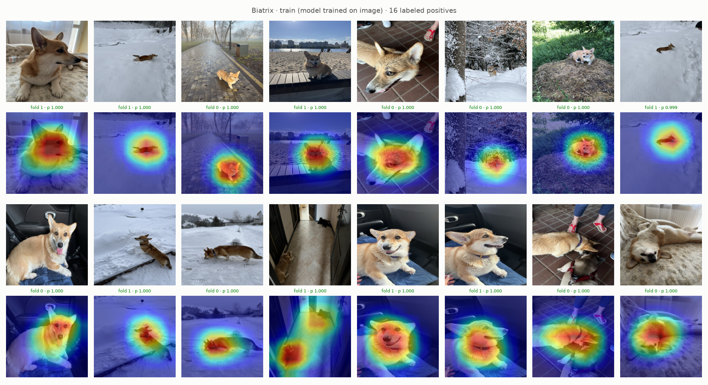

# Experiment 17: Background paste

## Request

create experiment where try to increase diversity of oversampled images, so model generalizes better

## Question

Does ResNet-18 with exp16 setup plus background paste give higher AP per VIP class on out-of-fold rows of folds 0 and 1 than exp16 on same rows?

## Plan

1. Plot exp13 figure with new recipe, before training: one figure per VIP class, 8 random labeled positives from fold 0 training part, one row per image, original first, then every draw of that image in one simulated epoch of exp16 sampler, title with draw count.
2. Plot precision-recall curve per class on out-of-fold rows of folds 0 and 1, one panel per class (5), one line per model: exp16, background paste, AP in legend.
3. Plot Grad-CAM VIP figures (`GradCamFigures.positives`) for new model: per VIP class unseen and trained images, 6 figures.

All plots follow `dataviz` skill.

## Setup

- **Notebook:** [exp17_background_paste.ipynb](../notebooks/experiments/exp17_background_paste.ipynb), config `configs/exp17_background_paste/resnet18.toml`, training `core.cv`
- **Tracking:** `cnn-model-background-paste`
- **What changes:** `augment = "paste"`: with p 0.5, animal cut out by its pseudo-box (`data/processed/boxes.csv`, plus margin) and pasted at random place and scale onto random training image without Cat or Dog; labels kept. Then default recipe. Every oversampled VIP draw gets new room, not same bed or carpet (CMO, `docs/oversampling.md`). Applied to all images, not only VIP, so paste does not mean VIP.
- **What stays fixed:** exp16 setup (`oversample = 8`, `downsample = 0.2`), 10 epochs, folds 0 and 1; exp16 results reused.
- **Metric:** AP per class on out-of-fold rows of folds 0 and 1 (pooled), from PR curves; Grad-CAM visual.

## Fixes

## Results

8 random VIP positives of fold 0 train part, every draw of one epoch: about half pasted onto new background (wild animals, plants, sky, plain rooms), rest default recipe. Patch often large, carries part of original room (bed, floor).

AP per class, out-of-fold rows of folds 0 and 1 pooled (4904 rows): Moris 0.947 to 0.950, Motya 0.927 to 0.913, Biatrix 0.988 to 0.988, Cat 0.999 to 0.998, Dog 0.997 to 0.996. Per fold, paste minus exp16: Moris −0.002 / +0.007, Motya +0.012 / −0.016, Biatrix +0.014 / 0.000, mAP +0.005 / −0.002.

All labeled positives per VIP class in folds 0 and 1 (22 Moris, 17 Motya, 16 Biatrix), sorted by out-of-fold prob; caption: fold model, its prob, green at or above best-F1 threshold (Moris 0.724, Motya 0.552, Biatrix 0.984), red below. Validation misses: Moris 2, Motya 2, Biatrix 1 (exp16: 4, 2, 0); train: none, every p ≥ 0.994.

## AI Summary

No: VIP AP and mAP differences flip sign between folds (mAP +0.005 / −0.002), all within 1–2 images, so paste neither helps nor hurts. Grad-CAM same as exp16: hits on animal, misses (Moris on gray bed, Moris with calico, small Motya at bowl, Motya close-up face) heat on background (bed edge, box, wall); train images still all p ≥ 0.994, so model still memorizes hard cases.

## Conclusion

For some images pasting improved GradCam, for some made it worse. Therefore, not worth keeping for now.