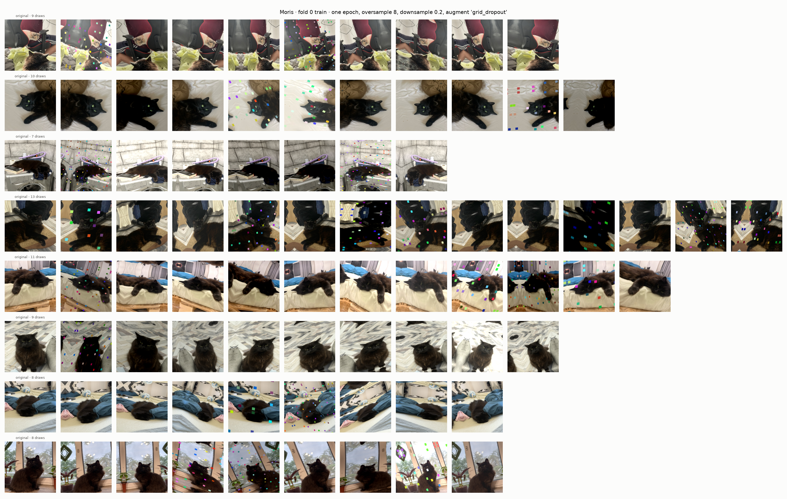
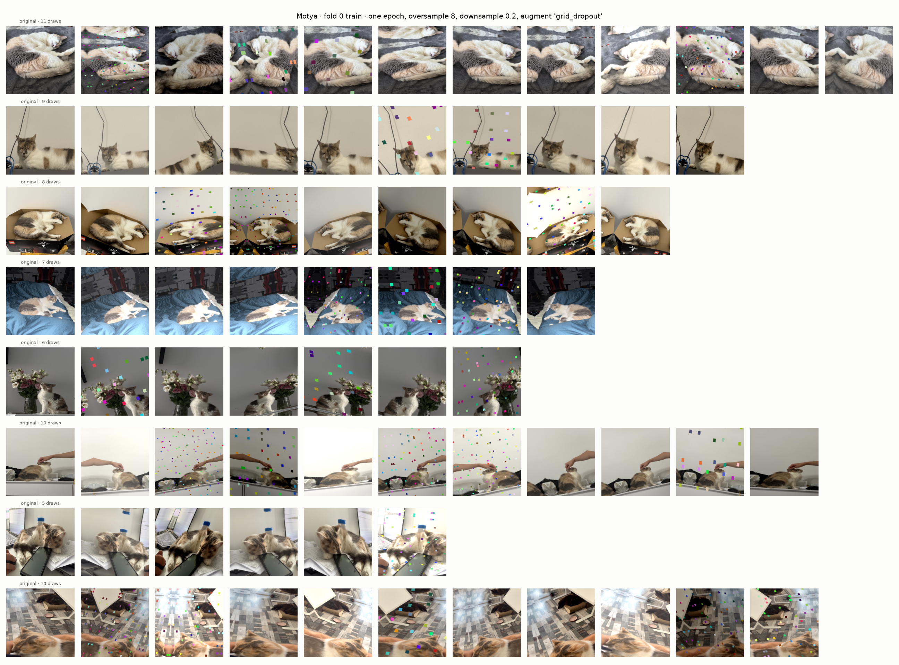
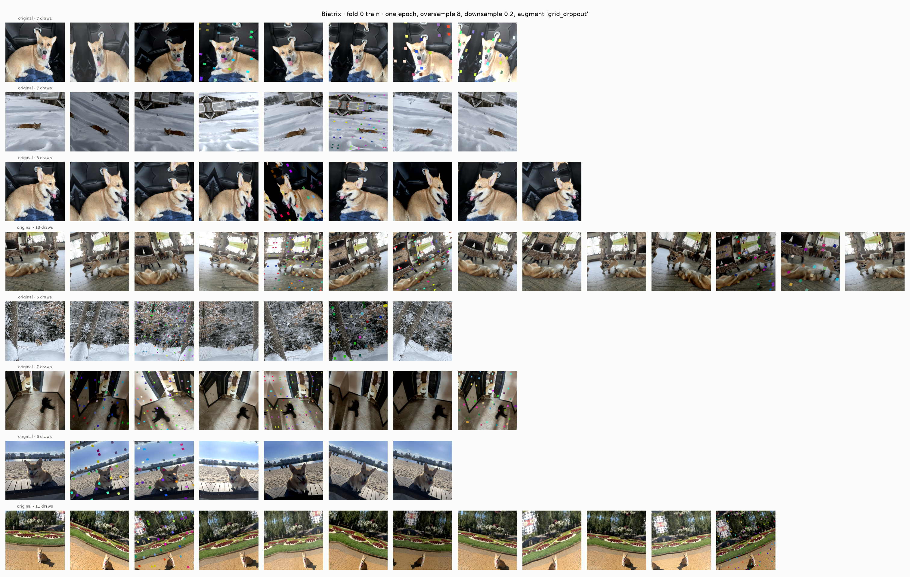
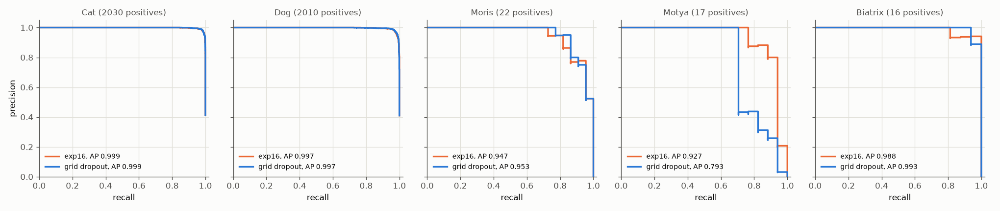
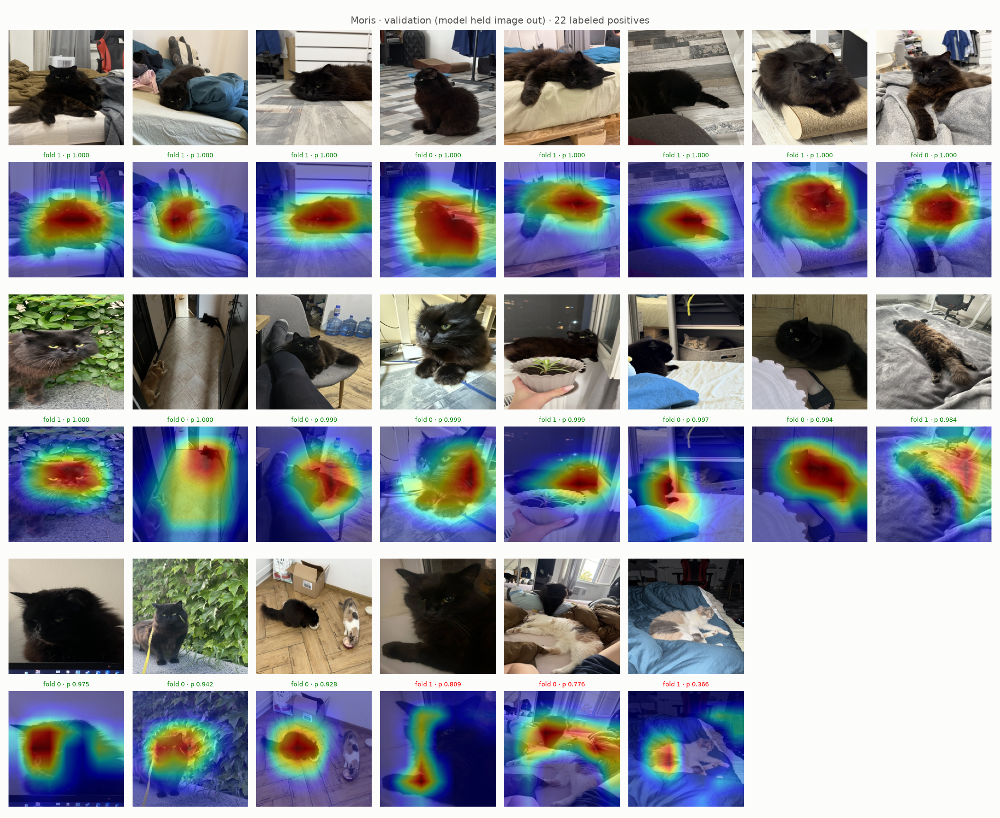
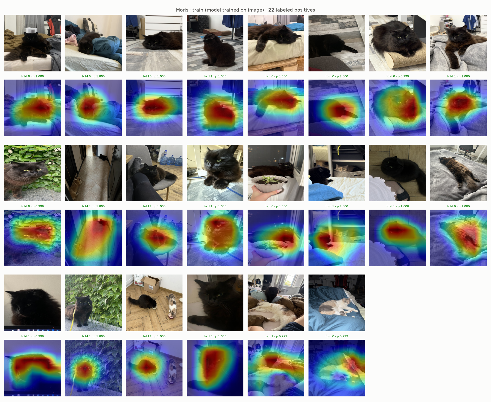
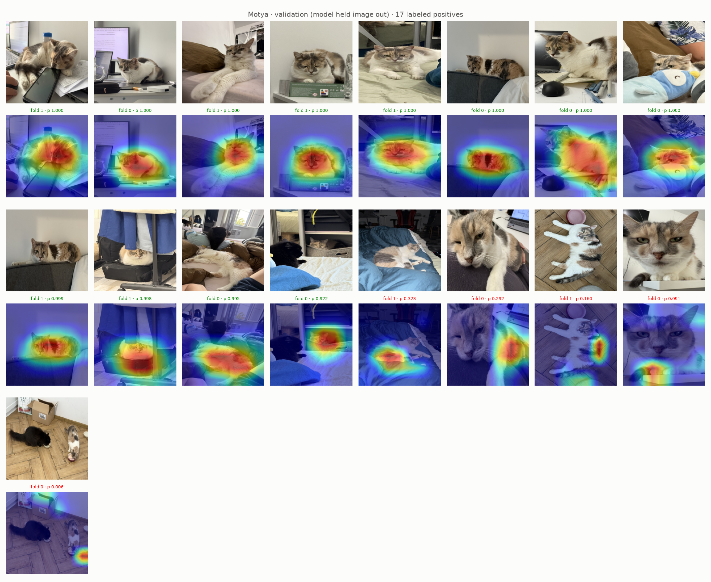
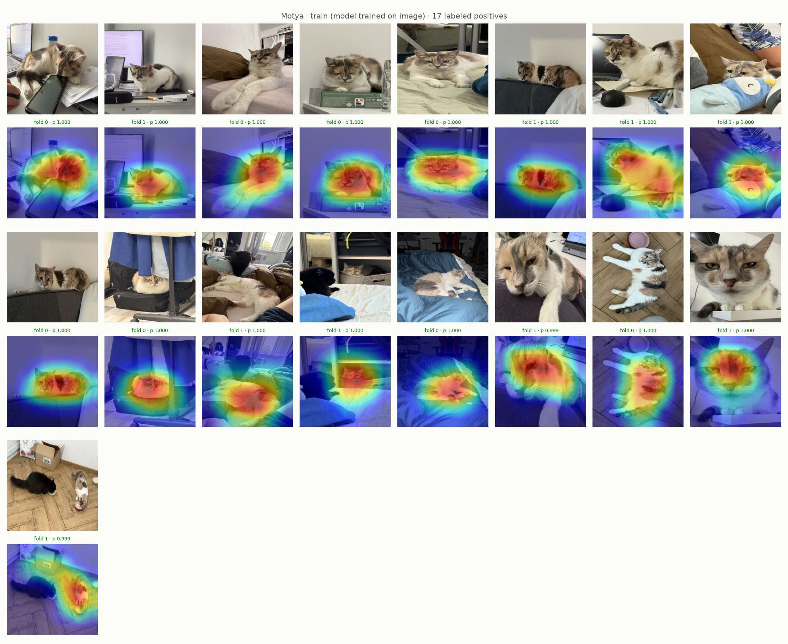
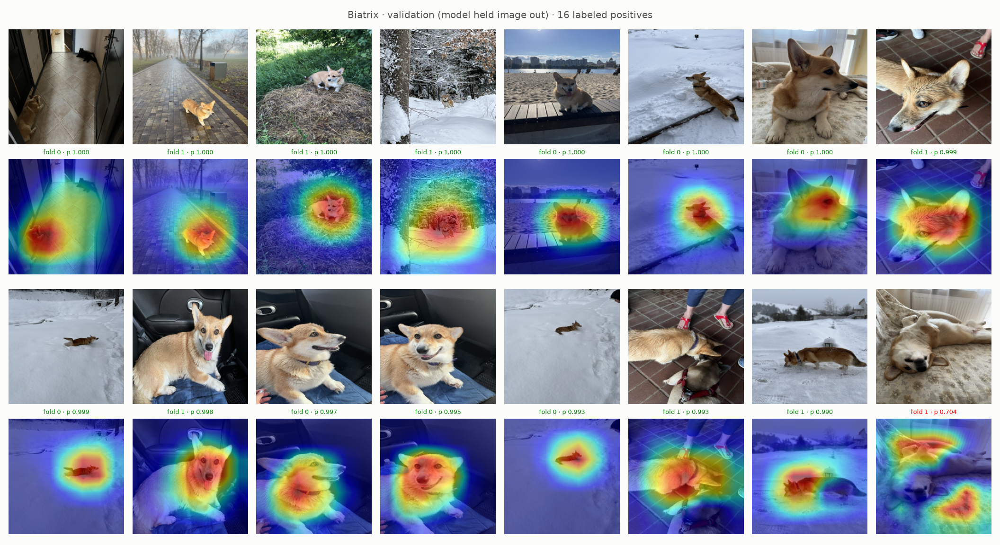
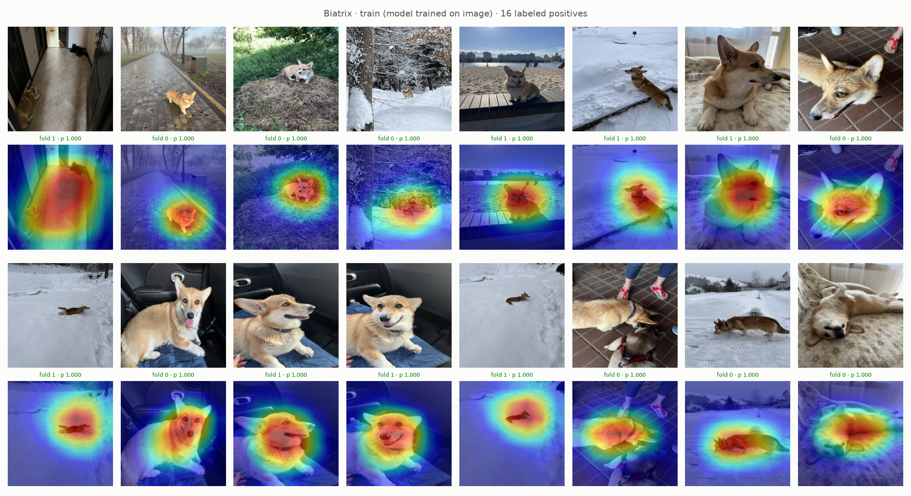

# Experiment 18: Grid dropout

## Request

create experiment with the same idea: make oversampled images more diverse, but using different augmentation techniques; before creating, suggest them

let's try 1

## Question

Does ResNet-18 with exp16 setup plus colored grid dropout and stronger `Affine` on every draw give higher AP per VIP class on out-of-fold rows of folds 0 and 1 than exp16 on same rows?

## Plan

1. Plot exp13 figure with new recipe, before training: one figure per VIP class, 8 random labeled positives from fold 0 training part, one row per image, original first, then every draw of that image in one simulated epoch of exp16 sampler, title with draw count.
2. Plot precision-recall curve per class on out-of-fold rows of folds 0 and 1, one panel per class (5), one line per model: exp16, grid dropout, AP in legend.
3. Plot Grad-CAM VIP figures (`GradCamFigures.positives`) for new model: per VIP class unseen and trained images, 6 figures.

All plots follow `dataviz` skill.

## Setup

- **Notebook:** [exp18_grid_dropout.ipynb](../notebooks/experiments/exp18_grid_dropout.ipynb), config `configs/exp18_grid_dropout/resnet18.toml`, training `core.cv`
- **Tracking:** `cnn-model-grid-dropout`
- **What changes:** `augment = "grid_dropout"`, all images, every step per draw in order (default recipe in brackets):
  1. `Resize` 224 (same)
  2. `HorizontalFlip`, p 0.5 (same)
  3. `GridDropout`, ratio 0.2 (hole side 20% of grid cell), unit size 10–25% of image, random offset, each hole one random color (`fill = "random_uniform"`), p 0.3 (none)
  4. `RandomBrightnessContrast`, ±0.2, p 0.5 (same)
  5. `Affine`, scale 0.7–1.2, rotate ±20°, shear ±10°, shift ±10%, reflect border, p 1 (scale 0.8–1.2, rotate ±15°, no shear, black border, p 0.5)
- **What stays fixed:** exp16 setup (`oversample = 8`, `downsample = 0.2`), 10 epochs, folds 0 and 1; exp16 results reused.
- **Metric:** AP per class on out-of-fold rows of folds 0 and 1 (pooled), from PR curves; Grad-CAM visual.

## Fixes

## Results

8 random VIP positives of fold 0 train part, every draw of one epoch: every draw shifted, rotated or zoomed; about 1 in 3 with small colored squares; zoom-out with reflect border sometimes mirrors part of animal (two Motyas in one draw).

AP per class, out-of-fold rows of folds 0 and 1 pooled (4904 rows), exp16 to grid dropout: Moris 0.947 to 0.953, Motya 0.927 to 0.793, Biatrix 0.988 to 0.993, Cat, Dog unchanged (0.999, 0.997). Per fold, grid dropout minus exp16: Moris −0.005 / −0.005, Motya −0.132 / −0.135, Biatrix +0.014 / −0.014, mAP −0.024 / −0.031.

All labeled positives per VIP class in folds 0 and 1 (22 Moris, 17 Motya, 16 Biatrix), sorted by out-of-fold prob; caption: fold model, its prob, green at or above best-F1 threshold (Moris 0.928, Motya 0.922, Biatrix 0.990), red below. Validation misses: Moris 3, Motya 5, Biatrix 1 (exp16: 4, 2, 0); train: none, every p ≥ 0.999.

## AI Summary

No: Motya AP drops 0.13 on both folds (5 validation misses instead of 2, heat on paws, floor, bowl, not on face or coat), Moris, Biatrix differences within noise, mAP lower on both folds. Likely cause: random colored squares look like calico patches, so Motya coat pattern stops being reliable cue.

## Conclusion

Grid dropout neutral for Moris and Biatrix (gains only in pooled AP, not on both folds), but destroyed Motya.
