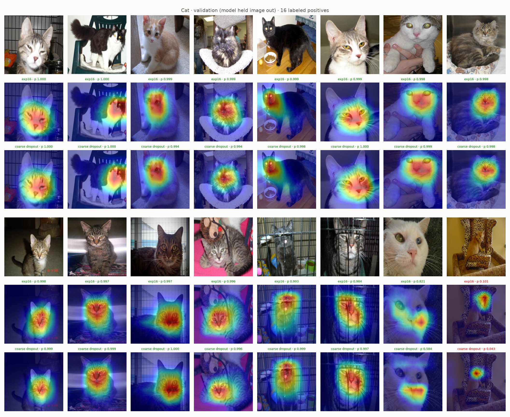
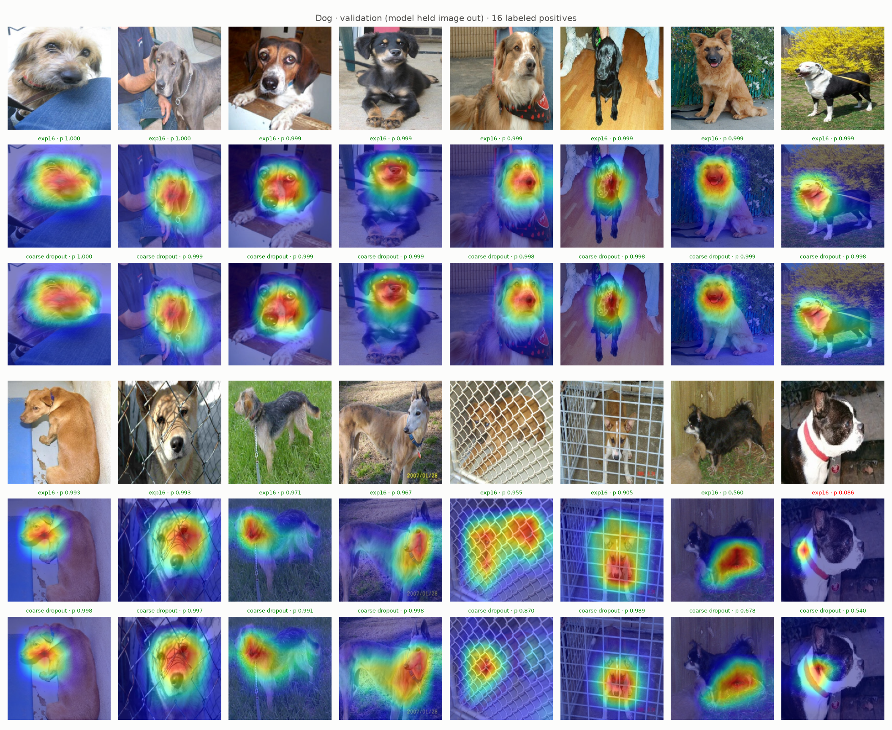
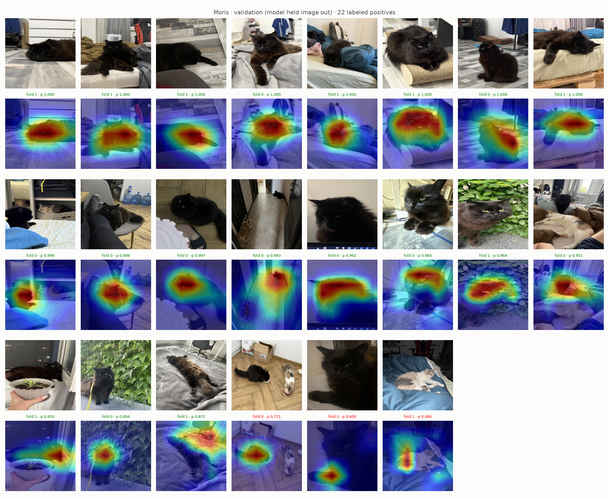
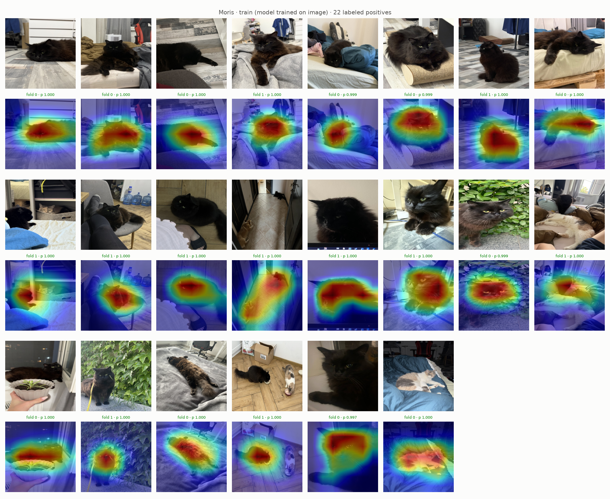
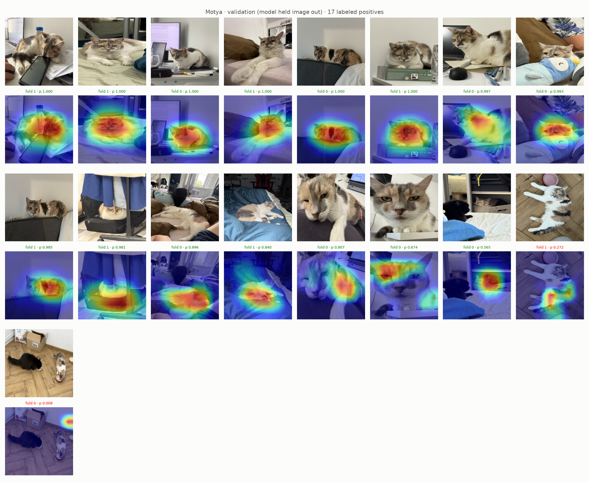
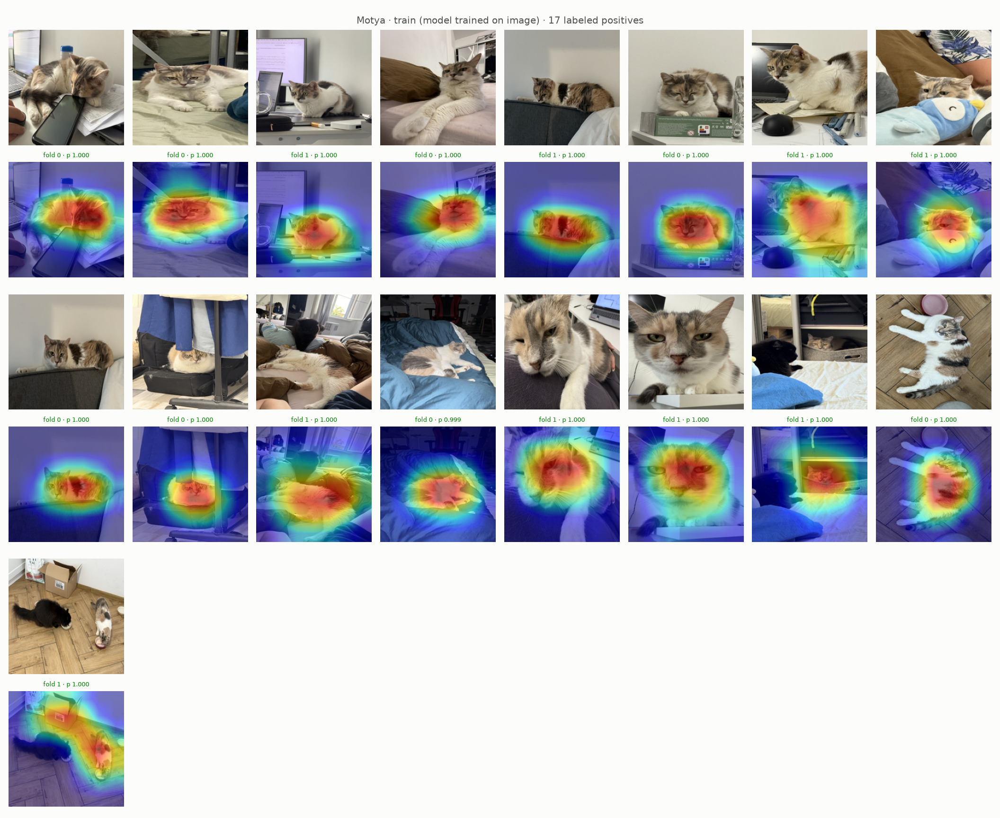
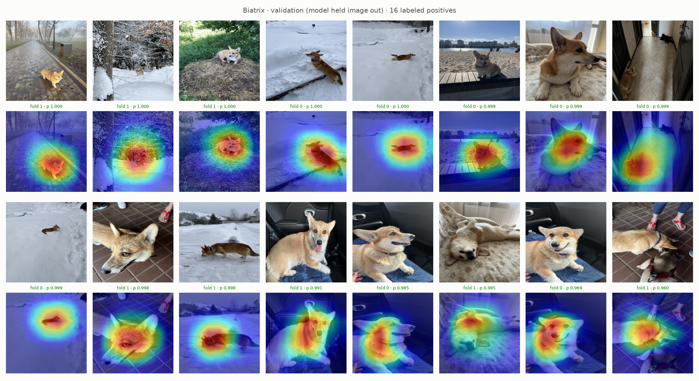
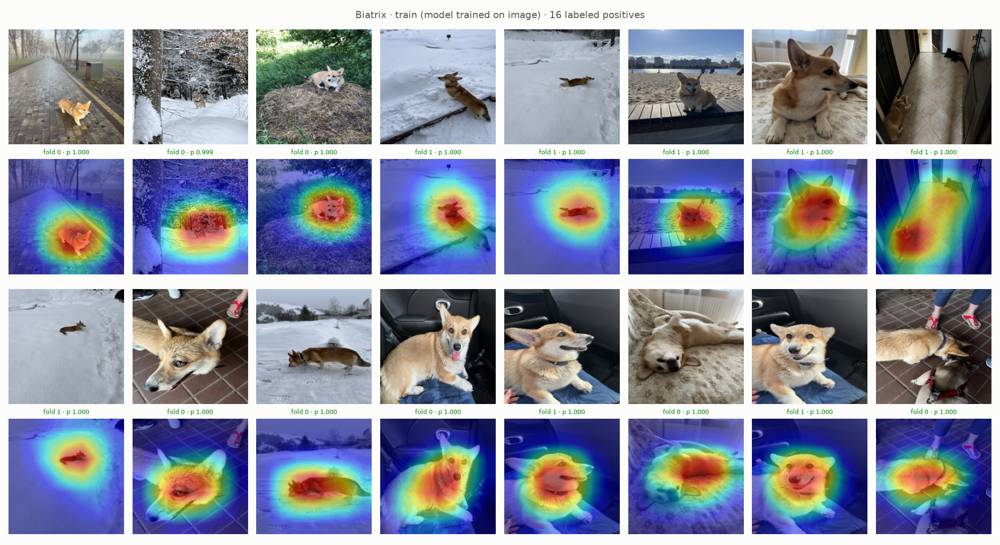
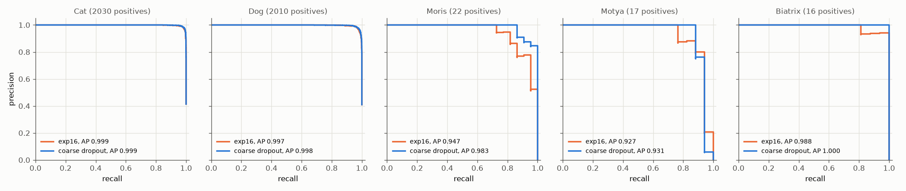

# Experiment 20: Coarse dropout on non-VIP images

## Request

does it make sense to apply Coarse Dropout (not black), but only on not VIP images, in the hope that model will better learn features of cats and dogs in general

create experiment

I do not want to increase their scores. I want to make model learn the whole dog instead of its face

add also grad cam visualizations for all dogs, cats and VIP animals

## Question

On exp19 images (16 random Cat and 16 random Dog positives, folds 0 and 1), does ResNet-18 with exp16 setup plus colored coarse dropout on non-VIP images put Grad-CAM heat on body (not only face) in more images than exp16, without lower VIP AP on out-of-fold rows of folds 0 and 1?

## Plan

1. Plot Grad-CAM Cat and Dog validation figures of both models on exp19 images, exp16 and coarse dropout map of same image side by side, caption with count of images with heat on body by eye.
2. Plot Grad-CAM VIP figures (`GradCamFigures.positives`) of new model: per VIP class all labeled positives of folds 0 and 1 (22 Moris, 17 Motya, 16 Biatrix), unseen and trained images, 6 figures, same layout as exp16 figures.
3. Plot precision-recall curve per class on out-of-fold rows of folds 0 and 1, one panel per class (5), one line per model: exp16, coarse dropout, AP in legend.

All plots follow `dataviz` skill.

## Setup

- **Notebook:** [exp20_coarse_dropout_non_vip.ipynb](../notebooks/experiments/exp20_coarse_dropout_non_vip.ipynb), config `configs/exp20_coarse_dropout_non_vip/resnet18.toml`, training `core.cv`
- **Tracking:** `cnn-model-coarse-dropout-non-vip`
- **What changes:** `augment = "coarse_dropout_non_vip"`: default recipe; rows with all VIP = 0 (Cat, Dog, none) also get `CoarseDropout` after `HorizontalFlip`: 1–4 holes, side 10–25% of image, each hole one random color (`fill = "random_uniform"`), p 0.5. VIP rows: default recipe unchanged.
- **What stays fixed:** exp16 setup (`oversample = 8`, `downsample = 0.2`, full ratio `pos_weight`), 10 epochs, folds 0 and 1; exp16 results reused.
- **Metric:** count of exp19 images with Grad-CAM heat on body, by eye (main); AP per class on out-of-fold rows of folds 0 and 1 (pooled), from PR curves (guard, VIP must not drop).

## Fixes

## Results

exp19 images, 16 per class, out-of-fold rows of folds 0 and 1; caption: model, its prob, green at or above own best-F1 threshold (exp16 Cat 0.666, Dog 0.392; coarse dropout Cat 0.337, Dog 0.519), red below. Heat on body, by eye: Cat about 3 of 16 both models (black cat, two caged cats), maps almost identical; Dog about 3 to 5 of 16 (greyhound, dog in yellow bush, chihuahua stronger; terrier on grass, Boston terrier added). Misses: Cat 1 both (leopard-print chair, p 0.101 to 0.043, heat on chair); Dog 1 to 0 (Boston terrier p 0.086 to 0.540, heat moves from collar to chest). Chain-link fence dog: heat leaves fence, sits on dog.

All labeled positives per VIP class in folds 0 and 1 (22 Moris, 17 Motya, 16 Biatrix), sorted by out-of-fold prob; green at or above best-F1 threshold (Moris 0.871, Motya 0.565, Biatrix 0.960). Validation misses: Moris 3, Motya 2, Biatrix 0 (exp16: 4, 2, 0).

AP per class, out-of-fold rows of folds 0 and 1 pooled (4904 rows), exp16 to coarse dropout: Moris 0.947 to 0.983, Motya 0.927 to 0.931, Biatrix 0.988 to 1.000, Cat 0.999, Dog 0.997 to 0.998. Per fold, coarse dropout minus exp16: Moris +0.006 / +0.046, Motya +0.009 / −0.017, Biatrix +0.014 / 0.000, mAP +0.006 / +0.006.

## AI Summary

Partly: Dog heat spreads from face onto body in about 2 more of 16 images and Boston terrier miss fixed, Cat maps unchanged, so holes on generic images did not make model look at whole cat. VIP not hurt: mAP +0.006 on both folds, Moris AP +0.036 pooled, Motya mixed within noise (1–2 images).

## Conclusion

Dropout definetely did not hurt performance. In the same time, it made prediction areas smoother. Further idea is to apply more stress augmentations on not VIP, so prediction areas become even smoother.

