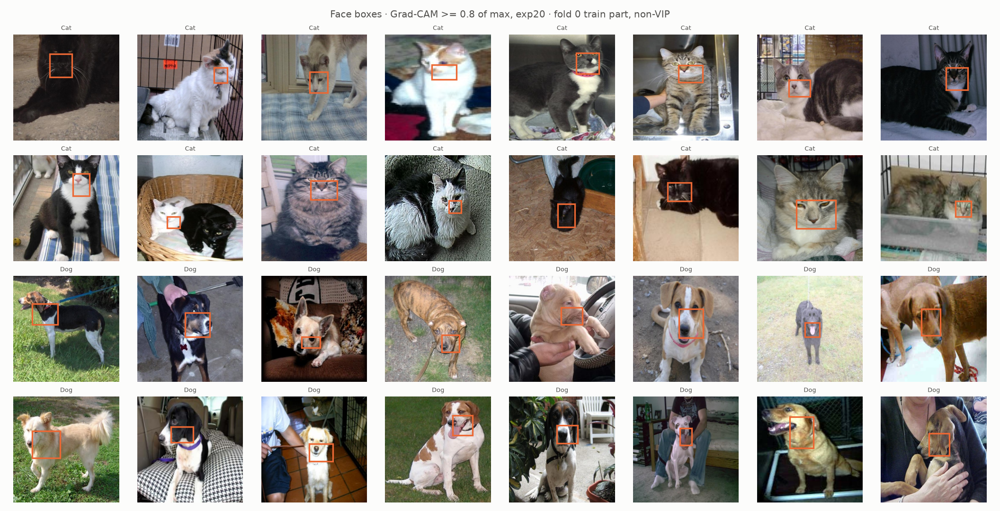
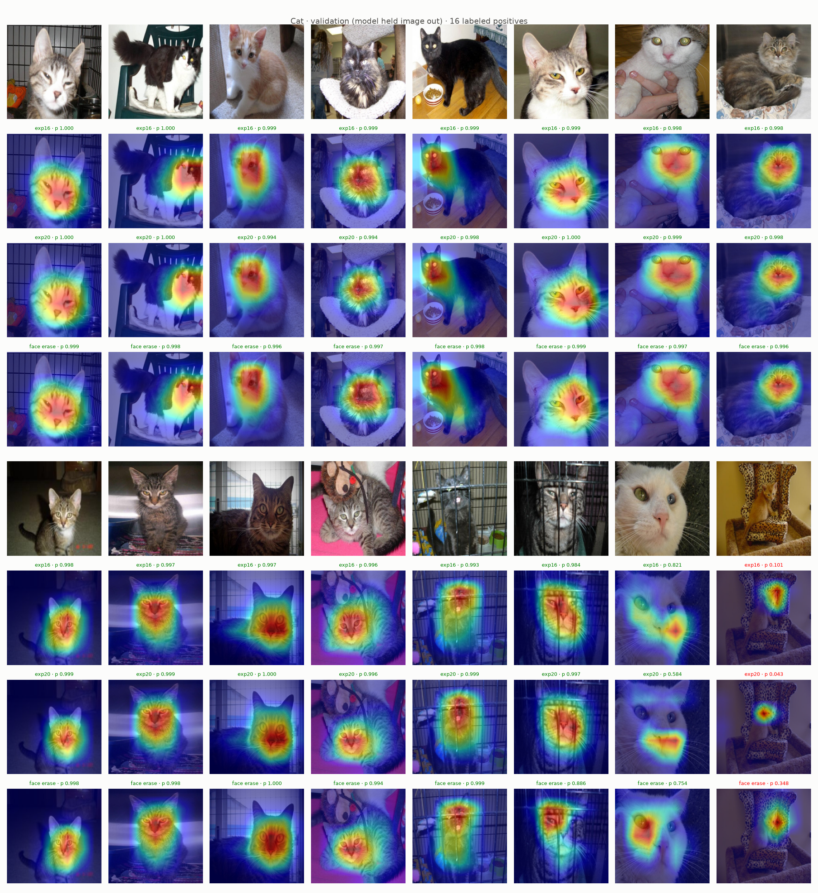
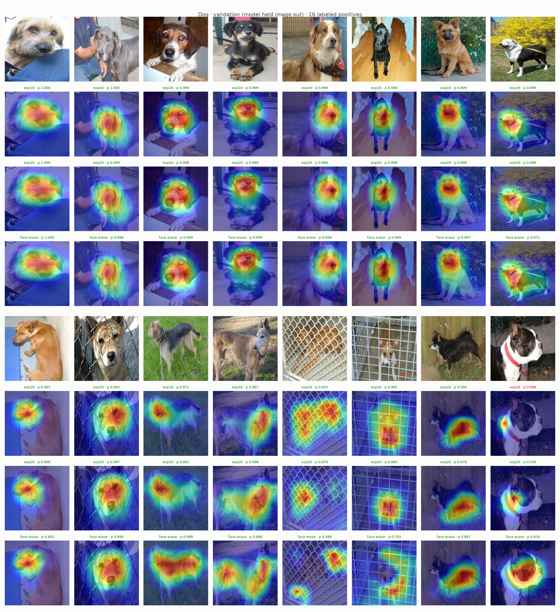
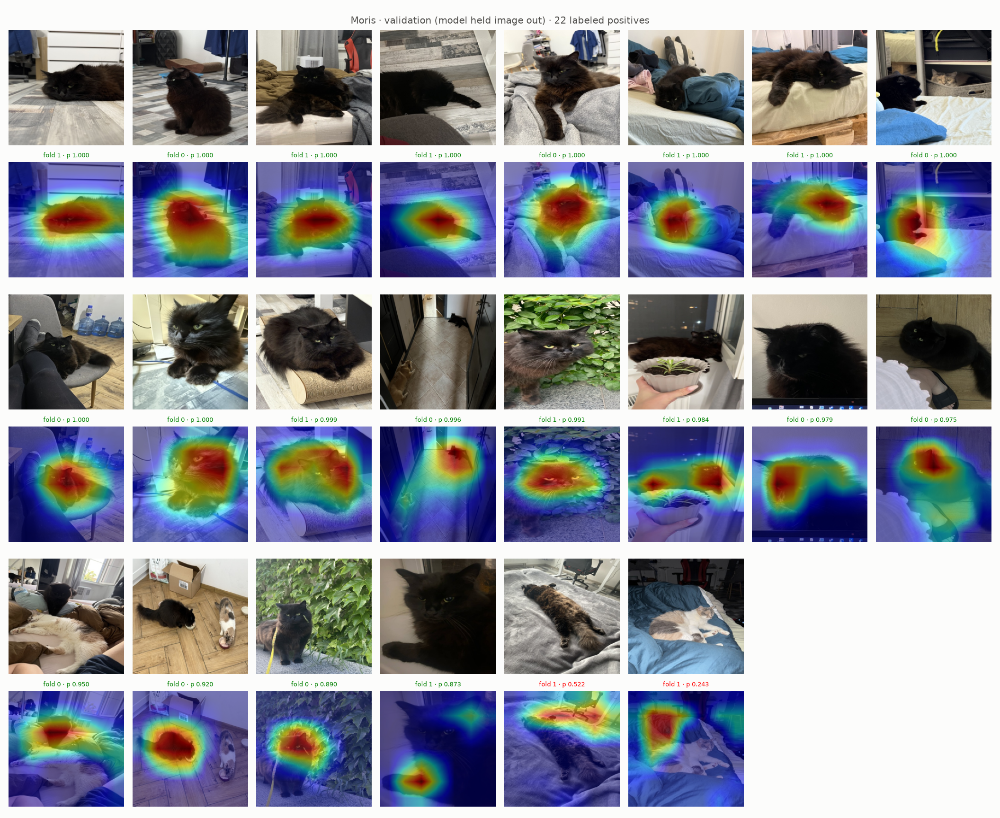
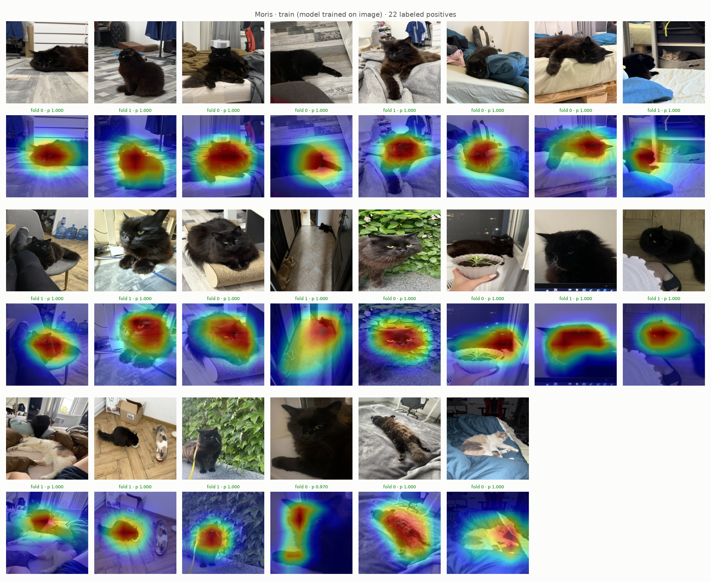
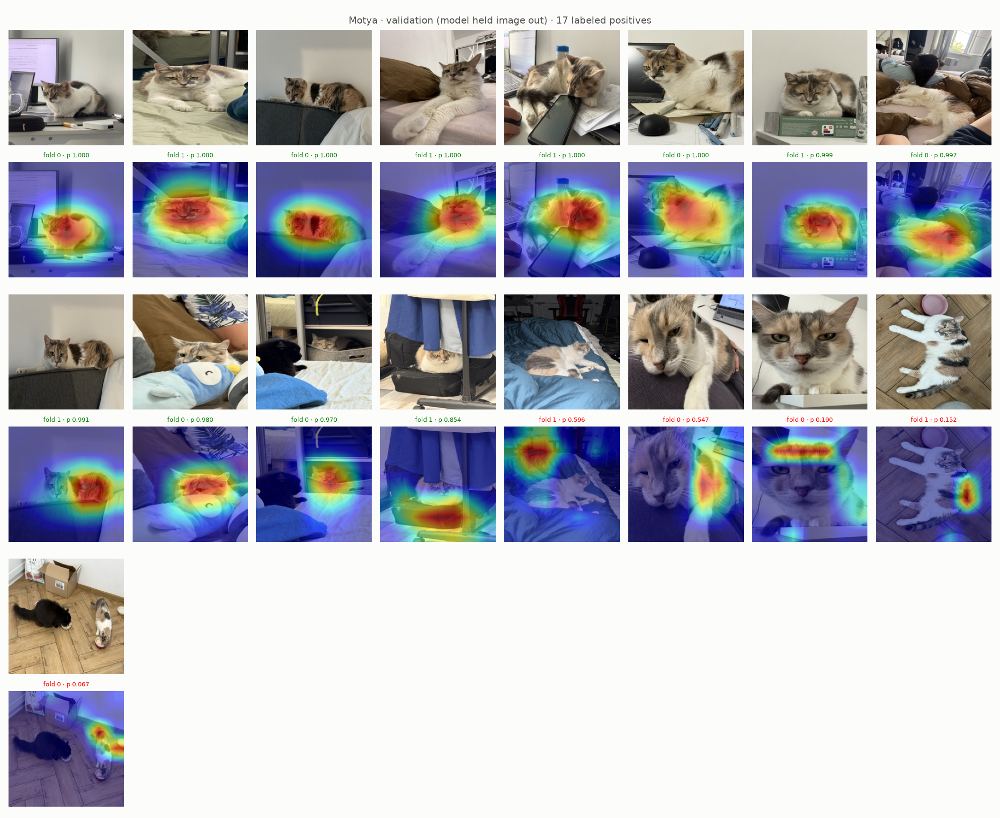
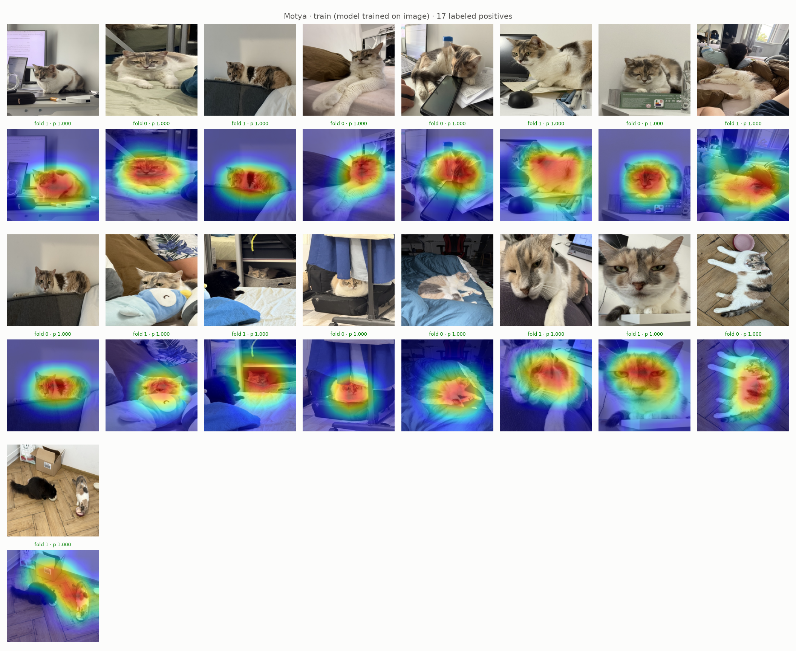
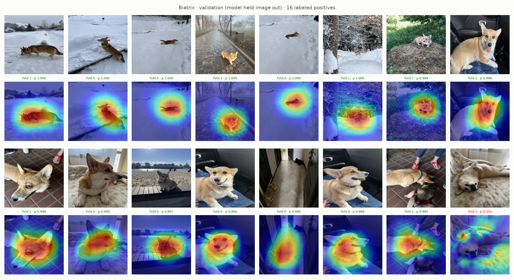
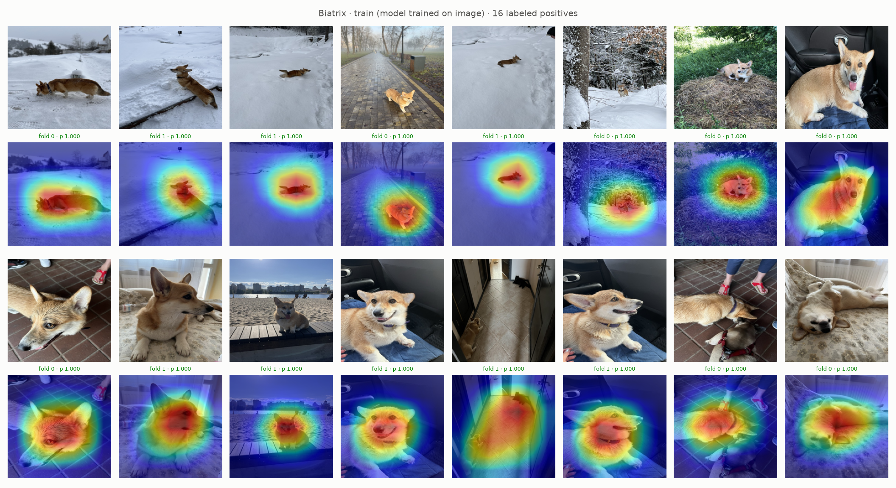
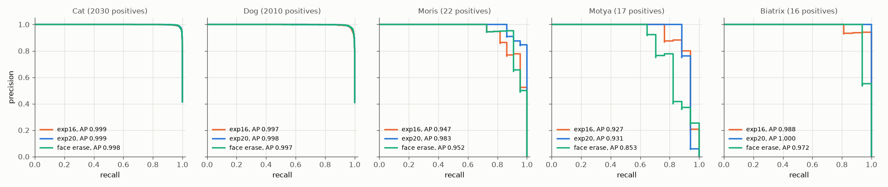

# Experiment 21: Face erase on non-VIP images

## Request

I want to push attention spread even further. Suggest next steps, also on non VIP animals

create new experiment, include dropout + option 3

## Question

On exp19 images (16 random Cat and 16 random Dog positives, folds 0 and 1), does ResNet-18 with exp20 setup plus Grad-CAM face erase on non-VIP images put Grad-CAM heat on body (not only face) in more images than exp20, without lower VIP AP on out-of-fold rows of folds 0 and 1?

## Plan

1. Plot face boxes on 16 random Cat and 16 random Dog images of fold 0 training part, original with box outline, before training.
2. Plot Grad-CAM Cat and Dog validation figures of exp16, exp20 and face erase on exp19 images, maps of same image stacked, caption with count of images with heat on body by eye.
3. Plot Grad-CAM VIP figures (`GradCamFigures.positives`) of new model: per VIP class all labeled positives of folds 0 and 1, unseen and trained images, 6 figures.
4. Plot precision-recall curve per class on out-of-fold rows of folds 0 and 1, one panel per class (5), one line per model: exp16, exp20, face erase, AP in legend.

All plots follow `dataviz` skill.

## Setup

- **Notebook:** [exp21_face_erase.ipynb](../notebooks/experiments/exp21_face_erase.ipynb), config `configs/exp21_face_erase/resnet18.toml`, training `core.cv`
- **Tracking:** `cnn-model-face-erase`
- **What changes:** `augment = "face_erase"`: exp20 recipe plus, on non-VIP rows only, face box erase in front: each Cat or Dog face box filled with one random color with p 0.5, box above 30% of image skipped (`EraseBoxes`, exp14). Face box: bounding rectangle of exp20 Grad-CAM map ≥ 0.8 of max (exp14 used 0.5, boxes covered whole animal), one per present Cat or Dog, by exp20 fold model that held image out, else fold 0; `data/processed/boxes_face.csv` by `python -m core.boxes --face` (10097 boxes, median 4.1% of image; exp14 0.5 boxes of Cat, Dog 15.4%).
- **What stays fixed:** exp20 setup (non-VIP colored holes, `oversample = 8`, `downsample = 0.2`, full ratio `pos_weight`), 10 epochs, folds 0 and 1; exp16, exp20 results reused.
- **Metric:** count of exp19 images with Grad-CAM heat on body, by eye (main); AP per class on out-of-fold rows of folds 0 and 1 (pooled), from PR curves (guard, VIP must not drop).

## Fixes

## Results

16 random Cat and 16 random Dog images, fold 0 training part, non-VIP: about 31 of 32 boxes on face (eyes, nose, snout); one on white cat face beside black cat in basket, also face.

exp19 images, 16 per class, out-of-fold rows of folds 0 and 1; caption: model, its prob, green at or above own best-F1 threshold (face erase Cat 0.398, Dog 0.439), red below. Heat on body, by eye: Cat about 3 of 16 all three models, maps almost unchanged; leopard-print chair kitten still missed (p 0.101, 0.043, 0.348), heat now on kitten, not chair back. Dog about 3, 5, 7 of 16: terrier on grass whole body, greyhound head and body, Boston terrier chest (p 0.916), chihuahua body. Fence and cage dogs worse: heat breaks into patches on body and wire, p 0.955, 0.870, 0.489 and 0.905, 0.989, 0.703.

All labeled positives per VIP class in folds 0 and 1 (22 Moris, 17 Motya, 16 Biatrix); green at or above best-F1 threshold (Moris 0.873, Motya 0.854, Biatrix 0.982). Validation misses: Moris 2, Motya 5, Biatrix 1 (exp20: 3, 2, 0). VIP false positives on 4854 non-VIP rows: Moris 1, Motya 1, Biatrix 0 (exp20: 0, 0, 0).

AP per class, out-of-fold rows of folds 0 and 1 pooled (4904 rows), exp20 to face erase: Moris 0.983 to 0.952, Motya 0.931 to 0.853, Biatrix 1.000 to 0.972, Cat 0.999 to 0.998, Dog 0.998 to 0.997. Per fold, face erase minus exp20: Moris −0.017 / −0.049, Motya −0.086 / −0.030, Biatrix 0.000 / −0.042, mAP −0.021 / −0.025.

## AI Summary

Partly for dogs: heat spreads onto body in about 2 more of 16 images than exp20, but on fence and cage photos it scatters onto wire and p drops; Cat maps unchanged. VIP hurt: mAP lower on both folds (−0.021 / −0.025), Motya AP −0.086 / −0.030, so face erase as is costs more than it gives.

## Conclusion

I wanted better spread on cats, but did not get it yet.
