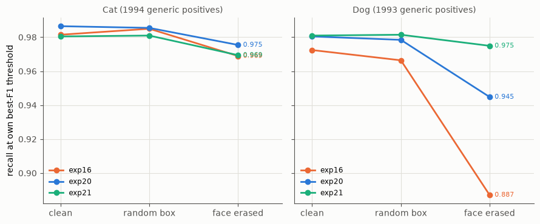
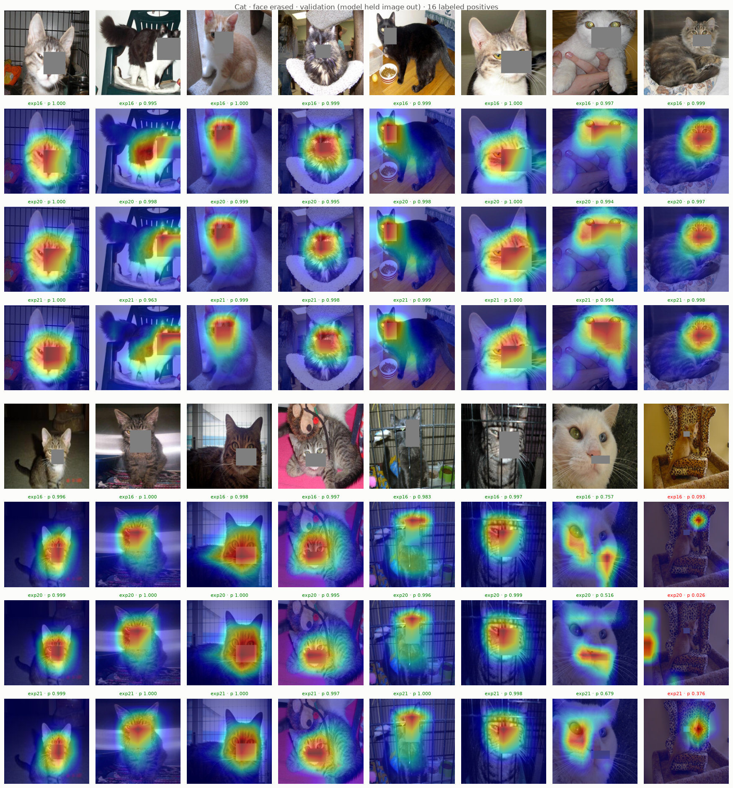
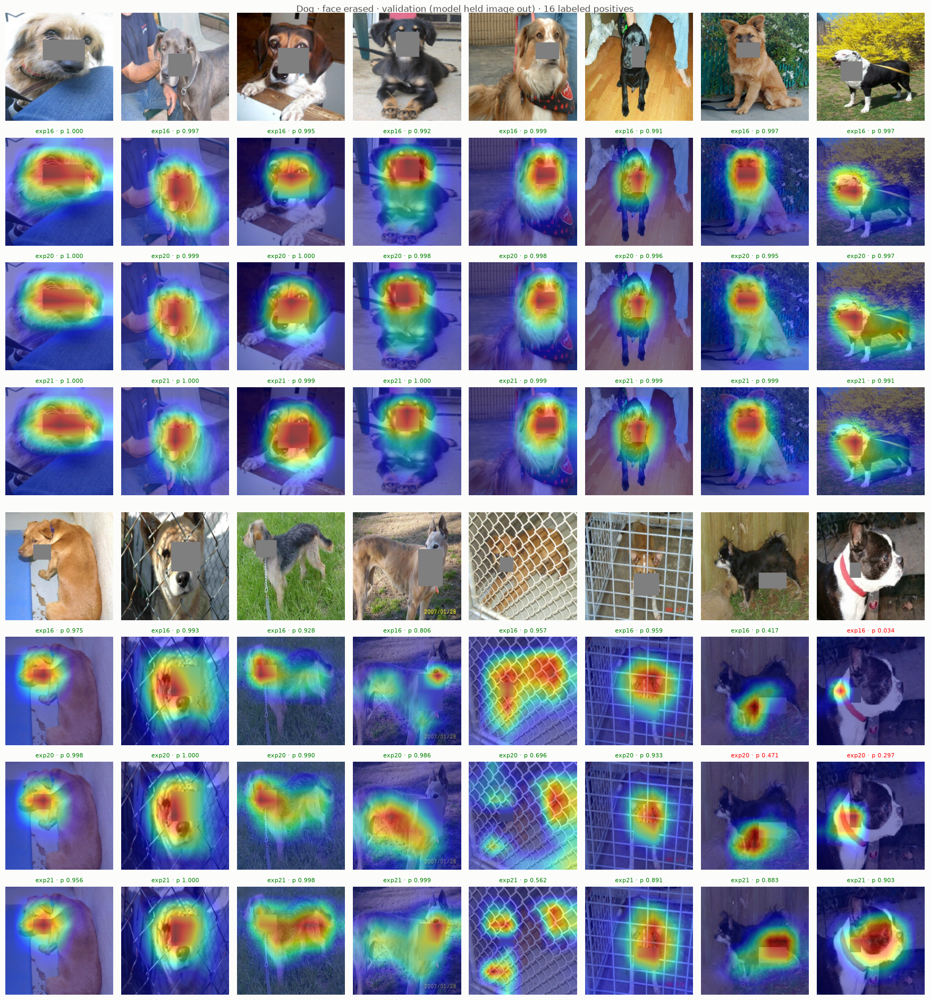

# Experiment 22: Face-erase test

## Request

create experiment with face-erase test

## Question

On generic (non-VIP) Cat and Dog positives of folds 0 and 1, does exp21 keep more positives at or above own best-F1 threshold than exp20 and exp16 when face box is erased?

## Plan

1. Plot recall at own best-F1 threshold per class (Cat, Dog) and model (exp16, exp20, exp21) on clean images, face erased, and same-size box erased at random place off face.
2. Plot Grad-CAM Cat and Dog of three models on exp19 images with face erased, maps of same image stacked.

All plots follow `dataviz` skill.

## Setup

- **Notebook:** [exp22_face_erase_test.ipynb](../notebooks/experiments/exp22_face_erase_test.ipynb), no training
- **Tracking:** none
- **What changes:** input only: face box from `data/processed/boxes_face.csv` (exp21 boxes, exp20 Grad-CAM ≥ 0.8 of max, fold model that held image out) filled with normalization mean (gray 128); control: same-size box, random place not overlapping face, same fill, fixed seed.
- **What stays fixed:** exp16, exp20, exp21 fold models of folds 0 and 1, each image scored by model that held it out; `val_tfms` 224 px; thresholds best-F1 on clean OOF rows, per model; all generic Cat (1994 of 1995) and Dog (1993 of 1994) positives of folds 0 and 1 with face box.
- **Metric:** recall at own threshold on clean, face-erased, random-box rows; drop from clean = cost of losing face, beyond cost of any hole.

## Fixes

## Results

Recall at own best-F1 threshold, generic positives of folds 0 and 1 (1994 Cat, 1993 Dog), each image by fold model that held it out; clean, random box, face erased:

| | Cat | Dog |
|---|---|---|
| exp16 | 0.981, 0.985, 0.969 | 0.972, 0.966, 0.887 |
| exp20 | 0.986, 0.985, 0.975 | 0.980, 0.978, 0.945 |
| exp21 | 0.980, 0.981, 0.969 | 0.981, 0.981, 0.975 |

Random box costs at most 0.006, so face-erased drop is cost of losing face: Dog −0.085, −0.035, −0.006; Cat −0.012, −0.011, −0.011.

exp19 images with face box erased, maps of exp16, exp20, exp21 stacked. Cat boxes often cover nose and mouth only, eyes stay visible (white cats, tabby close-ups); all three models keep heat on eyes and forehead above box. Dog: exp21 heat on body when snout gone (terrier on grass whole body, chihuahua body, Boston terrier chest p 0.903 vs exp20 0.297, exp16 0.034). Figures saved from notebook outputs (save cell not run).

## AI Summary

Yes for dogs: without face exp21 keeps recall 0.975 against 0.945 (exp20) and 0.887 (exp16), so it learned body features Grad-CAM hid on clean images. Cat test inconclusive: face box (hot core of exp20 map) misses eyes, all models lose only about 0.011, and on face-erased images the heat moves to the eyes left visible.

"""
Experiments 20 and 21 were training: they changed how the model learns. Experiment 22 was an exam: no training, it tested the models we already had.

Experiments 20 and 21: teaching

Think of the model as a student who learns to recognize cats and dogs from photos. We noticed it looks almost only at the face.

- exp20: during training, we covered random spots of ordinary cat and dog photos with colored squares. Sometimes a square landed on the face, and the student had to answer from the rest of the animal.
- exp21: same, but we also covered the face on purpose, in half of the photos. The student had to learn the body.

After each one we checked with Grad-CAM, the heat map showing where the model looks. The maps barely changed for cats: still the face.

Why we needed an exam

Grad-CAM shows only the strongest clue. If the face is visible, it's the strongest clue, so the map points there, even if the student also learned the body as a backup. The map can't show the backup.

Experiment 22: the exam

We took the three trained models (exp16 before any of this, exp20, exp21) and showed them validation photos they had never trained on, with the face covered by a gray square. Then we counted how many cats and dogs each model still recognized. As a control, we also covered a random spot of the same size, to check that the drop comes from losing the face, not from having a square at all.

What the exam showed

- Dogs: without the face, exp16 recognized 89%, exp20 95% and exp21 98%. So exp21 really did learn dog bodies, and Grad-CAM just hadn't shown it.
- Cats: the gray square often covered only the nose and mouth and left the eyes visible. Every model still recognized cats by the eyes, so this exam couldn't tell them apart. It needs bigger squares that also cover the eyes.

"""

## Conclusion

