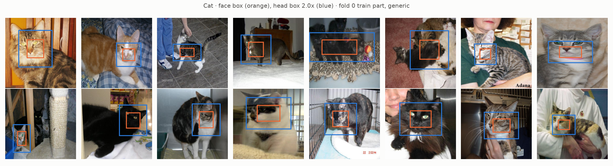
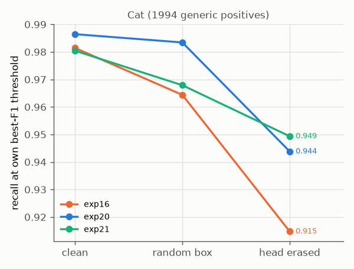
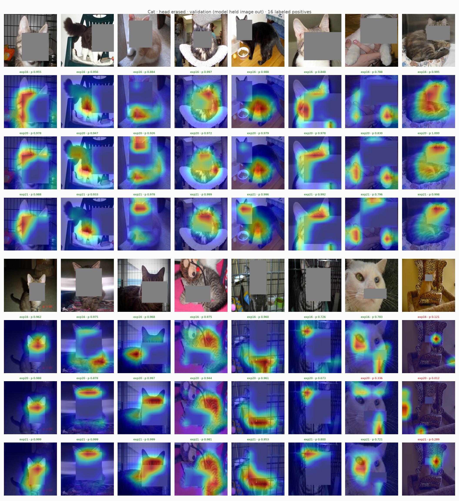

# Experiment 23: Head-erase test, cats

## Request

create experiment 23 with head boxes and exam

## Question

On generic (non-VIP) Cat positives of folds 0 and 1, does exp21 keep more positives at or above own best-F1 threshold than exp20 and exp16 when whole head box is erased?

## Plan

1. Plot face and head boxes on 16 random generic Cat images of fold 0 training part, both outlines on original.
2. Plot recall at own best-F1 threshold per model (exp16, exp20, exp21) on clean images, head erased, and same-size box erased at random place off head.
3. Plot Grad-CAM Cat of three models on exp19 Cat images with head erased, maps of same image stacked.

All plots follow `dataviz` skill.

## Setup

- **Notebook:** [exp23_head_erase_test.ipynb](../notebooks/experiments/exp23_head_erase_test.ipynb), no training
- **Tracking:** none
- **What changes:** erased box: head box instead of exp22 face box. Head box: exp22 Cat face box (`data/processed/boxes_face.csv`) grown 2× in width and height around its center, clipped to image; new `core.boxes.grow`. Control: same-size box, random place not overlapping head.
- **What stays fixed:** exp22 test: exp16, exp20, exp21 fold models of folds 0 and 1, each image by model that held it out; fill gray 128; `val_tfms` 224 px; thresholds best-F1 on clean OOF rows, per model; 1994 generic Cat positives with face box; seed 0.
- **Metric:** recall at own threshold on clean, head-erased, random-box rows; drop from clean = cost of losing head, beyond cost of any hole.

## Fixes

## Results

16 random generic Cat images, fold 0 training part: head box (2×) covers eyes and face on all 16, ears stick out above box on about half; on pile of kittens and two cats in one image box covers most of body.

Recall at own best-F1 threshold, 1994 generic Cat positives of folds 0 and 1, each image by fold model that held it out (read from figure, notebook saved without outputs); clean, random box, head erased: exp16 0.981, 0.964, 0.915; exp20 0.986, 0.983, 0.944; exp21 0.980, 0.968, 0.949. Head box median 16% of image, so random box now costs too (exp16 −0.017, exp20 −0.003, exp21 −0.012); drop beyond random box: exp16 −0.049, exp20 −0.039, exp21 −0.019.

exp19 Cat images with head box erased, maps of exp16, exp20, exp21 stacked. All three models alike: heat jumps to ears left above box in about 8 of 16 (kittens, tabby close-up, cat in window, caged cat), on body in only about 4 (black-white cat on chair, black cat by bowl, tabby on red blanket, caged cat legs); white cat held in hands: heat on fingers. Box misses head on 2 (white cat close-up: box on mouth, heat on eye; leopard-print chair kitten: box tiny, missed by all, p 0.121, 0.012, 0.289).

## AI Summary

Weakly, and mostly not through body: exp21 recall without head 0.949 vs 0.944 (exp20), 0.915 (exp16), but Grad-CAM shows all three models finding ears left above box, not body, in about half of images. Cats still recognized by head; exam needs box covering ears, and exp21 gain over exp20 too small to separate from ear leak.

## Conclusion
