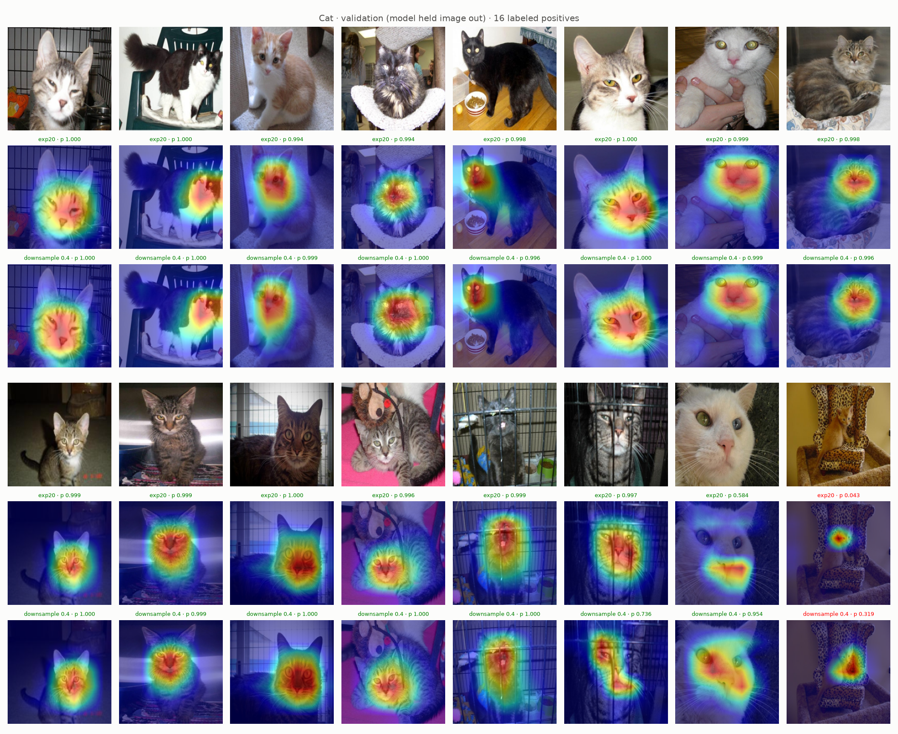
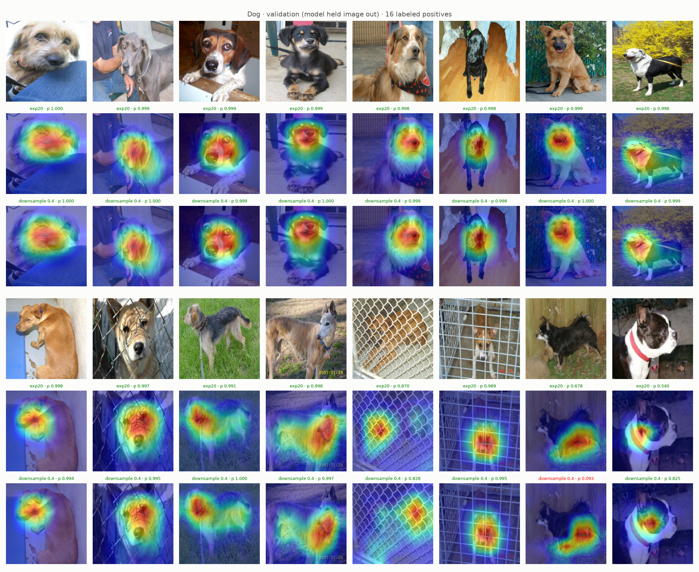
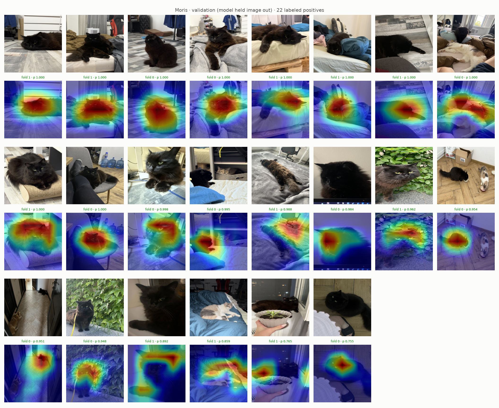
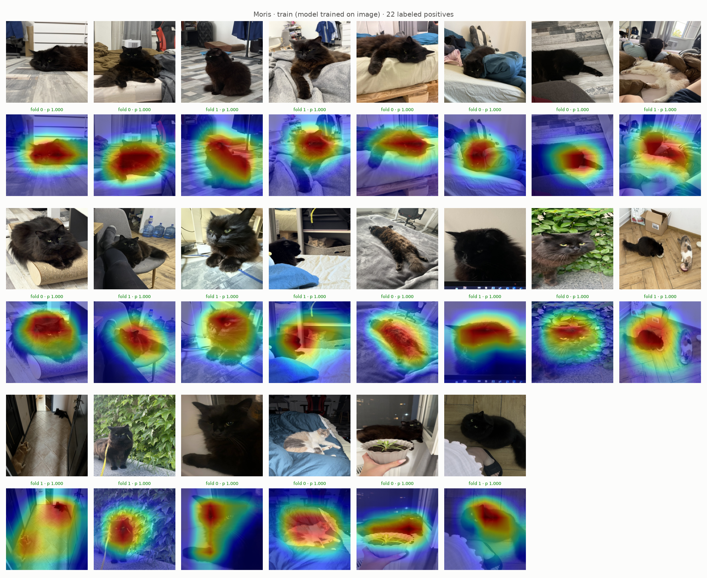
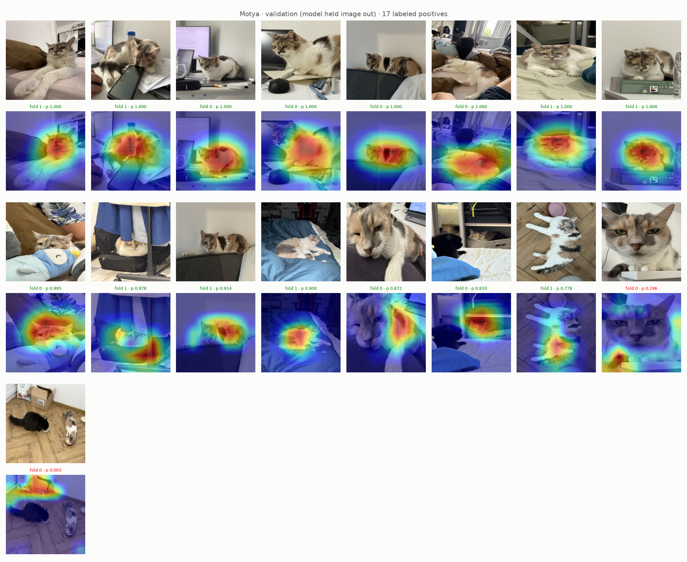
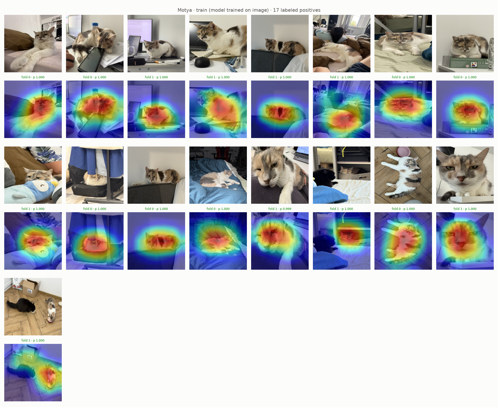
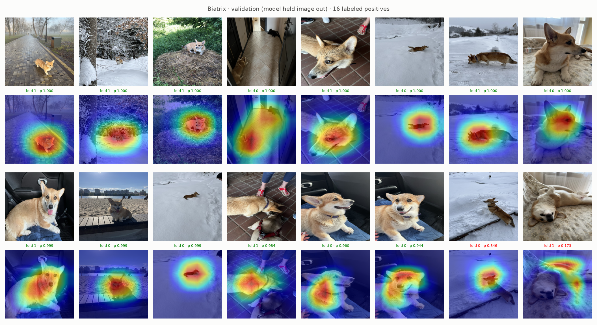
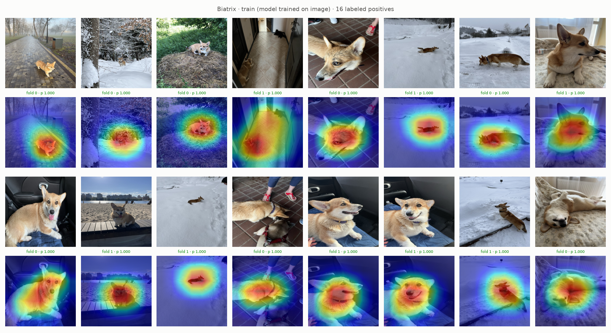
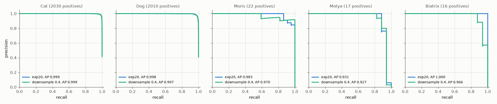

# Experiment 25: Coarse dropout, downsample 0.4

## Request

forget about these exams and return to my style. create an experiment which uses dropout but downsample is 0.4 instead of 0.2

## Question

On exp19 images (16 random Cat and 16 random Dog positives, folds 0 and 1), does exp20 setup with `downsample = 0.4` put Grad-CAM heat on body (not only face) in more images than exp20, without lower VIP AP on out-of-fold rows of folds 0 and 1?

## Plan

1. Plot Grad-CAM Cat and Dog validation figures of exp20 and new model on exp19 images, maps of same image stacked, caption with count of images with heat on body by eye.
2. Plot Grad-CAM VIP figures (`GradCamFigures.positives`) of new model: per VIP class all labeled positives of folds 0 and 1, unseen and trained images, 6 figures.
3. Plot precision-recall curve per class on out-of-fold rows of folds 0 and 1, one panel per class (5), one line per model: exp20, downsample 0.4, AP in legend.

All plots follow `dataviz` skill.

## Setup

- **Notebook:** [exp25_downsample_04.ipynb](../notebooks/experiments/exp25_downsample_04.ipynb), config `configs/exp25_downsample_04/resnet18.toml`, training `core.cv`
- **Tracking:** `cnn-model-downsample-04`
- **What changes:** `downsample = 0.4`: non-VIP rows random 40% per epoch instead of 20%. Generic share of Cat draws 58% to 74%, of Dog draws 75% to 86%; epoch about 1.7× longer.
- **What stays fixed:** exp20 setup: `augment = "coarse_dropout_non_vip"` (colored holes on non-VIP rows), `oversample = 8`, full ratio `pos_weight` counted over draws; 10 epochs, folds 0 and 1; exp20 results reused.
- **Metric:** count of exp19 images with Grad-CAM heat on body, by eye (main); AP per class on out-of-fold rows of folds 0 and 1 (pooled), from PR curves (guard, VIP must not drop).

## Fixes

## Results

exp19 images, 16 per class, out-of-fold rows of folds 0 and 1; caption: model, its prob, green at or above own best-F1 threshold (downsample 0.4: Cat 0.675, Dog 0.526), red below. Maps almost identical to exp20. Heat on body, by eye: Cat about 3 to 4 of 16 (caged tabby: heat moves down onto chest, p 0.997 to 0.736); white cat close-up heat spreads from mouth over eyes and nose, p 0.584 to 0.954; leopard-print chair kitten still missed (p 0.043 to 0.319). Dog about 5 of 16 both; chihuahua heat moves to legs, now missed (p 0.678 to 0.093); Boston terrier chest, p 0.540 to 0.825.

All labeled positives per VIP class in folds 0 and 1 (22 Moris, 17 Motya, 16 Biatrix); green at or above best-F1 threshold (Moris 0.755, Motya 0.778, Biatrix 0.944). Validation misses: Moris 0, Motya 2, Biatrix 2 (exp20: 3, 2, 0).

AP per class, out-of-fold rows of folds 0 and 1 pooled (4904 rows), exp20 to downsample 0.4: Moris 0.983 to 0.970, Motya 0.931 to 0.927, Biatrix 1.000 to 0.966, Cat 0.999, Dog 0.998 to 0.997. Per fold, downsample 0.4 minus exp20: Moris +0.008 / −0.034, Motya −0.026 / +0.028, Biatrix −0.014 / −0.069, mAP −0.006 / −0.016.

## AI Summary

No: Cat and Dog maps almost unchanged, body heat in about as many images as exp20, so doubling generic draws did not move attention from face. VIP mAP lower on both folds (−0.006 / −0.016), mainly Biatrix (2 misses), at 1.7× training time.

## Conclusion
