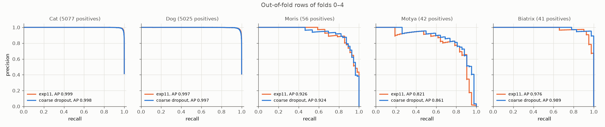
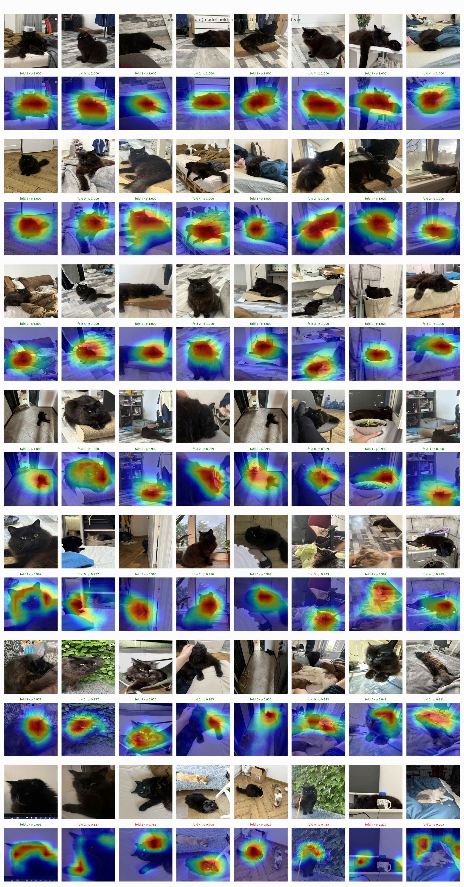
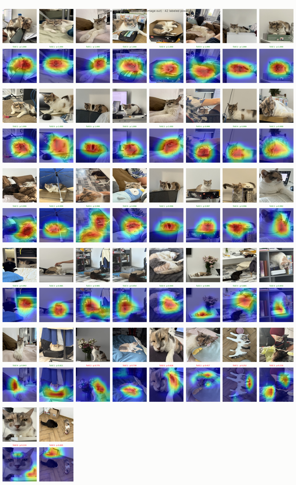
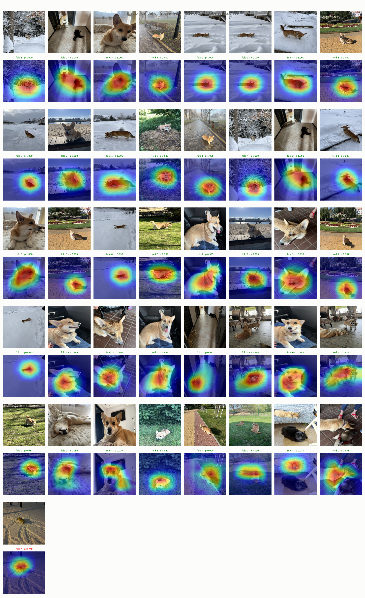

# Experiment 26: Coarse dropout, 5 folds

## Request

retrain exp20 on 5 folds, compare it with earlier submit model in the same way as it was compared with other

## Question

On out-of-fold rows of folds 0–4, does exp20 setup give higher mAP and honest Macro F1 (thresholds tuned on other folds) than exp11, the submitted model, on same rows?

## Plan

1. Tabulate AP per class, mAP and Macro F1 (best-F1 thresholds tuned on same fold rows) per fold for exp11 and new model, mean and standard deviation over folds 0–4, plus per-fold difference new minus exp11.
2. Tabulate per-class threshold and F1 and Macro F1 on pooled out-of-fold rows of folds 0–4 for both models, thresholds tuned on other 4 folds.
3. Plot precision-recall curve per class on pooled out-of-fold rows of folds 0–4, one panel per class (5), one line per model: exp11, coarse dropout, AP in legend.
4. Plot Grad-CAM Cat and Dog validation figures of exp11 and new model on exp19 images, maps of same image stacked.
5. Plot Grad-CAM VIP validation figures (`GradCamFigures.positives`) of new model: per VIP class all labeled positives of folds 0–4 (56 Moris, 42 Motya, 41 Biatrix), 3 figures.

All plots follow `dataviz` skill.

## Setup

- **Notebook:** [exp26_coarse_dropout_5fold.ipynb](../notebooks/experiments/exp26_coarse_dropout_5fold.ipynb), config `configs/exp26_coarse_dropout_5fold/resnet18.toml`, training `core.cv`
- **Tracking:** `cnn-model-coarse-dropout-5fold`
- **What changes:** exp20 setup on `folds = [0, 1, 2, 3, 4]` instead of `[0, 1]`; vs exp11: `augment = "coarse_dropout_non_vip"` (colored holes on non-VIP rows), `downsample = 0.2`.
  - Folds 0 and 1 retrained, not reused: new tracking experiment keeps exp20 results (loaded by exp21, exp25) on 2 folds.
- **What stays fixed:** exp20 setup: `oversample = 8`, full ratio `pos_weight` counted over draws, 10 epochs, batch 64, 224 px, best checkpoint by `val_map`; exp11 results reused. No test predictions, no submission.
- **Metric:** mAP and Macro F1 per fold, mean and standard deviation over folds 0–4; Macro F1 on pooled out-of-fold rows, thresholds tuned on other folds; Grad-CAM visual.

## Fixes

in exp26 add similar TP FP FN table

## Results

| class | model | TP | FP | FN |
|---|---|---|---|---|
| Moris | exp11 | 48 | 6 | 8 |
| Moris | coarse dropout | 49 | 7 | 7 |
| Motya | exp11 | 33 | 7 | 9 |
| Motya | coarse dropout | 34 | 8 | 8 |
| Biatrix | exp11 | 38 | 2 | 3 |
| Biatrix | coarse dropout | 40 | 2 | 1 |

Out-of-fold rows of folds 0–4 pooled, each model and class at own best-F1 threshold (submission thresholds).

exp19 images, 16 per class; caption: model, its prob, green at or above own best-F1 threshold, red below. Cat maps almost identical; leopard-print chair kitten hit by exp11 (p 0.503), missed by new (0.051). Dog: new spreads heat onto body on terrier on grass and fence dog; misses swap: exp11 misses chihuahua (0.452), new misses Boston terrier (0.609 at threshold 0.625).

All labeled positives per VIP class in folds 0–4 (56 Moris, 42 Motya, 41 Biatrix), fold model that held image out.

## AI Summary

Mixed: per-fold mAP +0.008 and Macro F1 +0.020 on average (3 of 5 folds up, within exp11 noise of 0.025), Biatrix AP 1.000 on every fold, but honest pooled Macro F1 0.885 vs 0.894 (Moris F1 0.862 to 0.822, thresholds transfer worse between folds). Worth one Kaggle upload: CV cannot separate two models, Kaggle public (exp11 0.827) is only score on photos outside training folds; keep exp11 as fallback unless public score higher.

## Conclusion

Coarsed dropout helped for 1 image on Motya, 1 image on Moris, 2 images on Beatrix.