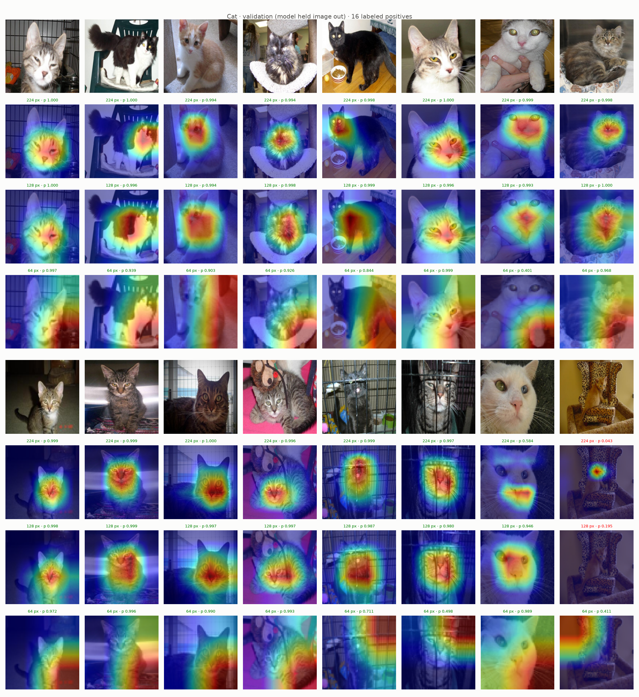
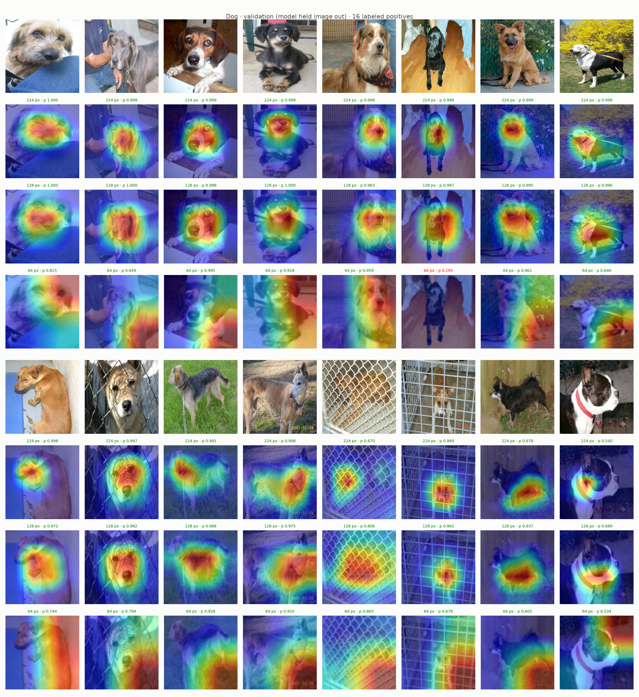
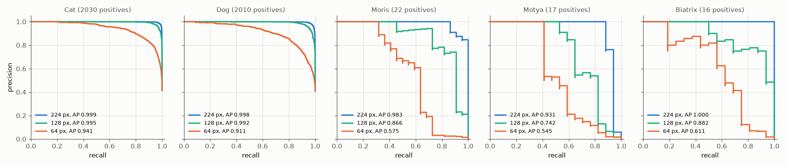
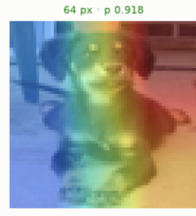

# Experiment 27: Smaller image sizes

## Request

create experiment for using smaller image sizes (64 and 128 for example)

## Question

On exp19 images (16 random Cat and 16 random Dog positives, folds 0 and 1), does exp20 setup at `img_size` 128 or 64 put Grad-CAM heat on whole body (not only face) in more images than exp20 at 224?

## Plan

1. Plot Grad-CAM Cat and Dog validation figures of 224 (exp20), 128 and 64 models on exp19 images, maps of same image stacked, caption with count of images with heat on body by eye.
2. Plot precision-recall curve per class on out-of-fold rows of folds 0 and 1, one panel per class (5), one line per size: 224, 128, 64, AP in legend.

All plots follow `dataviz` skill.

## Setup

- **Notebook:** [exp27_small_images.ipynb](../notebooks/experiments/exp27_small_images.ipynb), configs `configs/exp27_small_images/resnet18_128.toml`, `resnet18_64.toml`, training `core.cv`
- **Tracking:** `cnn-model-small-images`
- **What changes:** `img_size = 128` and `img_size = 64` (images 450 x 375 resized square). Grad-CAM map from last ResNet-18 stage: 4 x 4 at 128, 2 x 2 at 64 (7 x 7 at 224).
- **What stays fixed:** exp20 setup: `augment = "coarse_dropout_non_vip"` (holes relative: 1–4, each 10–25% of side, after resize; same share of image at every size, 6–16 px at 64), `oversample = 8`, `downsample = 0.2`, full ratio `pos_weight`, 10 epochs, batch 64, folds 0 and 1; exp20 results reused.
- **Metric:** count of exp19 images with Grad-CAM heat on body, by eye (main); AP per class on out-of-fold rows of folds 0 and 1 (pooled), from PR curves (sanity check).

## Fixes

## Results

exp19 images, 16 per class, out-of-fold rows of folds 0 and 1; caption: size, prob, green at or above own best-F1 threshold, red below. Heat on body, by eye: Cat 224 about 3, 128 about 5 of 16 (black-white cat, black cat, tabby in cage); Dog 224 about 4, 128 about 8 of 16 (weimaraner, black lab, terrier on grass, greyhound, Boston terriers). 128 blobs wider partly by coarse map: 4 x 4 cells, one cell = quarter of side. 64: maps not readable, peak in bottom-right quarter for 13 of 16 Cat and 11 of 16 Dog images, wherever animal is (224: 6 and 2, chance: 4); misses: black lab (p 0.195), white cat (0.401), leopard-print chair kitten (0.411).

AP per class, out-of-fold rows of folds 0 and 1 pooled (4904 rows), 224 / 128 / 64: Cat 0.999 / 0.995 / 0.941, Dog 0.998 / 0.992 / 0.911, Moris 0.983 / 0.866 / 0.575, Motya 0.931 / 0.742 / 0.545, Biatrix 1.000 / 0.882 / 0.611.

## AI Summary

Partly at 128: heat spreads onto body in about twice as many images (Dog 8 vs 4, Cat 5 vs 3), but partly coarser 4 x 4 map, and VIP AP drops 0.07–0.19. At 64 Grad-CAM cannot answer question (2 x 2 map, peak stuck bottom-right), and VIP AP falls to about 0.55–0.61, so face-vs-body attention not tested there.

## Conversation

Why does 64 px model "look" at right side of dog? Map shows ResNet-18 grid, not where model looks.

Architecture (timm `resnet18.a1_in1k`, pretrained at 224, tested at 288): stem `conv1` 7 x 7 stride 2 + `maxpool` stride 2, then `layer1`–`layer4`, 2 `BasicBlock` each, `layer2`–`layer4` start with stride 2; total stride 32; `global_pool` avg, `fc`. Grad-CAM on `layer4` output: 7 x 7 at 224, 4 x 4 at 128, 2 x 2 at 64.

1. 2 x 2 map, 4 numbers. Grad-CAM upsamples 4 numbers bilinear to 64 x 64: always smooth band or corner blob, never dog shape. Dog red band on right = one or two of 4 cells larger.
2. Each cell sees whole image. Theoretical receptive field of `layer4` cell: 435 px, image 64 px. All 4 cells see whole dog; differ only in centre and zero padding share. So map cannot localize face vs body.
3. Grid shifted to top-left. Every stride-2 layer (`conv1` k 7 p 3, `maxpool` k 3 p 1, 3 x 3 p 1 convs, 1 x 1 downsample) centres output cell i on input pixel 2i, not 2i + 0.5. After 5 of them, `layer4` cell j centred on pixel 32j, not 32j + 15.5. At 64 px cell centres 0 and 32: bottom-right cell centred on image centre, where animal usually is; top-left cell centred on corner, half its window zero padding. Bottom-right cell gets strongest activation, Grad-CAM peak lands there for 13 of 16 Cat, 11 of 16 Dog images. Same shift at 224 is 15.5 of 224 px (7%), invisible.
4. Scale mismatch with pretraining. Weights learned on 224 px ImageNet objects; at 64 px dog 3.5 times smaller, eyes about 2 px. Pretrained face, eye, fur filters fire weakly; model re-learns from coarse colour and outline in 10 epochs. Fine for Cat, Dog (AP 0.94, 0.91), not for VIP: individual cats differ by coat details lost at 64 px (AP 0.55–0.61).

## Conclusion

ResNet is pretrained on 224 px ImageNet, so 224 px images should be used on it.
