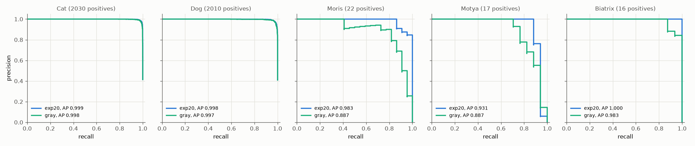

# Experiment 30: Gray non-VIP

## Request

help to create new experiment: i want to check how destroying color features on non VIP affects model

## Question

Does exp20 setup plus `ToGray(p=0.5)` on non-VIP training rows give lower mAP on out-of-fold rows of folds 0 and 1 than exp20?

## Plan

1. PR curves per class, exp20 against gray model, AP in legend.
2. Cat and Dog validation Grad-CAM on exp19 images, exp20 against gray model.
3. VIP Grad-CAM of gray model, unseen and trained images.

All plots follow `dataviz` skill.

## Setup

- **Notebook:** [exp30_gray_non_vip.ipynb](../notebooks/experiments/exp30_gray_non_vip.ipynb), config `configs/exp30_gray_non_vip/resnet18.toml`, training `core.cv`
- **Tracking:** `cnn-model-gray-non-vip`
- **What changes:** `augment = "gray_non_vip"`: `ToGray(p=0.5)` on non-VIP rows only, before `Normalize`; validation untouched.
  - Risk: gray may become "not VIP" shortcut, clean generic cats then lean to VIP (false positives).
- **What stays fixed:** exp20 setup, 224 px; exp20 results reused.
- **Metric:** mAP and AP per class on out-of-fold rows of folds 0 and 1 (pooled), from PR curves.

## Fixes

add table with TN, FN, TP, FP for exp20 and exp30

## Results

AP per class, out-of-fold rows of folds 0 and 1 pooled. mAP exp20 to gray: 0.982 to 0.951, lower on both folds.

| class | model | TP | FP | FN |
|---|---|---|---|---|
| Moris | exp20 | 19 | 0 | 3 |
| Moris | gray | 18 | 2 | 4 |
| Motya | exp20 | 15 | 0 | 2 |
| Motya | gray | 13 | 1 | 4 |
| Biatrix | exp20 | 16 | 0 | 0 |
| Biatrix | gray | 14 | 0 | 2 |

Out-of-fold rows of folds 0 and 1 pooled, each model and class at own best-F1 threshold.

exp19 images, 16 per class, fold model that held image out.

Gray model, all labeled VIP positives of folds 0 and 1.

## AI Summary

Yes: mAP lower on both folds, all from VIP, Cat and Dog unchanged. At best-F1 thresholds gray model loses mostly by misses (FN), few new false positives; shortcut "gray means not VIP" pushes VIP thresholds up but does not show as many FP.

## Conclusion

with Gray Moris predicted 2 FP, Motya 1 FP. Without it, it was not present. Conclusion: do not include Gray, color stress makes predictions worse.
