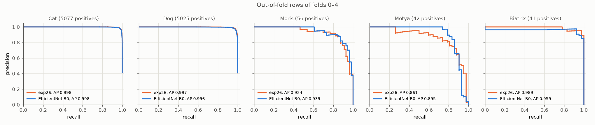
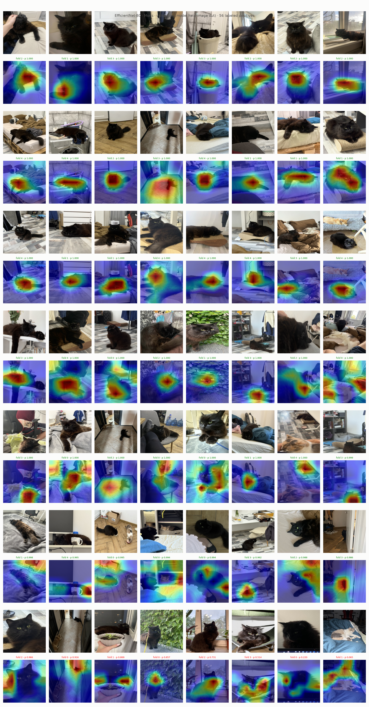
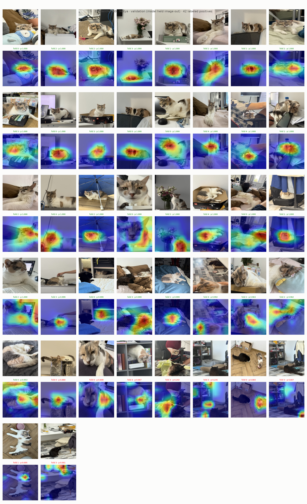
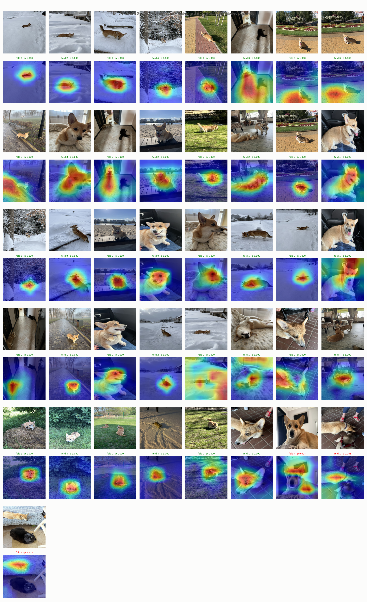

# Experiment 32: EfficientNet-B0, 5 folds

## Request

create experiment cards for training effnet, regnety_016.tv2_in1k, convnext_tiny.fb_in1k

## Question

On all labeled VIP positives of folds 0–4, does EfficientNet-B0 with exp26 setup put Grad-CAM heat on body (not only face) in more images than exp26 ResNet-18, without lower VIP AP on pooled out-of-fold rows of folds 0–4?

## Plan

1. Plot precision-recall curve per class on pooled out-of-fold rows of folds 0–4, one panel per class (5), one line per model: exp26, EfficientNet-B0, AP in legend.
2. Plot Grad-CAM VIP validation figures (`GradCamFigures.positives`) of EfficientNet-B0: per VIP class all labeled positives of folds 0–4 (56 Moris, 42 Motya, 41 Biatrix), 3 figures, same layout as exp26.

All plots follow `dataviz` skill.

## Setup

- **Notebook:** [exp32_efficientnet_b0_5fold.ipynb](../notebooks/experiments/exp32_efficientnet_b0_5fold.ipynb), config `configs/exp32_efficientnet_b0_5fold/efficientnet_b0.toml`, training `core.cv`
- **Tracking:** `cnn-model-efficientnet-b0-5fold`
- **What changes:** `timm_model = "efficientnet_b0.ra_in1k"` instead of `resnet18.a1_in1k`.
  - Grad-CAM layer: `bn2`, already in `last_feature_layer`.
  - vs exp10: `ra_in1k` weights (top-1 77.7) instead of `tf_efficientnet_b0.in1k`; exp26 setup instead of exp09.
- **What stays fixed:** exp26 setup (`augment = "coarse_dropout_non_vip"`, `oversample = 8`, `downsample = 0.2`, full ratio `pos_weight`), Adam lr 1e-3 to 1e-5, 10 epochs, 224 px, folds 0–4; exp26 results reused.
- **Metric:** count of VIP positives with Grad-CAM heat on body, by eye, vs exp26 figures (main); AP per VIP class on pooled out-of-fold rows of folds 0–4, from PR curves (guard, must not drop).

## Fixes

add table with thresholds

## Results

| class | exp26 threshold | exp26 F1 | EfficientNet-B0 threshold | EfficientNet-B0 F1 |
|---|---|---|---|---|
| Cat | 0.417 | 0.981 | 0.467 | 0.978 |
| Dog | 0.625 | 0.975 | 0.546 | 0.974 |
| Moris | 0.895 | 0.875 | 0.966 | 0.875 |
| Motya | 0.821 | 0.810 | 0.953 | 0.868 |
| Biatrix | 0.875 | 0.964 | 0.999 | 0.950 |

Out-of-fold rows of folds 0–4 pooled, best-F1 threshold per model and class (submission thresholds).

All labeled positives per VIP class in folds 0–4 (56 Moris, 42 Motya, 41 Biatrix), fold model that held image out.

## AI Summary

AP guard holds only partly: Moris and Motya up, Biatrix down (0.989 to 0.959), so AP drops on Biatrix. Grad-CAM body count vs exp26 by eye left to you; VIP thresholds pushed near 1 (Biatrix 0.999) suggest EfficientNet-B0 overconfident on VIP.

## Conclusion
