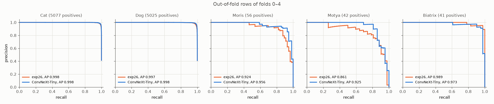
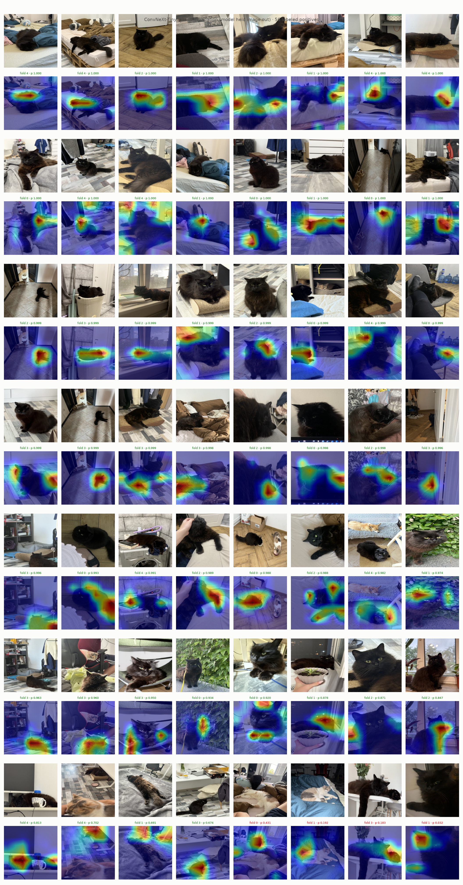
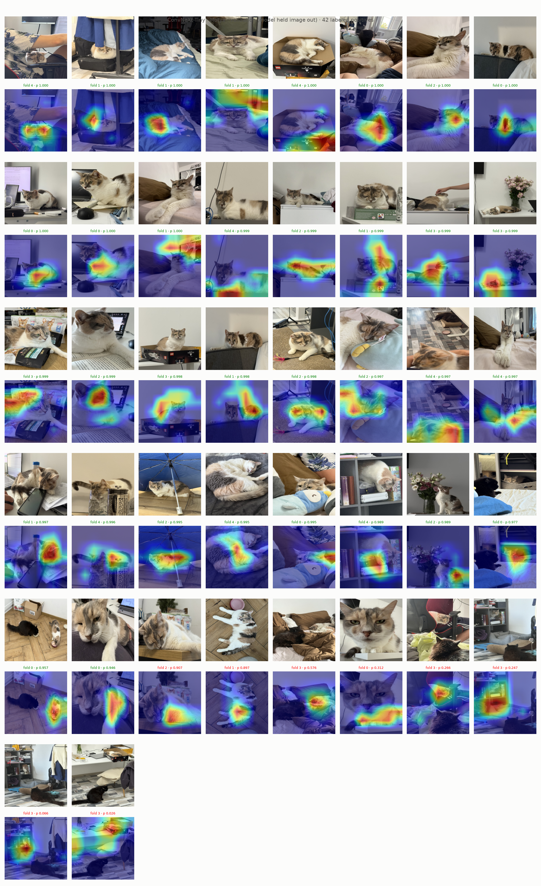
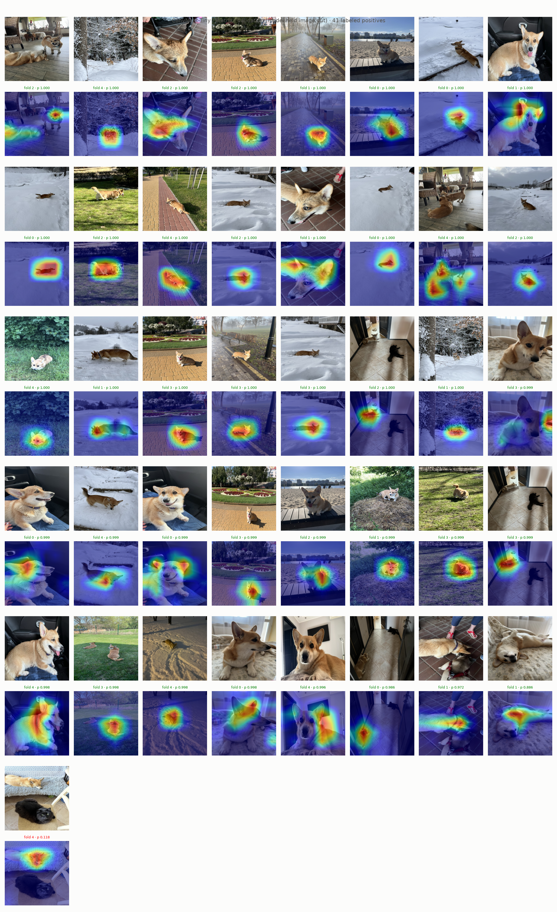

# Experiment 34: ConvNeXt-Tiny

## Request

create experiment cards for training effnet, regnety_016.tv2_in1k, convnext_tiny.fb_in1k

## Question

On all labeled VIP positives of folds 0–4, does ConvNeXt-Tiny with exp26 setup put Grad-CAM heat on body (not only face) in more images than exp26 ResNet-18, without lower VIP AP on pooled out-of-fold rows of folds 0–4?

## Plan

1. Plot precision-recall curve per class on pooled out-of-fold rows of folds 0–4, one panel per class (5), one line per model: exp26, ConvNeXt-Tiny, AP in legend.
2. Plot Grad-CAM VIP validation figures (`GradCamFigures.positives`) of ConvNeXt-Tiny: per VIP class all labeled positives of folds 0–4 (56 Moris, 42 Motya, 41 Biatrix), 3 figures, same layout as exp26.

All plots follow `dataviz` skill.

## Setup

- **Notebook:** [exp34_convnext_tiny.ipynb](../notebooks/experiments/exp34_convnext_tiny.ipynb), config `configs/exp34_convnext_tiny/convnext_tiny.toml`, training `core.cv`
- **Tracking:** `cnn-model-convnext-tiny`
- **What changes:** `timm_model = "convnext_tiny.fb_in1k"` instead of `resnet18.a1_in1k`.
  - Grad-CAM layer: `stages.3` (last stage, 7 × 7 at 224 px), added to `last_feature_layer`.
  - Risk: Adam lr 1e-3 high for ConvNeXt fine-tuning (usually AdamW, lower lr); kept, not tuned.
- **What stays fixed:** exp26 setup (`augment = "coarse_dropout_non_vip"`, `oversample = 8`, `downsample = 0.2`, full ratio `pos_weight`), Adam lr 1e-3 to 1e-5, 10 epochs, 224 px, folds 0–4; exp26 results reused.
- **Metric:** count of VIP positives with Grad-CAM heat on body, by eye, vs exp26 figures (main); AP per VIP class on pooled out-of-fold rows of folds 0–4, from PR curves (guard, must not drop).

## Fixes

## Results

Out-of-fold rows of folds 0–4 pooled, AP per class in legend.

All labeled positives per VIP class in folds 0–4 (56 Moris, 42 Motya, 41 Biatrix), fold model that held image out.

## AI Summary

AP guard fails only on Biatrix, slightly down (0.989 to 0.973, loss in fold 0 only); Moris and Motya clearly up, Motya most. Grad-CAM body count vs exp26 by eye left to you.

## Conclusion

Visually, ConvNext takes the whole bodies of VIP animals on pictures where they are far, and looks at some details for images where they are closer. Looks like it overfits sometimes, so I would not use it as inference model, but it is good for ensemble.
