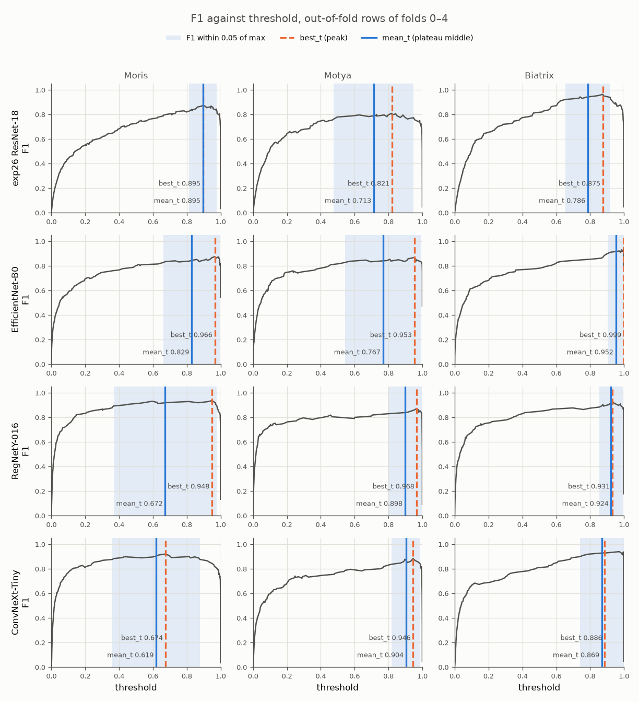

# Experiment 37: Plateau thresholds

## Request

create new experiment, where it is performed and visualized

(middle of plateau: middle of threshold range where F1 within margin of max, instead of peak `best_f1` threshold)

## Question

On out-of-fold rows of folds 0–4, how far do plateau-middle thresholds (F1 within 0.05 of max) move from peak thresholds, and how does honest Macro F1 (thresholds tuned on other folds) compare between two rules for exp26, EfficientNet-B0, RegNetY-016 and ConvNeXt-Tiny?

## Plan

1. Plot F1 against threshold per class on pooled out-of-fold rows, one row per model (4), one column per class (5), plateau shaded, peak and plateau-middle thresholds marked.
2. Tabulate peak and plateau-middle threshold and F1 per model and class, plus honest Macro F1 for both rules with thresholds tuned on other 4 folds.

All plots follow `dataviz` skill.

## Setup

- **Notebook:** [exp37_plateau_thresholds.ipynb](../notebooks/experiments/exp37_plateau_thresholds.ipynb)
- **Tracking:** none; reads saved results of exp26, exp32, exp33, exp34
- **What changes:** threshold rule: middle of thresholds with F1 ≥ max − 0.05, instead of argmax F1.
- **What stays fixed:** out-of-fold probs as saved, folds 0–4, prediction rule prob ≥ threshold.
- **Metric:** F1 per class and Macro F1; honest Macro F1 with thresholds from other folds.

## Fixes

remove figures for dogs and cats

add number scale for figure, add mean_t and best_t, near lines

## Results

| model | Moris best_t / mean_t | Motya best_t / mean_t | Biatrix best_t / mean_t | honest Macro F1 peak / plateau |
|---|---|---|---|---|
| exp26 ResNet-18 | 0.895 / 0.895 | 0.821 / 0.713 | 0.875 / 0.786 | 0.885 / 0.893 |
| EfficientNet-B0 | 0.966 / 0.829 | 0.953 / 0.767 | 0.999 / 0.952 | 0.902 / 0.895 |
| RegNetY-016 | 0.948 / 0.672 | 0.968 / 0.898 | 0.931 / 0.924 | 0.919 / 0.919 |
| ConvNeXt-Tiny | 0.674 / 0.619 | 0.946 / 0.904 | 0.886 / 0.869 | 0.927 / 0.915 |

Out-of-fold rows of folds 0–4 pooled; plateau = F1 within 0.05 of max; honest Macro F1 over all 5 classes, each fold scored with thresholds tuned on other 4 folds.

## AI Summary

Plateau middle always at or below peak, sometimes far (RegNetY-016 Moris, EfficientNet-B0 Motya), since peaks sit near right edge of plateau. Honest Macro F1 mixed and within noise: up for exp26, flat for RegNetY-016, down for EfficientNet-B0 and ConvNeXt-Tiny.

## Conclusion

any threshold in (0.1, 0.9) for dogs and cats gives roughly the same F1 score for every model, so keep 0.5 for both
