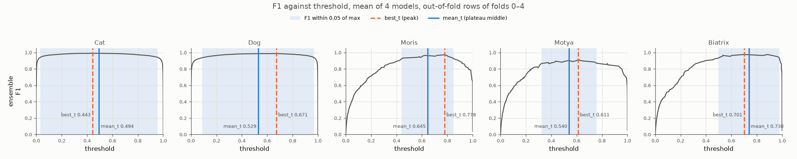

# Experiment 38: Ensemble plateau thresholds

## Request

create experiment the same as exp39, but for ensemble of four models

(exp39 = exp37; mean probs, model section)

## Question

On out-of-fold rows of folds 0–4, how far does plateau-middle threshold (F1 within 0.05 of max) move from peak threshold for mean-prob ensemble of exp26, EfficientNet-B0, RegNetY-016 and ConvNeXt-Tiny, and how does honest Macro F1 compare between two rules?

## Plan

1. Plot F1 against threshold per VIP class (3) for ensemble on pooled out-of-fold rows, plateau shaded, best_t and mean_t lines labeled with values.
2. Tabulate best_t and mean_t with F1 per class, plus honest Macro F1 for both rules with thresholds tuned on other 4 folds.

All plots follow `dataviz` skill.

## Setup

- **Notebook:** [exp38_ensemble_plateau_thresholds.ipynb](../notebooks/experiments/exp38_ensemble_plateau_thresholds.ipynb)
- **Tracking:** none; reads saved results of exp26, exp32, exp33, exp34
- **What changes:** ensemble = mean of four models' out-of-fold probs per class, one threshold vector.
- **What stays fixed:** exp37 rules (peak `best_f1`, plateau `plateau_f1` margin 0.05), folds 0–4.
- **Metric:** F1 per class and Macro F1; honest Macro F1 with thresholds from other folds.

## Fixes

add also figures for cats and dogs

## Results

| class | best_t / F1 | mean_t / F1 |
|---|---|---|
| Cat | 0.443 / 0.990 | 0.494 / 0.989 |
| Dog | 0.671 / 0.986 | 0.529 / 0.985 |
| Moris | 0.778 / 0.972 | 0.645 / 0.955 |
| Motya | 0.611 / 0.911 | 0.540 / 0.889 |
| Biatrix | 0.701 / 0.976 | 0.738 / 0.963 |
| honest Macro F1 | 0.951 | 0.959 |

Mean-prob ensemble of 4 models, out-of-fold rows of folds 0–4 pooled; plateau = F1 within 0.05 of max; honest Macro F1 over all 5 classes, each fold scored with thresholds tuned on other 4 folds.

Why thresholds lower: each model confidently wrong on different non-VIP images. Single model scores some negatives near 1, so its threshold near 1. No negative scored high by all 4 models, so ensemble pulls them to middle; true VIP images stay high (most scored high by all 4). Wide gap between groups, best threshold moves down into it.

## AI Summary

Ensemble plateaus much wider than single models' (Moris about 0.45–0.85, Motya 0.32–0.76) and both thresholds sit lower, 0.54–0.78 instead of near 1; plateau middle moves at most about 0.13 from peak. Honest Macro F1 slightly up with plateau rule (0.951 to 0.959), both above every single model in exp37 (best ConvNeXt-Tiny 0.927).

## Conclusion
