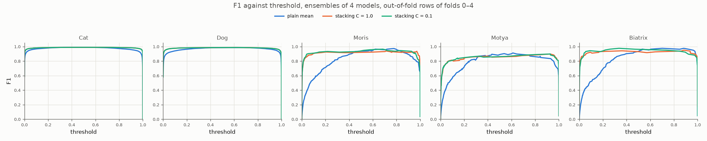
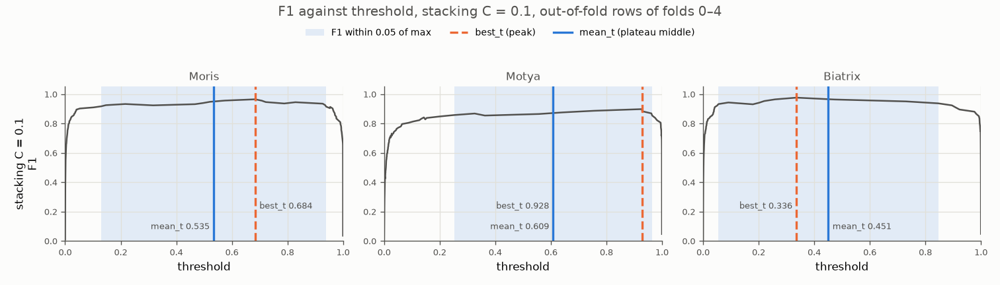

# Experiment 39: Stacking with logistic regression

## Request

create new experiment for stacking, compare F1 against threshold curves

## Question

On out-of-fold rows of folds 0–4, how does F1 against threshold of logistic regression stacking of exp26, EfficientNet-B0, RegNetY-016 and ConvNeXt-Tiny differ from plain mean ensemble (exp38) per class?

## Plan

1. Plot F1 against threshold per class (5) on pooled out-of-fold rows, one panel per class, two curves: plain mean, logistic regression stacking.

All plots follow `dataviz` skill.

## Setup

- **Notebook:** [exp39_stacking_logreg.ipynb](../notebooks/experiments/exp39_stacking_logreg.ipynb)
- **Tracking:** none; reads saved results of exp26, exp32, exp33, exp34
- **What changes:** combiner: one `LogisticRegression` per class on members' logits of that class (4 features), instead of mean of probs.
  - Stacked OOF probs cross-fold: each fold predicted by meta-model fit on other 4 folds.
  - L2 penalty, `C = 1` (scikit-learn default) and `C = 0.1` (stronger), one stacking curve each.
- **What stays fixed:** members' out-of-fold probs as saved, folds 0–4.
- **Metric:** F1 per class against threshold.

## Fixes

change card and notebook so I can see weights explicitly

okay, add to experiment C=0.1 regularization, add 2nd table

separately add figure for F1 threshold curves for C=0.1 VIPs, where best vs plateau is compared; update summary on weights in table

## Results

F1 per class against threshold, pooled out-of-fold rows of folds 0–4; stacking probs cross-fold (meta-model fit on other 4 folds).

`C = 1`:

| class | exp26 ResNet-18 | EfficientNet-B0 | RegNetY-016 | ConvNeXt-Tiny | intercept |
|---|---|---|---|---|---|
| Cat | 0.38 ± 0.04 | 0.18 ± 0.03 | 0.25 ± 0.03 | 0.41 ± 0.06 | 0.42 ± 0.23 |
| Dog | 0.22 ± 0.03 | 0.18 ± 0.03 | 0.28 ± 0.03 | 0.45 ± 0.04 | −0.67 ± 0.20 |
| Moris | 0.16 ± 0.11 | 0.31 ± 0.24 | 0.49 ± 0.10 | 0.38 ± 0.15 | −1.88 ± 1.03 |
| Motya | 0.17 ± 0.36 | 0.28 ± 0.09 | 0.19 ± 0.25 | 0.68 ± 0.32 | −1.15 ± 1.56 |
| Biatrix | 1.25 ± 0.35 | 0.25 ± 0.18 | 0.03 ± 0.20 | 0.26 ± 0.07 | −3.54 ± 0.61 |

`C = 0.1`:

| class | exp26 ResNet-18 | EfficientNet-B0 | RegNetY-016 | ConvNeXt-Tiny | intercept |
|---|---|---|---|---|---|
| Cat | 0.37 ± 0.04 | 0.18 ± 0.03 | 0.25 ± 0.03 | 0.40 ± 0.06 | 0.41 ± 0.23 |
| Dog | 0.22 ± 0.03 | 0.18 ± 0.03 | 0.28 ± 0.03 | 0.45 ± 0.04 | −0.67 ± 0.20 |
| Moris | 0.16 ± 0.05 | 0.26 ± 0.10 | 0.40 ± 0.04 | 0.30 ± 0.05 | −1.90 ± 0.36 |
| Motya | 0.20 ± 0.20 | 0.25 ± 0.04 | 0.17 ± 0.12 | 0.49 ± 0.09 | −0.80 ± 0.81 |
| Biatrix | 0.51 ± 0.13 | 0.24 ± 0.08 | 0.12 ± 0.08 | 0.21 ± 0.05 | −2.71 ± 0.42 |

Logistic regression coefficient per member logit, mean ± standard deviation over 5 fits (each fit on 4 folds); per-fold values in notebook.

Stacking `C = 0.1`, VIP classes; plateau = F1 within 0.05 of max; best_t peak, mean_t plateau middle.

## AI Summary

Stacking makes VIP curves nearly flat from about 0.1 to 0.95, so threshold choice matters much less than for plain mean; Cat and Dog flatter at edges too. Peak F1 not higher: plain mean peaks slightly above stacking on Moris and Biatrix, about equal on Motya.

Weights:
- Small at both `C`, about 0.2–0.7 per member (Biatrix `C = 1` exception): flatness not from large weights but from combining in logit space; one confident member outvoted, prob stays near 0 or 1 instead of middle (plain mean).
- Cat, Dog: same at both `C`, all members used, stable over folds; ConvNeXt-Tiny highest.
- `C = 0.1` changes only VIP: fold spread roughly halves, weights more even.
- Moris: RegNetY-016 and ConvNeXt-Tiny lead at both `C`; EfficientNet-B0 fold swing shrinks at `C = 0.1`.
- Motya: ConvNeXt-Tiny leads; at `C = 1` exp26 and RegNetY-016 swing more than their own size over folds, at `C = 0.1` still unstable for exp26 but less.
- Biatrix: `C = 1` almost only exp26 ResNet-18 (1.25), RegNetY-016 near zero; `C = 0.1` exp26 down to about half, rest share more.
- VIP intercepts negative, vary by fold, less at `C = 0.1`: shift threshold position, rare positives.

Why `C = 0.1` lowers fold variance:
- Each fit sees only 33–45 VIP positives; other held-out fold removes other 8–11, weak penalty lets weights chase remaining few.
- Members correlated: many weight mixes fit almost equally well, small data changes pick different mix per fold.
- Stronger penalty prefers small, even weights over correlated members: same split chosen whatever fold left out.
- Cat, Dog: thousands of positives, data outweighs penalty at both `C`, no change.
- Cost: bias, weights pulled toward each other; stable weights alone not proof of higher test F1.

## Conclusion

VIP are much more flat, which makes me assume that this model is more robust. Now I need to think clearly what I want for VIP animals: higher, lower or mean threshold.

C = 0.1 is much more stable, so choose it for Logistic Regression.

It performed worse on Kaggle.
