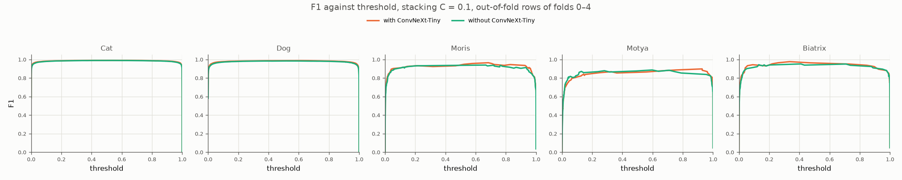
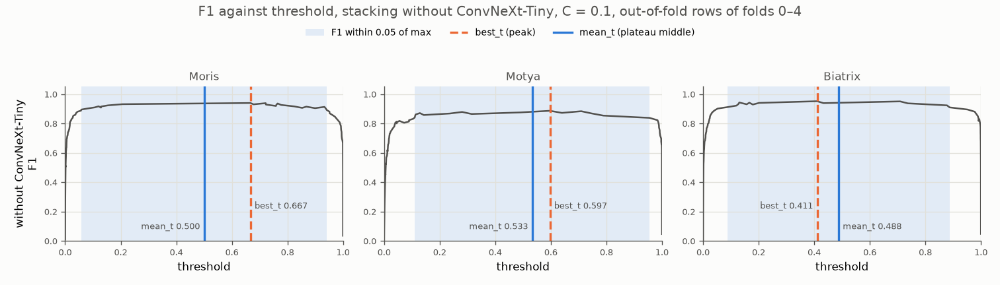

# Experiment 40: Stacking without ConvNeXt-Tiny

## Request

create experiment with logistic regression stacking without convnext, compare with stacking C=0.1

## Question

On out-of-fold rows of folds 0–4, how do F1 against threshold, weights and peak vs plateau thresholds of logistic regression stacking of exp26, EfficientNet-B0 and RegNetY-016 differ from 4-model stacking with ConvNeXt-Tiny (exp39, `C = 0.1`)?

## Plan

1. Plot F1 against threshold per class (5) on pooled out-of-fold rows, one panel per class, two curves: 4-model stacking, 3-model stacking.
2. Tabulate 3-model stacking weights per class, mean ± standard deviation over 5 fits.
3. Plot F1 against threshold per VIP class (3) for 3-model stacking, plateau shaded, best_t and mean_t lines labeled with values.

All plots follow `dataviz` skill.

## Setup

- **Notebook:** [exp40_stacking_no_convnext.ipynb](../notebooks/experiments/exp40_stacking_no_convnext.ipynb)
- **Tracking:** none; reads saved results of exp26, exp32, exp33, exp34
- **What changes:** members: exp26 ResNet-18, EfficientNet-B0, RegNetY-016; ConvNeXt-Tiny dropped.
- **What stays fixed:** exp39 stacking: per class `LogisticRegression`, L2, `C = 0.1`, members' logits, cross-fold OOF (fit on other 4 folds); plateau margin 0.05.
- **Metric:** F1 per class against threshold; weights; best_t vs mean_t.

## Fixes

## Results

F1 per class against threshold, pooled out-of-fold rows of folds 0–4, stacking cross-fold, `C = 0.1`.

| class | exp26 ResNet-18 | EfficientNet-B0 | RegNetY-016 | intercept |
|---|---|---|---|---|
| Cat | 0.47 ± 0.04 | 0.26 ± 0.02 | 0.42 ± 0.01 | 0.34 ± 0.08 |
| Dog | 0.42 ± 0.02 | 0.24 ± 0.03 | 0.41 ± 0.03 | −0.60 ± 0.14 |
| Moris | 0.26 ± 0.06 | 0.28 ± 0.11 | 0.50 ± 0.04 | −2.14 ± 0.17 |
| Motya | 0.33 ± 0.13 | 0.36 ± 0.05 | 0.27 ± 0.10 | −1.00 ± 0.33 |
| Biatrix | 0.57 ± 0.10 | 0.31 ± 0.09 | 0.16 ± 0.09 | −2.94 ± 0.22 |

3-model stacking coefficient per member logit, mean ± standard deviation over 5 fits (each fit on 4 folds).

3-model stacking, VIP classes; plateau = F1 within 0.05 of max; best_t peak, mean_t plateau middle.

## AI Summary

Curves with and without ConvNeXt-Tiny nearly overlap on every class; with it, peak F1 slightly higher on Moris and Biatrix, Motya about equal. Without it, ConvNeXt-Tiny's share moves to other members (Motya split almost evenly), fold spread stays low, plateaus stay wide and mean_t sits near 0.5 for all VIP classes.

## Conclusion

Locally it showed almost no difference. Considering that ConvNeXt tends to overfit, removing it will not hurn results on Kaggle board as well.
