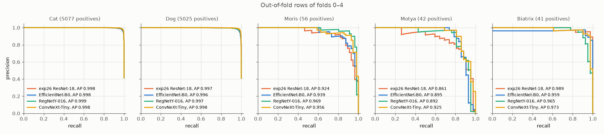
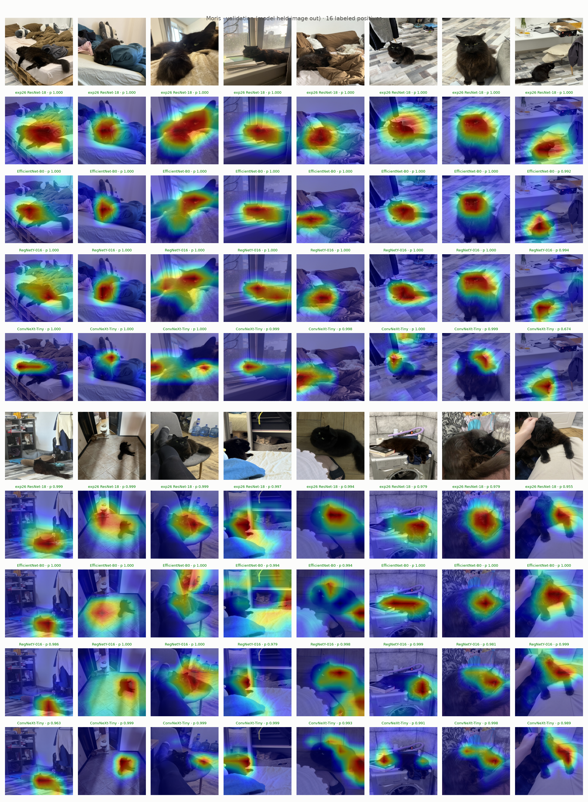
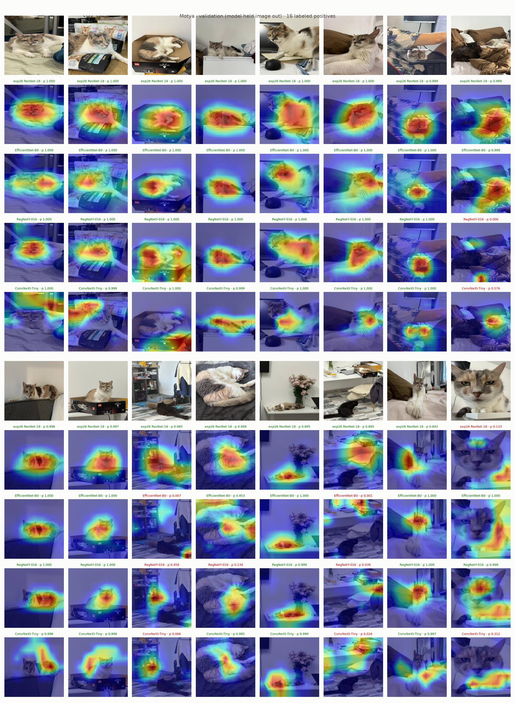
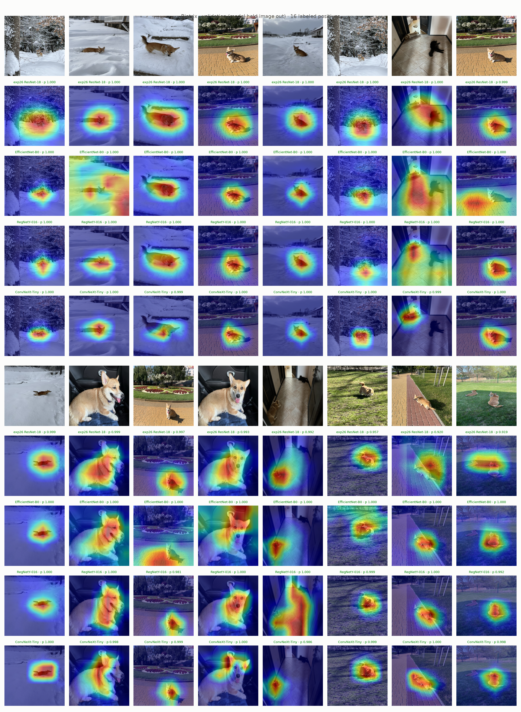

# Model Report

CV Ensembling note: all tested models currently are average of 5 folds, so it is also form of ensembling, but very weak.

## My Notes

- I should do several things:
  - set up reusable src/
  - baseline timm CNN
  - tune my model

- Should I for example try following: optimize model and then predict other species based on VIP animals.

It is very interesting idea itself, but it is really crutch.

"Reusable src/" is not really separate task. What is really separate task – is choose baseline timm model. Which is really one experiment, but I will use it to adjust my metric.

### Baseline timm model

Primary purpose of this section is not to choose timm best model itself, but also to understand what metric is better to use for F1 macro **score**.

- This will be short: I just want to choose better model.

### Augmentation

This is the most important part of this project.

## Experiments (AI written)

Tried: backbones (AlexNet, ResNet-18, EfficientNet-B0, RegNetY-016, ConvNeXt-Tiny), imbalance handling, 5-fold CV, threshold rules, ensembles.

Worked:

- exp04, exp09, exp16: VIP oversampling ×8, full ratio `pos_weight`, 20% non-VIP rows per epoch; all standard now.
- exp32–34: newer backbones on exp26 setup: Moris and Motya AP up vs ResNet-18, Biatrix slightly down.
- exp37: Cat, Dog: any threshold in (0.1, 0.9) gives same F1, keep 0.5.
- exp38: plain mean of 4 models: wide F1 plateaus, thresholds away from 1, best local and Kaggle result.

Did not work:

- exp01: AlexNet collapses.
- exp10: EfficientNet-B0 (`tf_` weights, 2 folds) unstable vs ResNet-18.
- exp34: ConvNeXt-Tiny looks at details on close photos, overfits sometimes; useful only inside ensemble.
- exp37: plateau-middle thresholds for single models: mixed, within noise.

## Augmentation experiments (AI written)

Worked:

- exp20, exp26: coarse dropout on non-VIP rows: Dog heat onto body, Kaggle up vs exp29.
- exp03: lecture recipe (lighting, color, orientation): mAP within noise.
- exp07: box-safe crop: mAP flat.
- exp17: background paste: mAP within noise.

Did not work:

- exp05, exp06: color and degradation recipes hurt Moris, Motya.
- exp18: grid dropout squares look like calico, Motya down.
- exp21, exp24: face and head erase: VIP AP down or no gain.
- exp27: smaller images: VIP AP down.
- exp28: JPEG: VIP AP down.
- exp30: gray on non-VIP: extra Moris, Motya false positives.
- exp14: no result, pseudo-boxes cover whole animal.

Pattern: color or texture change hurts VIP identity by coat; non-VIP-only augmentation safe.

## Ensembles (AI written)

- exp38: plain mean of probs, 4 models, plateau thresholds.
- exp39: logistic regression stacking on logits, `C = 0.1`: flatter F1 curves locally, peak not higher, weights stable over folds.
- exp40: stacking without ConvNeXt-Tiny, weights normalized per class: locally almost same as with it.
- Mean ensembling beat logistic regression stacking on Kaggle public. Possible cause, untested: stacking weights fit to training photos, transfer worse to new VIP photos.

## Kaggle public scores (AI written)

| submission | public score |
|---|---|
| exp11 ResNet-18, 5 folds | 0.827 |
| exp38 mean, 4 models, plateau | 0.92773 |
| exp39 stacking `C = 0.1`, 4 models, plateau | 0.90639 |
| exp40 stacking `C = 0.1`, 3 models normalized, plateau | 0.89919 |
| mean, 3 models without ResNet-18, plateau | 0.92287 |

## Figures (AI written)

Precision-recall curves, 4 models, out-of-fold rows of folds 0–4 (exp36):

Grad-CAM, same 16 VIP positives per class, 4 models stacked (exp36):

Uncertain: local scores from training photos only; Kaggle VIP photos differ, one seed.
